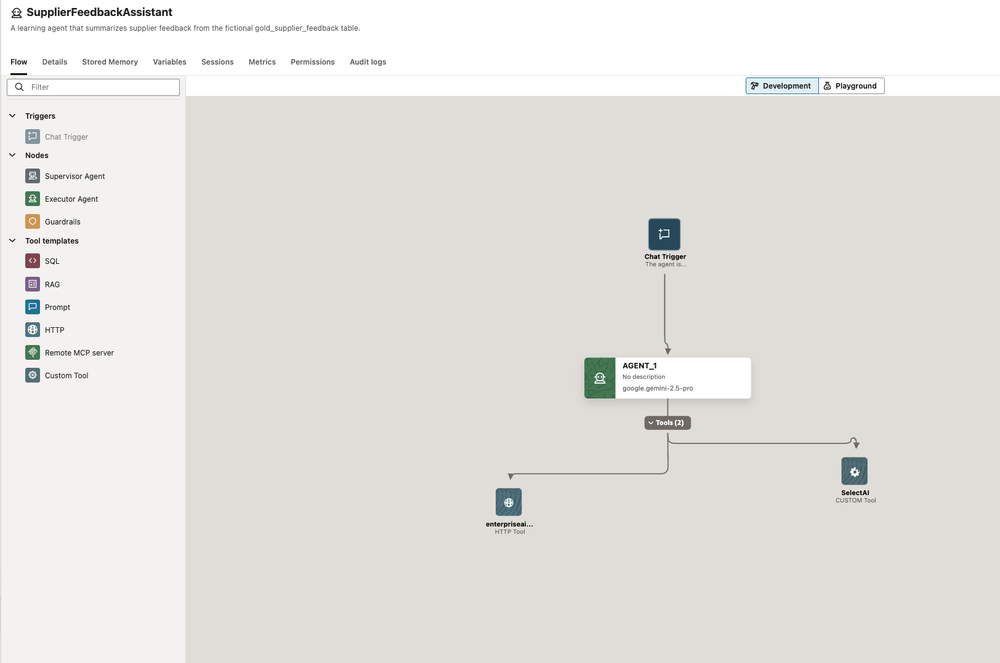

# Build this AIDP agent

This tutorial builds the vendor feedback agent shown in the screenshots. It runs in AI Data Platform Workbench and uses two tools:

1. **Query Supplier Feedback** calls Select AI in Autonomous AI Database through the database MCP server.
2. **Document Search** searches an OCI Generative AI Vector Store through an AIDP HTTP tool.

The agent uses results from both tools in one answer. It does not update records or make a vendor decision.

The package includes the Custom Tool source and upload ZIP, setup instructions, and screenshots from a fictional demo. It has no credentials or raw database/document files. Use your own database table and approved documents.

## Start here

Follow [`files/docs/quick-start.md`](files/docs/quick-start.md) from top to bottom. It links to Oracle's instructions for [Select AI profiles](https://docs.oracle.com/en/cloud/paas/autonomous-database/serverless/adbsb/select-ai-manage-profiles.html), [the Autonomous Database MCP server](https://docs.oracle.com/en/cloud/paas/autonomous-database/serverless/adbsb/use-mcp-server.html), [Vector Store APIs](https://docs.oracle.com/en-us/iaas/Content/generative-ai/vector-store-api-key-tutorial.htm), and [AIDP agent tools](https://docs.oracle.com/en/cloud/paas/ai-data-platform/aidug/agent-flow-tools.html).

The guide uses OCI Generative AI Vector Store + HTTP for document search. If you want AIDP to manage document ingestion, see Oracle's [Knowledge Base and RAG guide](https://docs.oracle.com/en/cloud/paas/ai-data-platform/aidug/knowledge-bases.html).

## Files

- [`files/docs/quick-start.md`](files/docs/quick-start.md) — build and deploy the agent.
- [`files/database/create-select-ai-mcp-tool.sql`](files/database/create-select-ai-mcp-tool.sql) — register the database MCP tool after creating a Select AI profile.
- [`files/custom-tool/README.md`](files/custom-tool/README.md) — configure the AIDP Custom Tool.
- [`files/custom-tool/select-ai-custom-tool.zip`](files/custom-tool/select-ai-custom-tool.zip) — upload to AIDP.
- [`files/custom-tool/source/`](files/custom-tool/source/) — readable Python and JSON source.
- [`files/docs/test-questions.md`](files/docs/test-questions.md) — test each tool and then both together.
- [`files/docs/github-preview-and-upload.md`](files/docs/github-preview-and-upload.md) — preview the rendered README in a private repo.

The AIDP upload ZIP is not a workspace export. Export a Git Bundle from AIDP after building the flow if you need to share the native agent.

## Keep secrets out of GitHub

Store database passwords and API keys in the AIDP Credential Store. Do not publish API gateway URLs, endpoint IDs, headers, or session values in screenshots.