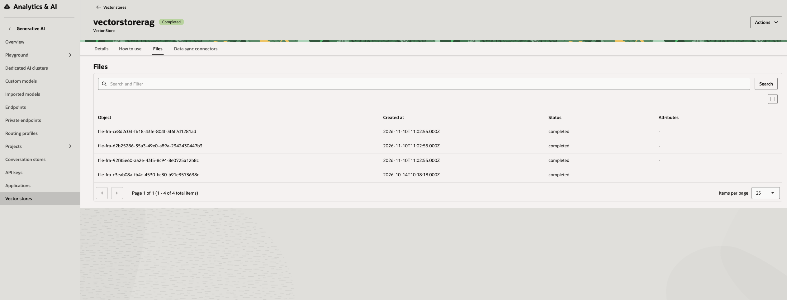
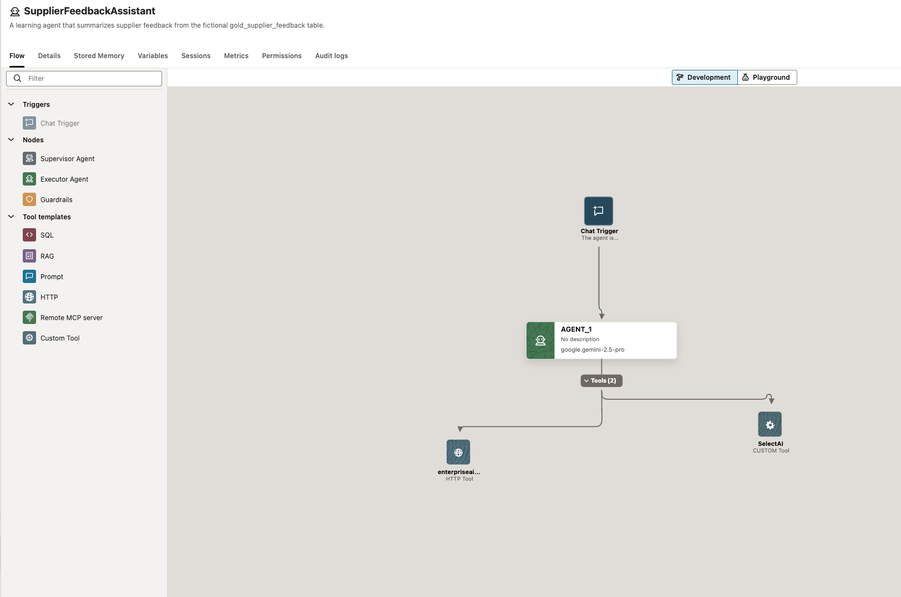
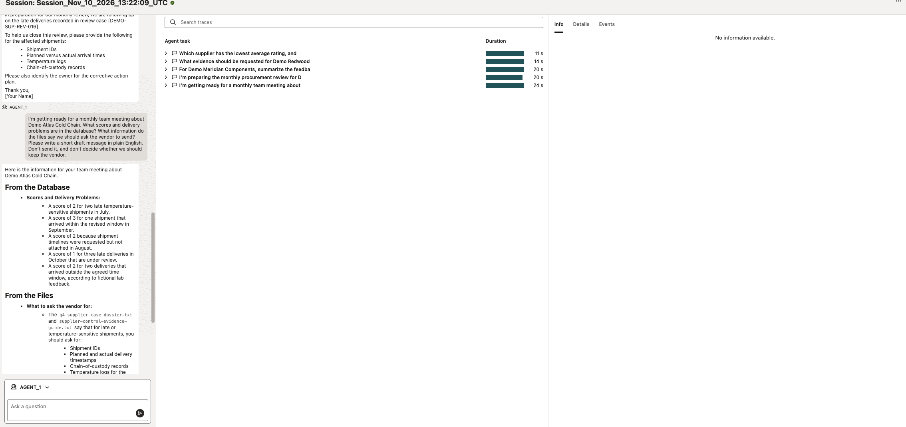

# Quick start: build the vendor feedback review agent

This guide builds the agent shown in the screenshots: one AIDP agent, a Select AI Custom Tool for table questions, and an HTTP tool that searches an OCI Generative AI Vector Store. Use your own permitted table and approved files. No data or credentials are bundled.

## 1. Prepare the database and Select AI

1. In Autonomous AI Database, choose the table the agent may query. For the example prompt, a feedback table should have fields comparable to vendor name, rating, and review summary. Adapt the prompt and profile to your real column names.
2. Create or select a database user for the agent. Limit it to the required table and Select AI tool; use read-only access for this review use case.
3. Configure the provider credential and Select AI profile for the tables/views the tool may access. Test a plain-language `SELECT AI ...` question in Database Actions or your SQL client and inspect the generated SQL/result.
4. Enable the Autonomous Database MCP server using Oracle's [MCP Server guide](https://docs.oracle.com/en/cloud/paas/autonomous-database/serverless/adbsb/use-mcp-server.html). The OCI Console free-form tag is `adb$feature` with value `{"name":"mcp_server","enable":true}`. Apply it as an OCI identity allowed to update the database.
5. Register the built-in SQL tool using [`../database/create-select-ai-mcp-tool.sql`](../database/create-select-ai-mcp-tool.sql). Replace `YOUR_SELECT_AI_PROFILE` with your profile name, then run the script as a user allowed to create Select AI tools. If this tool already exists, inspect it instead of creating a duplicate. The MCP endpoint should expose it with the `ACTION` and `QUERY` inputs used by the AIDP package.

Official setup: [Select AI profiles](https://docs.oracle.com/en/cloud/paas/autonomous-database/serverless/adbsb/select-ai-manage-profiles.html) · [Select AI overview](https://docs.oracle.com/en/cloud/paas/autonomous-database/serverless/adbsb/select-ai-about.html) · [Enable MCP and create tools](https://docs.oracle.com/en/cloud/paas/autonomous-database/serverless/adbsb/use-mcp-server.html) · [SQL built-in tool attributes](https://docs.oracle.com/en/cloud/paas/autonomous-database/serverless/adbsb/dbms-cloud-ai-agent-package.html).

> **Screenshot to add:** show the Select AI profile and a successful natural-language query. Hide database connection details and private rows.

## 2. Upload and index documents

Use the [OCI Vector Store API-key tutorial](https://docs.oracle.com/en-us/iaas/Content/generative-ai/vector-store-api-key-tutorial.htm). It provides both a Python SDK path and a curl path. Follow one path from top to bottom:

1. Choose the region, compartment, and Generative AI project. Confirm your API key is allowed to manage Files and Vector Stores in that compartment.
2. Set the region-specific base URL, compartment OCID, and project OCID. Enter the API key through a hidden prompt or a local secret environment variable. Keep the same region/project/compartment for each request.
3. Create a vector store and save the returned store ID in your private notes.
4. Upload each approved PDF/TXT/DOCX document through the Files API with the project header; save each returned file ID.
5. Add the file IDs to the vector store using the file-batch API.
6. Poll until the batch status is `completed` and failed/cancelled counts are zero.
7. Search for a phrase from one uploaded file. Confirm the expected passage appears before connecting the store to AIDP.

The screenshot shows files with completed status in the vector store:

## 3. Set up AIDP credentials and egress

1. In the AIDP workspace's **Credential Store**, create a **Secret Token** credential for the database login. Add keys named `username` and `password`; enter your own database user and password.
2. Create a second **Secret Token** credential for the OCI Generative AI API key. Use the key name required by the HTTP node/session variable you configure.
3. Add egress for the database MCP host `dataaccess.adb.<region>.oraclecloudapps.com` and the regional Generative AI inference host `inference.generativeai.<region>.oci.oraclecloud.com`.
4. Do not put any secret values in the source, agent instructions, or GitHub. The Select AI Custom Tool obtains a short-lived database bearer token on each run; the vector-search HTTP tool uses the Generative AI API key.

## 4. Add the Select AI Custom Tool

1. Attach an active **AI Compute** to the agent.
2. Add a **Custom Tool** node and upload [`../custom-tool/select-ai-custom-tool.zip`](../custom-tool/select-ai-custom-tool.zip).
3. Enable the `SupplierFeedbackQuery` tool and attach it to the agent.
4. Set its configuration:
   - `region`: your Autonomous Database region identifier
   - `database_ocid`: your database OCID
   - `credential_name`: the Credential Store name from step 3
   - `username_key`: `username`
   - `password_key`: `password`
   - `timeout_seconds`: `45`
5. Test it with a natural-language question about a table in the Select AI profile. It should return database rows. If it fails, check the MCP tool name/schema, database login, and AIDP egress.

The code is visible in [`../custom-tool/source/tool_implementation.py`](../custom-tool/source/tool_implementation.py). It has no embedded credentials or database IDs. It reads secrets using AIDP `aidputils.secrets`, requests a token, initializes MCP, and calls `SUPPLIER_FEEDBACK_SQL` with `ACTION=runsql` and the user's question as `QUERY`.

> **Screenshot to add:** the Custom Tool configuration/test page. Hide region-specific database OCID and the credential name.

## 5. Add the Vector Store HTTP tool

1. Add an **HTTP** tool node to the agent.
2. Set method to `POST` and use the vector store's `/search` endpoint for your region and store ID. Use [`../aidp/http-vector-search.json`](../aidp/http-vector-search.json) as the field template.
3. Add headers for the API key credential, compartment ID, and JSON content type. Set the JSON body to pass the user's question as `query` and limit returned passages.
4. In Playground, open **Session Parameters** and select the stored bearer credential for the HTTP tool if AIDP asks for it. Select the bearer credential for the variable AIDP shows for your HTTP tool. For deployed calls, pass any required session values server-side.
5. Test a question that should match one uploaded file.

> **Screenshot to add:** HTTP tool settings with the service URL, store ID, headers, and secret values hidden. A successful tool-test result is enough; do not publish request details.

## 6. Build and test the agent

Use [`../aidp/agent-instructions.md`](../aidp/agent-instructions.md). In Visual Builder, create Chat Trigger → agent, attach the Select AI Custom Tool and Vector Store HTTP tool, then save.

The screenshot shows the finished two-tool flow. It does not expose the HTTP configuration or gateway URL.

Ask these in Playground:

- **Database only:** “Summarize the feedback and ratings for [vendor].”
- **Documents only:** “According to the uploaded guide, what information should we ask for when [issue] happens?”
- **Both:** “Summarize the database feedback for [vendor], use the uploaded files to identify what information is missing, and write a short follow-up note in plain English. Do not decide whether to keep the vendor.”

Check the response against the tool outputs. Open the trace and confirm the combined prompt called both tools. The screenshot below is an example Playground session; use your own test data in customer environments.

> **Screenshot to add:** an expanded trace for the combined question showing the Select AI Custom Tool and vector-search HTTP tool calls. Hide the endpoint details and any private data.

## 7. Deploy and hand off

After the Playground checks pass, deploy the agent in AIDP. Test the deployed endpoint using an authorized caller. Hide the API gateway URL, endpoint path/ID, headers, and token if capturing a deployment screenshot. Export an AIDP Git Bundle to share the native visual flow; the GitHub asset ZIP is documentation and tool source, not the workspace bundle.

## What each part does

- **Select AI profile/database MCP tool:** turns the natural-language request into a database query and returns rows from the allowed table(s).
- **Custom Tool code:** securely obtains database credentials from AIDP, obtains a short-lived database token, and forwards the question to the database MCP tool.
- **Vector Store HTTP tool:** retrieves matching passages from approved documents.
- **AIDP agent:** chooses which tool(s) to call and combines the returned evidence into one answer.

Optional alternative: AIDP’s native Knowledge Base + RAG tool is another valid document route. It uses files in a managed/external volume and ingestion through a Knowledge Base; it is not the same as this tutorial's OCI Generative AI Vector Store API route. See Oracle [Knowledge Bases](https://docs.oracle.com/en/cloud/paas/ai-data-platform/aidug/knowledge-bases.html) and [AIDP RAG tools](https://docs.oracle.com/en/cloud/paas/ai-data-platform/aidug/agent-flow-tools.html) for that alternative.
