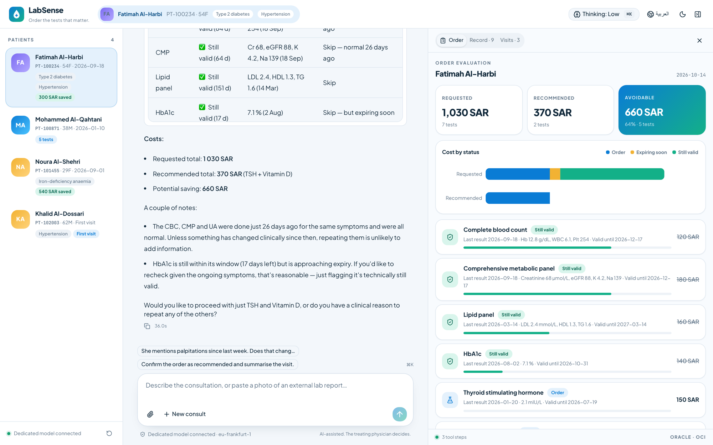

# LabSense — every test, justified

A physician-facing demo for a private hospital: before blood tests are ordered, the assistant checks the patient's record, flags tests whose last result is still within its validity window, shows the cost of what was requested versus what is actually needed, and remembers the visit so the next consultation starts informed.

Everything runs locally against a **dedicated OCI Generative AI endpoint hosting an imported model**. No credentials reach the browser.

> All patients, results, clinics and prices are fictional. Validity windows are illustrative hospital policy, not clinical guidance.



## What the demo shows

| Capability | Where it appears |
| --- | --- |
| Native function calling on an imported model | Six tools, multi-step loops, visible as inspectable tool steps in the chat |
| Streamed reasoning with selectable effort | Collapsed "thinking" blocks; ⌘K to switch `none / low / medium / xhigh` |
| Image understanding | Upload or paste a photo of an external lab report; the model transcribes it and its results join the record |
| Memory across visits | Orders and visit summaries are written to a patient record and read back next time |
| Cost justification | Order board: requested vs recommended, cost by status, cumulative savings per patient |
| Arabic and English | Toggle in the top bar; the model answers in the language of the doctor's last message |

## Run it

```bash
cp .env.example .env            # fill in OCI_ENDPOINT_ID and OCI_COMPARTMENT_ID
uv sync
uv run python scripts/make_sample_report.py
cd web && npm install && npm run build && cd ..
uv run python scripts/serve.py  # gateway :8001 + web :3000, both on loopback
```

Open <http://localhost:3000>. `Ctrl+C` stops both processes.

The gateway signs requests with the `OCI_PROFILE` from `~/.oci/config`. The endpoint must be an imported-model dedicated endpoint that answers on the OpenAI-compatible route (`/20231130/actions/v1/chat/completions`). Verify yours first:

```bash
uv run python scripts/probe_endpoint.py   # chat, streaming, tools, vision → data/endpoint-capabilities.json
```

## Suggested storyline (about ten minutes)

1. **Fatimah Al-Harbi** (returning, diabetic). Use starter 1. The agent greets her by her last visit, evaluates seven requested tests, and flags five as still valid. The order board shows 1,110 SAR requested against 370 SAR recommended.
2. Starter 2: she reports palpitations. The agent agrees to repeat the blood count on clinical grounds and says why. Policy guides, the physician decides.
3. Starter 3: confirm. The receipt shows this visit's saving and her lifetime saving. Open the *Visits* tab.
4. **Mohammed Al-Qahtani** (check-up). Starter 1: everything is needed, his results are old. Starter 2 loads the fictional Al-Noor report image. The model reads it with vision, imports the results, re-evaluates, and most tests drop out.
5. **Khalid Al-Dossari** (new patient): nothing on file, nothing flagged. The contrast makes the point.
6. Switch to Arabic and ask a follow-up for any patient.
7. Press the reset button at the bottom of the patient rail to restore the seed data.

## How it works

```
browser ──► Next.js 16 (web/)            ──► FastAPI gateway (gateway/)        ──► OCI inference, Frankfurt
            Vercel AI SDK ToolLoopAgent       /v1/chat/completions  signed proxy      dedicated endpoint, imported model
            six tools, streaming UI           /patients /orders /results            native chat for vision
            order board (Recharts)            SQLite patient record (data/labsense.db)
```

- **Tools** (`web/src/lib/agent.ts`): `getPatientRecord`, `searchTestCatalog`, `evaluateOrder`, `placeOrder`, `readReport`, `importResults`. The model never does date arithmetic. `gateway/rules.py` decides needed / still valid / expiring from `data/catalog.json`, and the model explains and handles exceptions.
- **Memory**: `gateway/records.py` keeps one JSON record per patient in SQLite. `placeOrder` appends the visit and marks ordered tests as pending results. `scripts/reset_demo.py` or the UI button reloads `data/patients.json`.
- **Reports**: images go straight to the model's vision; PDFs use local text extraction with vision only for scanned pages.
- **Why Chat Completions and not the Responses API**: OCI's Responses API rejects imported models (`400 Imported model … is not supported for Responses API`, verified October 2026). Function calling through Chat Completions is the supported surface for dedicated endpoints.

## Development

```bash
uv run uvicorn gateway.app:app --host 127.0.0.1 --port 8001 --reload
cd web && npm run dev -- --hostname 127.0.0.1
uv run python scripts/smoke_test.py          # evaluate + place order against the live model
uv run python scripts/smoke_test.py --full   # adds vision import and an Arabic turn
cd web && npm run lint && npm run build
```

## Adapting for a customer

- Replace `data/catalog.json` with the hospital's own test list, validity policy and tariff.
- Replace `data/patients.json` with de-identified or synthetic records in the same shape.
- The system prompt in `web/src/lib/agent.ts` holds the clinical-exception rules; adjust the tone and the escalation questions there.
- Brand tokens live at the top of `web/src/app/globals.css`.
