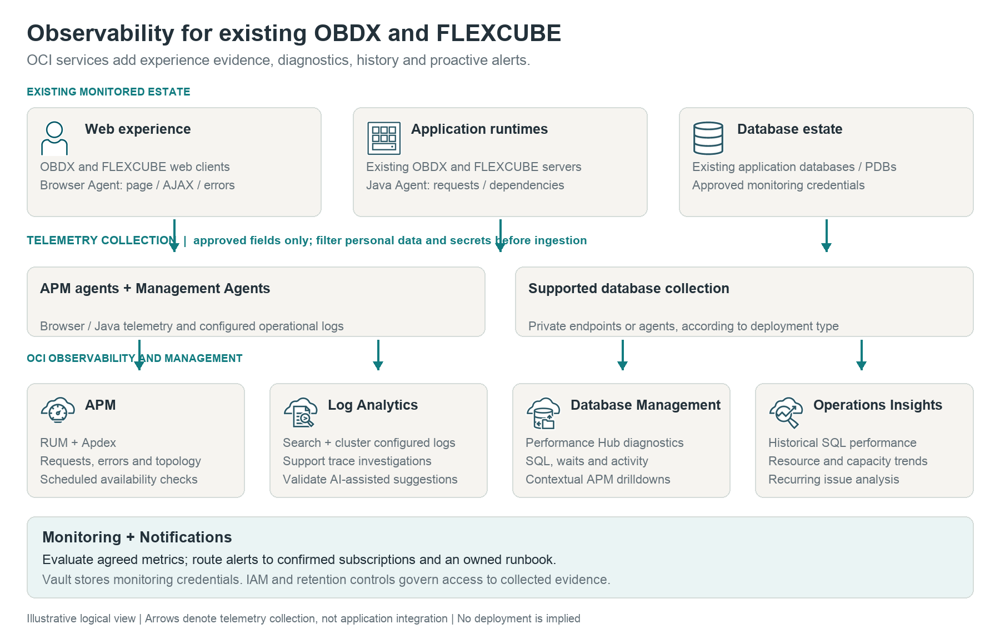
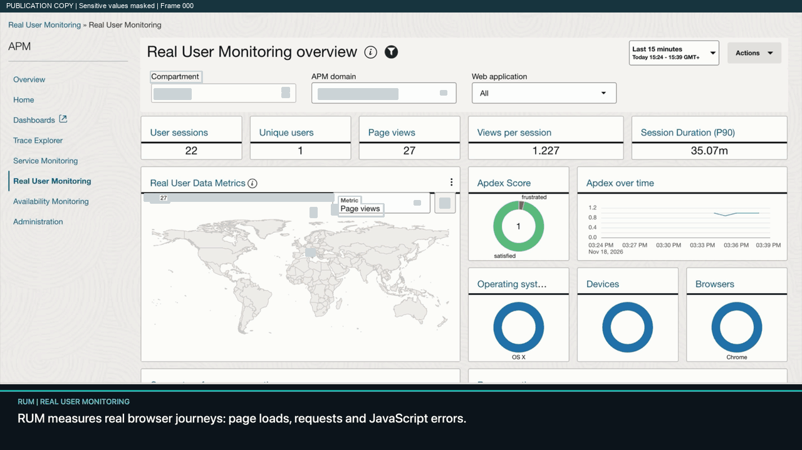
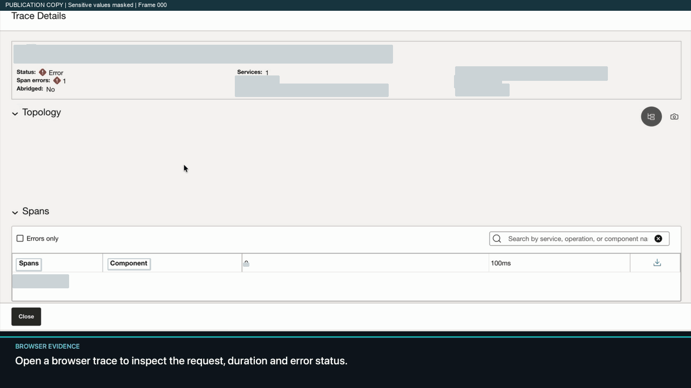
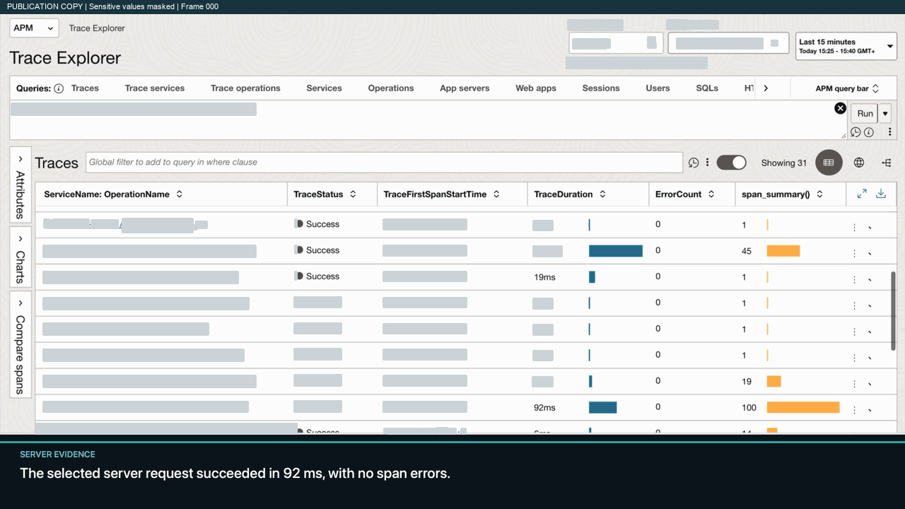
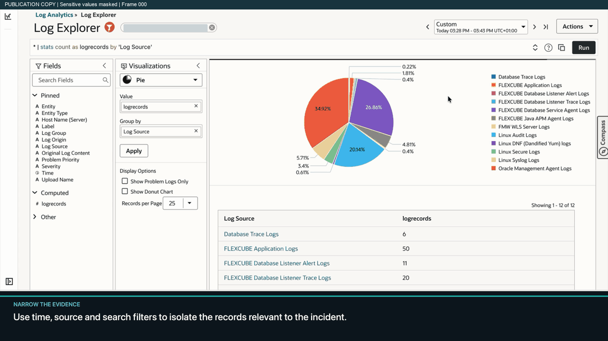
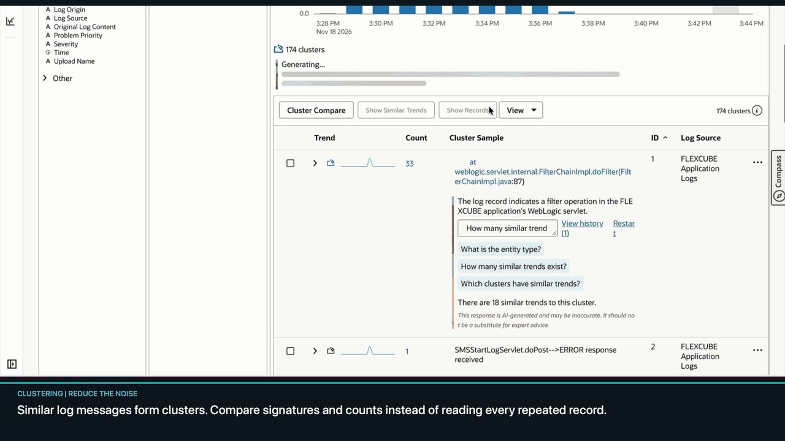
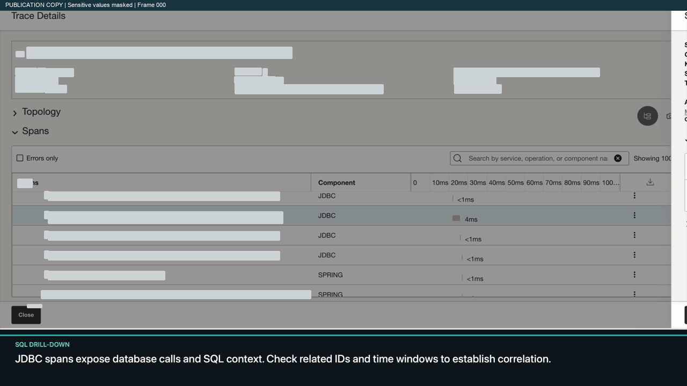
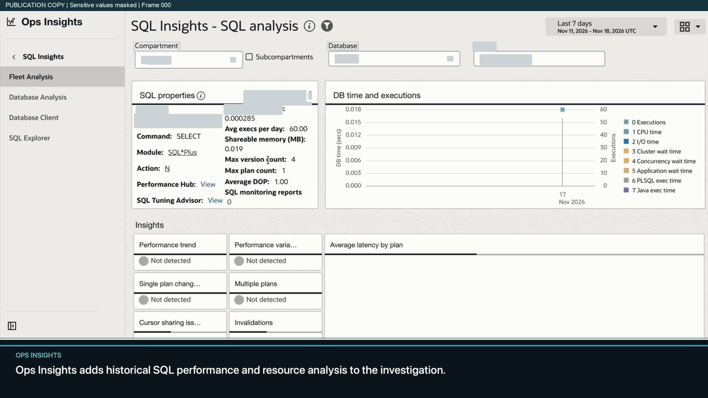
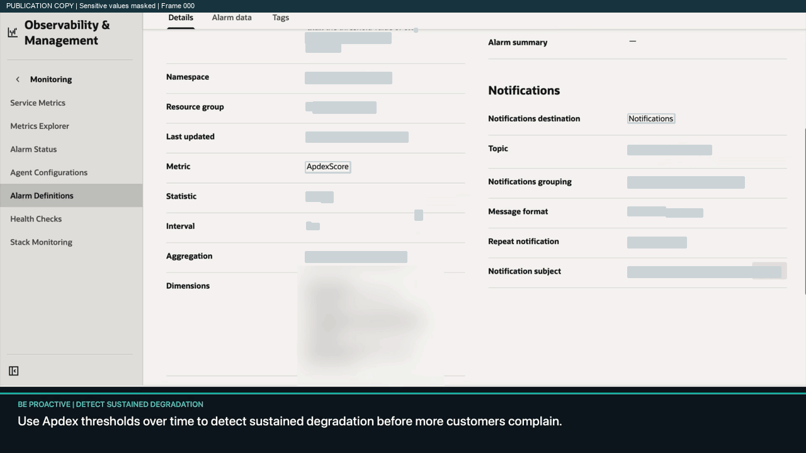

# Observability for OBDX and FLEXCUBE Environments

This guide describes an observability layer for the customer’s existing applications and databases. It covers performance visibility, centralized logs, database diagnostics, historical analysis, and actionable notifications. Application deployment and OBDX–FLEXCUBE integration are outside its scope.

## 1. Customer pain

### 1.1 A customer complains, but operations lacks correlated evidence

A customer reports a slow inquiry, a timeout, or an unsuccessful banking action. The applications are running, infrastructure dashboards may look normal, and individual teams have logs. Operations still cannot quickly explain what happened to that specific interaction.

The evidence is fragmented across browser behavior, application traces, middleware logs, and database activity. Support asks the customer to repeat the action while application and database teams investigate separately. A technical suspicion can become the working explanation before the affected request has been identified.

The questions that need an evidence-backed answer are:

- Which operation was affected, and when?
- How long did the interaction take, and where was that time spent?
- Which error or dependency failure belongs to the affected request?
- Was the problem isolated or affecting a wider set of interactions?
- If database work contributed, which SQL and activity support that conclusion?
- Does a fresh execution confirm that the customer experience has recovered?

### 1.2 Operations learns about degradation from the complaint

Availability alone does not describe service quality. OBDX and FLEXCUBE can remain reachable while selected actions become slow or unreliable. If teams monitor only component uptime, the customer complaint becomes the first useful signal.

The missing capability is an operational view of important banking actions: their experience metrics, failures, dependencies, and trends, with alerts routed to a team that knows what to investigate.

### 1.3 What should improve

| Customer pain | Required observability capability | Operational result to demonstrate |
| --- | --- | --- |
| A complaint has no supporting request evidence | Searchable traces with operation, time, duration, and error context | Support can identify the affected interaction |
| Application and database teams exchange disconnected screenshots | Contextual access to traces, logs, and database diagnostics | Teams investigate the same event and time window |
| Degradation is discovered through complaints | Experience-based alarms and scheduled availability checks | Operations receives actionable signals independently of complaints |
| The same performance issue returns | Historical SQL and resource analysis | Recurring problems become preventive improvement work |
| A fix is declared without checking the original symptom | Repeatable validation of the affected action | Recovery is supported by fresh evidence |

These are intended outcomes. Improvements in detection time or investigation time should be measured against the customer’s baseline.

## 2. Observability architecture and explanation

### 2.1 Add visibility around the existing estate

The monitored estate already contains OBDX, FLEXCUBE, their application runtimes, and their databases. The observability architecture adds four complementary capabilities:

1. **Experience and request visibility:** OCI Application Performance Monitoring (APM).
2. **Searchable operational evidence:** OCI Log Analytics.
3. **Database diagnosis:** OCI Database Management and Performance Hub.
4. **Historical analysis and proactive signals:** OCI Operations Insights, Monitoring, Notifications, and APM Availability Monitoring.

Management Agents collect configured logs. Database monitoring uses the supported collection method for the customer’s deployment. Where private endpoints are appropriate, they provide the management services with private database connectivity. OCI Vault stores the monitoring credential.

### 2.2 Reference observability architecture

*Illustrative observability architecture. Labels are generic; the figure contains no actual addresses, database names, or tenancy identifiers.*

The architecture positions the observability services around the application and database estate: APM for experience and requests, Log Analytics for supporting events, Database Management for diagnosis, Operations Insights for historical analysis, and Monitoring with Notifications for alerting.

The animated excerpts below illustrate these capabilities using the supplied FLEXCUBE demo recording. Publication copies use compact opaque masks over environment, user, session, and database values, preserving surrounding charts and table structure. Some blur was already present in the supplied recording. Charts remain recorded examples; masked values are not replacement diagnostic evidence.

### 2.3 Apdex and Real User Monitoring (RUM)

**Real User Monitoring (RUM)** provides visibility into actual browser activity: sessions, page views, page and AJAX response times, and JavaScript errors. For an existing OBDX or FLEXCUBE web application, these measurements help operations assess the experience users receive during normal use. They are available when the APM Browser Agent is configured and uploading data. See Oracle’s [APM Metrics documentation](https://docs.oracle.com/en-us/iaas/application-performance-monitoring/doc/application-performance-monitoring-metrics.html).

**Apdex** summarizes response-time satisfaction as a score from 0 to 1, with higher values indicating a better experience. APM domain rules define the response times considered satisfied, tolerating, or frustrated. Agree thresholds for the monitored operations so that the score reflects the bank’s service expectations. See Oracle’s [Apdex Thresholds documentation](https://docs.oracle.com/en-us/iaas/application-performance-monitoring/doc/configure-apdex-thresholds.html).

*The RUM overview brings experience indicators together, then exposes page and session performance to help narrow the investigation.*

Start with the relevant application and time window. Review Apdex alongside traffic volume, response times, and script errors, then inspect the affected pages or sessions and open their browser traces. An aggregate score can hide a poorly performing operation or an isolated failure; use the detailed evidence to understand the complaint. Sustained deterioration can then inform the alert conditions described later in this guide.

### 2.4 Experience and request visibility

APM browser instrumentation captures supported web interactions and experience data. Java instrumentation captures supported server operations and dependencies. Together, these help operations find the affected action and examine where latency or errors appear.

Trace context must be propagated across instrumented boundaries. Putting several services in the same APM domain is useful for investigation but does not, by itself, connect their traces. Native mobile application coverage must be assessed separately from browser coverage.

#### Browser evidence: inspect the affected interaction

*Opening a browser trace and examining the error details provides concrete evidence beyond the reported symptom.*

#### Server evidence: inspect dependencies and spans

*Server spans and topology help identify where to investigate next. The browser and server excerpts are separate examples; request identifiers and context are needed to establish their relationship.*

### 2.5 Logs as supporting evidence

Log Analytics makes configured records searchable across the monitored estate. Sources should preserve timestamps, resource identity, and useful application identifiers. When trace or request identifiers are present in logs, they provide a stronger association with a request than timestamp proximity alone.

Collection coverage must include the sources needed to answer operational questions, not simply every readable file. Parsing failures, missing sources, and ingestion delays should be visible to the operations team.

#### Reduce repeated messages to inspectable patterns

*Clusters all log sources to examine repeated message patterns.*

#### Use AI assistance alongside the underlying records

*The operator requests an explanation of selected log evidence. Treat the answer as an investigation aid and validate its suggestions against the records and other diagnostics.*

### 2.6 Database evidence and longer-term analysis

Database Management and Performance Hub support investigation of the relevant database workload. An APM drilldown can open the correct database, SQL ID, and time window when the required span attributes are available.

Operations Insights serves a different timescale: historical SQL behavior and resource trends help teams prioritize preventive work. It complements the incident investigation rather than replacing the request evidence.

#### Preserve SQL context from the application investigation

*Inspect the JDBC span's attribute names and available diagnostic navigation. Values and captured SQL have been removed for publication. The excerpt navigates toward database diagnostics and subsequently shows Operations Insights; it does not demonstrate a completed Performance Hub investigation.*

#### Review historical SQL behavior

*SQL history and database analysis provide a longer-term view for investigating recurring degradation.*

### 2.7 Proactive detection and alerting

APM metric groups make selected metrics available to Monitoring. Alarms evaluate agreed conditions and Notifications sends messages to confirmed destinations. Availability Monitoring adds scheduled checks, including when there is little real-user traffic.

Every actionable signal needs an owner, a severity, and an initial investigation action. Detection is incomplete until notification delivery and operational response have been exercised.

#### Turn experience degradation into an operational signal

*Inspect the alarm and notification destination. The recording shows configuration, not proof of a delivered alert; confirm the subscription and test delivery separately.*

## 3. Benefits of each observability service

| Service or component | Contribution | Benefit for operations |
| --- | --- | --- |
| **OCI APM — Real User Monitoring** | Captures supported browser activity and web experience | Provides evidence of the action and duration experienced by the user |
| **OCI APM — Java instrumentation** | Records supported server and dependency spans | Helps locate request latency and failures across instrumented components |
| **OCI APM — Availability Monitoring** | Executes scheduled browser, REST, or scripted checks | Detects defined availability and performance issues without waiting for real-user complaints |
| **OCI Log Analytics** | Centralizes and searches configured operational logs | Helps substantiate an investigation with errors and events from multiple resources |
| **Management Agent and Log Analytics plugin** | Continuously collect configured log sources | Reduce manual evidence gathering from individual hosts |
| **OCI Database Management / Performance Hub** | Provides database performance investigation | Lets application and database teams examine the relevant SQL and activity context |
| **OCI Operations Insights** | Analyzes historical SQL and resource behavior | Helps identify recurring problems and prioritize capacity or SQL improvement work |
| **OCI Monitoring** | Evaluates metric-based alarm conditions | Turns sustained degradation into an operational signal |
| **OCI Notifications** | Routes messages to confirmed subscriptions | Delivers the signal to the responsible team or response channel |
| **OCI Vault** | Stores monitoring credentials as managed secrets | Supports centrally managed database-monitoring credentials |
| **Database private endpoints, where applicable** | Provide private service-to-database connectivity | Enable collection without exposing the database listener publicly |
| **APM contextual drilldowns** | Carry selected span context into another investigation interface | Reduce repeated searches and help teams retain the same database, identifier, and time window |

Expected benefits depend on coverage, retained data, correlation quality, and an operational response. A service being enabled is not sufficient proof of customer-experience coverage.

## 4. How to implement observability

### Step 1 — Agree on the actions and questions to monitor

Select a small set of important customer and operator workflows already used in production. For each, record its operational owner, expected result, acceptable response time, failure definition, and relevant application/database resources.

### Step 2 — Prepare APM access and naming

Create or select the APM domain for the intended environment. Establish consistent service and application names for OBDX, FLEXCUBE, and the instrumented runtimes. Separate environments clearly in naming and access.

Obtain the upload endpoint and appropriate data keys. Use the private data key for the server agent and the public data key for browser instrumentation.

**Official Oracle documentation:** [Create an APM Domain](https://docs.oracle.com/en-us/iaas/application-performance-monitoring/doc/create-apm-domain.html).

### Step 3 — Instrument the existing Java runtimes

Check the supported agent configuration for the customer’s application server and JVM. Provision and deploy the Java agent on the selected OBDX and FLEXCUBE runtimes using the documented startup settings. If an agent is already deployed, assess its health and coverage before making changes.

Exercise an agreed inquiry and inspect the resulting request and dependency spans. Verify propagation across the relevant monitored boundaries and record any gaps.

**Official Oracle documentation:** [Provision and Deploy APM Java Agent](https://docs.oracle.com/en-us/iaas/application-performance-monitoring/doc/provision-deploy-apm-java-agents-linux-application-servers.html), [Provision the Agent](https://docs.oracle.com/en-us/iaas/application-performance-monitoring/doc/provision-apm-java-agent.html), and [Deploy the Agent](https://docs.oracle.com/en-us/iaas/application-performance-monitoring/doc/deploy-apm-java-agent.html).

### Step 4 — Enable web-experience visibility and trace correlation

Deploy browser instrumentation through the supported application-template or Java-agent injection mechanism. Verify script loading and browser-span ingestion for the selected web actions.

Check browser-to-server trace context. Configure approved endpoint and cross-origin behavior where necessary. Assess native mobile coverage separately; browser instrumentation is not proof of native-app coverage.

**Official Oracle documentation:** [Deploy the APM Browser Agent](https://docs.oracle.com/en-us/iaas/application-performance-monitoring/doc/deploy-browser-agent-your-application.html) and [Configure Ajax Calls Instrumentation](https://docs.oracle.com/en-us/iaas/application-performance-monitoring/doc/configure-automatic-end-end-tracing-same-domain.html).

### Step 5 — Add the context needed to investigate complaints

Use an approved allowlist of telemetry fields and filter sensitive values before ingestion. Do not collect customer personal data, banking/account identifiers, passwords, cookies, session or access tokens, authorization headers, request/response bodies, URL query values, or SQL literals. Apply the documented agent/source filtering supported by each collector; validate new traces and logs before broad rollout. Restrict telemetry access and retention according to the customer’s approved policy. Hashing an identifier alone does not establish anonymity.

Choose attributes that help identify an operation or classify an affected group of interactions. Define each attribute’s meaning and trusted source. Keep authenticated user identity separate from selected record values. For example, an approved `FlexcubeRole` attribute describes the role selected in a maintenance screen; it does not identify the operator performing the action. Use synthetic role examples in public material.

For browser attributes, use the documented dynamic attribute mechanism where values can change. For server attributes, use the supported agent configuration or instrumentation appropriate to the source. Activate the required attributes in APM and verify new spans.

**Official Oracle documentation:** [Configure Attributes for Real User Monitoring](https://docs.oracle.com/en-us/iaas/application-performance-monitoring/doc/configure-attributes-real-user-monitoring.html), [Modify Probe Settings](https://docs.oracle.com/en-us/iaas/application-performance-monitoring/doc/modify-probe-settings.html), and [Span Attributes](https://docs.oracle.com/en-us/iaas/application-performance-monitoring/doc/configure-span-attributes.html).

### Step 6 — Centralize the logs needed for investigation

Install or verify Management Agents and their Log Analytics plugins on the appropriate log-emitting hosts. Configure log groups, entities, sources, and source-entity associations. Use Oracle-defined sources where suitable and create sources for application-specific formats when needed.

Cover the application, middleware, OS, database alert, listener, and agent records relevant to the selected actions. Verify timestamps, parsing, file access, and collection freshness. Retain approved request or trace identifiers where applications emit them; never use session authentication tokens as correlation identifiers. Review access-log addresses and paths for sensitive content before collection.

**Official Oracle documentation:** [Continuous Log Collection Using Management Agent](https://docs.oracle.com/en-us/iaas/log-analytics/doc/continuous-log-collection-form-your-hosts.html), [Manage Source-Entity Association](https://docs.oracle.com/en-us/iaas/log-analytics/doc/manage-source-entity-association.html), and [Create a Source](https://docs.oracle.com/en-us/iaas/log-analytics/doc/create-log-source.html).

### Step 7 — Enable database diagnostics for the relevant targets

Identify the databases and PDBs that support the monitored actions. Follow the onboarding method for their deployment type. For supported OCI cloud databases, configure the required monitoring credential, Vault secret, private connectivity, permissions, and Database Management feature set.

Grant the privileges required by the selected features in the correct database containers. Check Performance Hub availability against the database edition, version, and applicable entitlements. Do not assume that collection from one database covers all application databases or PDBs.

**Official Oracle documentation:** [Enable Diagnostics & Management for Oracle Cloud Databases](https://docs.oracle.com/en-us/iaas/database-management/doc/enable-database-management-oracle-cloud-databases.html), [Create a Database Management Private Endpoint](https://docs.oracle.com/en-us/iaas/database-management/doc/create-database-management-private-endpoint.html), [Creating a Secret](https://docs.oracle.com/en-us/iaas/Content/secret-management/Tasks/create-secret.htm), and [Managed Database / Performance Hub Prerequisites](https://docs.oracle.com/en-us/iaas/database-management/doc/monitor-manage-specific-managed-database.html).

### Step 8 — Build historical SQL and resource visibility

Enable Operations Insights using the supported monitoring method and prerequisites for the database estate. Reuse suitable existing collection where supported. For private-endpoint onboarding, verify the endpoint, network permissions, and monitoring credential.

Allow history to accumulate before drawing trend conclusions. New cloud-database data may take up to 24 hours to appear. Establish a recurring review of SQL behavior, resource demand, and capacity trends.

**Official Oracle documentation:** [Ops Insights for Cloud Databases](https://docs.oracle.com/en-us/iaas/operations-insights/doc/enabling-database-cloud-service-databases-exadata-systems.html), [Cloud Database Prerequisites](https://docs.oracle.com/en-us/iaas/operations-insights/doc/prerequisites-oracle-cloud-db.html), and [Create an Ops Insights Private Endpoint](https://docs.oracle.com/en-us/iaas/operations-insights/doc/create-private-endpoint.html).

### Step 9 — Configure contextual investigation links

Add APM drilldowns that open useful destinations with the selected span’s context. For Performance Hub, map the correct database resource, `DbOracleSqlId`, and investigation time window. Make the link available only when the necessary attributes and target conditions are present.

For Log Analytics, define an investigation link using identifiers available in both the trace and the customer’s log data. A link simplifies navigation; it does not create missing log identifiers or prove that two events are related.

**Official Oracle documentation:** [Drilldown Configurations](https://docs.oracle.com/en-us/iaas/application-performance-monitoring/doc/configure-drilldown-configurations.html).

### Step 10 — Turn experience metrics into actionable alarms

Create APM span filters and metric groups for the important operations. Confirm that the resulting metric streams represent the intended traffic. Use agreed response-time, error, and experience objectives to define Monitoring alarms.

For example, an initial evaluation might use an **Apdex score below 0.85 for five minutes**. The recorded alarm example uses 0.90; these are separate illustrative configurations. This is an illustrative starting point, not a universal banking-service target. Review the response-time thresholds used to calculate Apdex separately from the alarm’s score threshold. Use operation-level signals where an aggregate could hide a localized issue, and handle missing telemetry separately.

Attach the appropriate Notifications destination, confirm subscriptions, and assign an owner and investigation procedure. Test the complete delivery route. Expired subscription-confirmation links can be resent.

**Official Oracle documentation:** [Metric Groups](https://docs.oracle.com/en-us/iaas/application-performance-monitoring/doc/configure-metric-groups.html), [Creating an Alarm](https://docs.oracle.com/en-us/iaas/Content/Monitoring/Tasks/create-alarm.htm), [Managing Alarms](https://docs.oracle.com/en-us/iaas/Content/Monitoring/Tasks/managingalarms.htm), and [Confirming a Subscription](https://docs.oracle.com/en-us/iaas/Content/Notification/Tasks/confirm-subscription.htm).

### Step 11 — Add scheduled checks for proactive coverage

Use APM Availability Monitoring for approved availability or performance checks. Select browser, scripted-browser, REST, or scripted-REST monitoring according to the interaction being tested. Choose an appropriate schedule and vantage point for the endpoint’s accessibility.

Start with an agreed inquiry or other non-mutating test. Define the expected result, not only an HTTP success code, and connect the monitor’s signals to the operational alerting process.

**Official Oracle documentation:** [Create a Monitor](https://docs.oracle.com/en-us/iaas/application-performance-monitoring/doc/create-monitor.html).

### Step 12 — Establish the complaint and alert runbook

Use one evidence procedure for a customer complaint and an automated alert:

1. Record the affected operation, reported time and timezone, channel, and symptom.
2. Find the matching interaction in APM and retain its trace/span identifiers, duration, error, and available business context.
3. Examine the connected spans and identify the component or dependency associated with the observed delay or failure. Record visibility gaps.
4. Search Log Analytics for supporting events using shared identifiers and the same time window.
5. Where SQL is implicated and an SQL ID is available, open Performance Hub with the correct database and time context.
6. Use Operations Insights to assess whether the incident relates to a recurring SQL or resource trend.
7. Record the supported diagnosis, uncertainty, corrective action, and a fresh execution that validates recovery.

A matching timestamp or high resource metric is an investigation lead, not sufficient evidence of root cause on its own.

Measure time to detect, time to notify, investigation time, the proportion of complaints with matching request evidence, and the proportion of actionable alerts received before related complaints. Use the customer’s measured baseline to assess improvement.

**Official Oracle documentation:** [APM Documentation](https://docs.oracle.com/en-us/iaas/application-performance-monitoring/home.htm), [Drilldown Configurations](https://docs.oracle.com/en-us/iaas/application-performance-monitoring/doc/configure-drilldown-configurations.html), and [Managing Alarms](https://docs.oracle.com/en-us/iaas/Content/Monitoring/Tasks/managingalarms.htm).

# License

Copyright (c) 2026 Oracle and/or its affiliates.

Licensed under the Universal Permissive License (UPL), Version 1.0.
