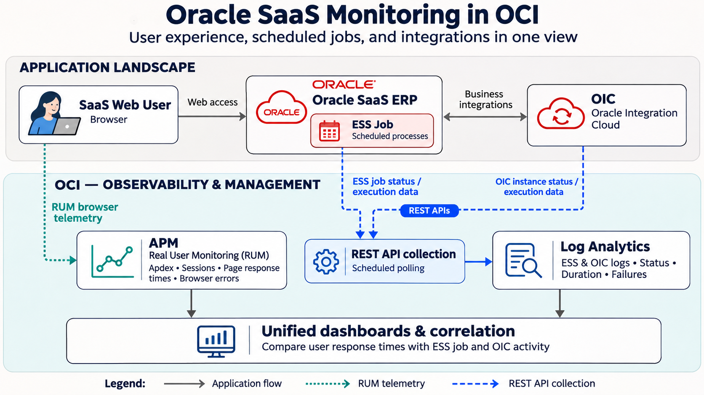
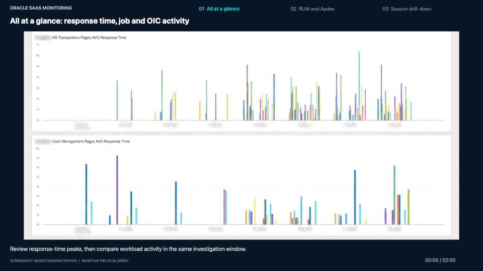
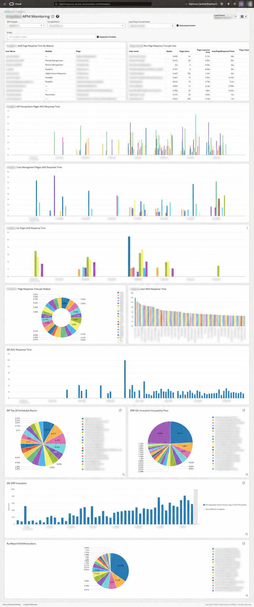
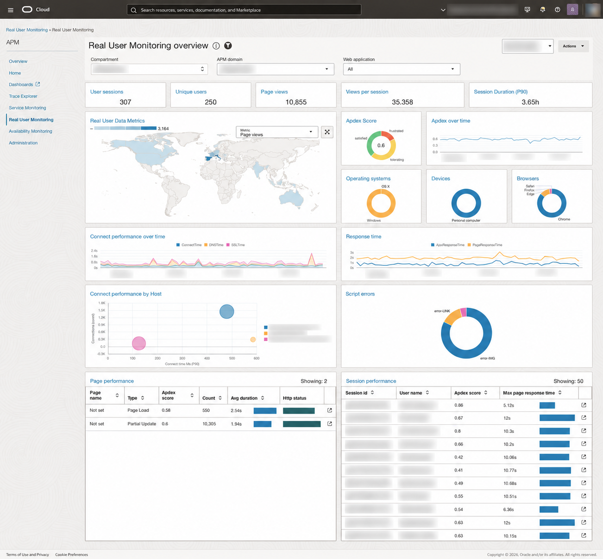
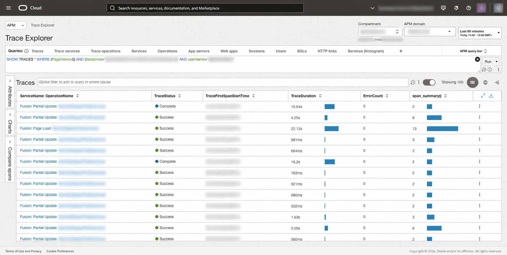
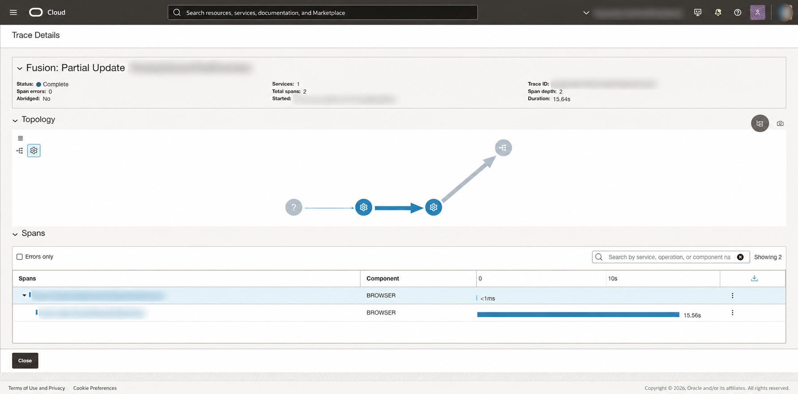
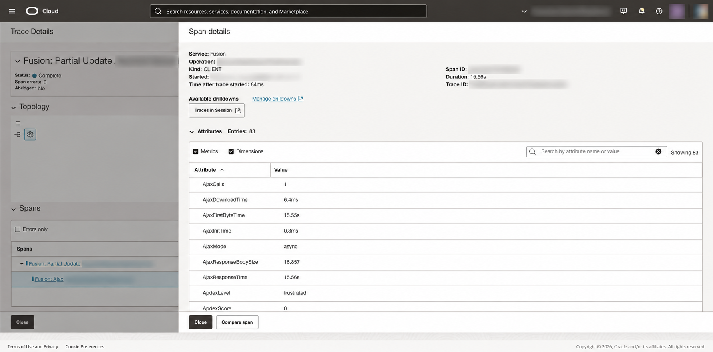

# Oracle SaaS Monitoring in OCI

Connect the experience of Oracle SaaS ERP users with scheduled processing and integration activity. OCI Application Performance Monitoring (APM) provides the browser experience view through Real User Monitoring (RUM), while Log Analytics brings ESS job and Oracle Integration Cloud (OIC) execution data into the investigation.

The aim is to answer three questions: **What are users experiencing? What else was running? Which request, job, or integration needs investigation?**

## 1. Customer pain: slow ERP, fragmented evidence

A user reports that the ERP application is slow. The application team, integration team, and support team may each see only part of the picture. A successful job or integration does not explain how long a user waited, and a slow page does not identify the processing activity behind it.

The customer needs to understand:

- **Business impact:** Which users, sessions, and application activities experience delays?
- **Timing:** When do slowdowns occur, and do they overlap with ESS jobs or OIC activity?
- **Scope:** Is this a broad degradation or a problem affecting one session?
- **Next action:** Which request, job, or integration should the team investigate, and what evidence can it share with support?

A shared monitoring view helps teams move from a general complaint to a specific time window and a focused investigation. It can also inform workload scheduling decisions once the relevant relationships have been verified.

## 2. Architecture and monitoring flow

### What APM, RUM, and Log Analytics mean

- **APM — Application Performance Monitoring:** the OCI service for understanding application performance and investigating slow requests. In this architecture, APM provides the user-experience and browser-trace view.
- **RUM — Real User Monitoring:** the browser-based monitoring capability of APM. It records actual user interactions, page and Ajax timings, and browser errors so teams can understand what users experience. See [Oracle’s APM Browser Agent guide](https://docs.oracle.com/en-us/iaas/application-performance-monitoring/doc/configure-browser-agent-real-user-monitoring.html).
- **Log Analytics:** the OCI service for collecting, searching, and analyzing log data. Here, it brings ESS job and OIC execution records into a shared workload investigation view.

**How to implement the architecture:** start with the [Oracle blog: Enhancing Observability for Oracle Fusion Applications with OCI Services](https://blogs.oracle.com/observability/om-solution-enhancing-observability-fusion-applications-oci), which introduces the solution and links to the [step-by-step Oracle implementation guide](https://docs.oracle.com/en/learn/ofaob/index.html). For the Fusion log collection setup, see [Simplify Oracle Fusion Applications Observability with OCI Log Analytics](https://blogs.oracle.com/observability/simplify-oracle-fusion-applications-observability-with-oci-log-analytics).

### Application flow

The **SaaS Web User** accesses **Oracle SaaS ERP** through a browser. ERP runs **ESS Jobs** for scheduled processing and exchanges business data with **OIC** integrations.

### Monitoring flow

1. **Capture the browser experience with APM/RUM.** Configured browser instrumentation sends RUM telemetry to OCI APM. This provides the user-facing view: sessions, page and Ajax timings, browser errors, and Apdex. The telemetry originates in the browser; it does not imply access to the SaaS application's internal server instrumentation.
2. **Collect ESS execution data through REST APIs.** A scheduled collection component retrieves the available job execution details, such as identifiers, status, and timing, using the configured access permissions.
3. **Collect OIC execution data through REST APIs.** The collection component retrieves the available integration execution details, such as instance identifiers, status, and timing. Available detail depends on the source configuration and retention.
4. **Ingest and analyze the collected data in Log Analytics.** Parse the ESS and OIC records into useful fields so investigators can filter executions and compare durations, failures, and activity over time. REST collection and ingestion must be configured; the diagram does not imply automatic collection.
5. **Bring the evidence into OCI dashboards.** Present APM experience signals alongside ESS and OIC activity. Start with a shared time window, then drill into the relevant source for detail.

**Protect telemetry before ingestion.** Allowlist the fields needed for monitoring, and filter cookies, tokens, sensitive query parameters, request bodies and SQL literals before they reach logs or spans. Apply appropriate access and retention controls.

| Source | Monitoring path | Question it helps answer |
| --- | --- | --- |
| SaaS web browser | RUM → APM | What did the user experience? |
| ERP ESS jobs | REST API collection → Log Analytics | Which jobs ran, and what were their status and duration? |
| OIC integrations | REST API collection → Log Analytics | Which integrations ran, failed, or took longer? |
| APM and collected execution data | OCI dashboards | What activity coincided with the user slowdown? |

The dashboard supports **time-based correlation**. A common time window is a starting point for investigation, not proof that a particular job caused a slow page. A direct request-to-job relationship requires identifiers or other evidence available in the collected data.

## 3. Dashboard results and investigation walkthrough

The screenshots below are demonstration examples with sensitive details obscured by localized blur. Visible timings illustrate the investigation process; they are not measured improvements or proof of root cause.

### 3.1 All at a glance: response time, job and OIC activity

Start with the shared dashboard. Review application response time over time, then compare it with OIC invocation activity. Include ESS job execution counts, durations, and status in the same investigation view when those records have been collected.

**What the supplied dashboard shows:** response-time charts, report and integration distributions, and an OIC invocation timeline. It does not show an ESS execution-results table.

**How to investigate:**

1. Select the interval in which users reported delays.
2. Locate response-time peaks and determine whether they affect one module or several.
3. Compare OIC activity and available ESS execution data for that interval.
4. Record candidate executions for log investigation. Check quieter periods as well, so ordinary background activity is not mistaken for the cause.

**Result:** a bounded time window and a list of workload candidates to investigate.

**Full monitoring dashboard**

### 3.2 RUM: understand the user experience

[View the animated RUM and Apdex walkthrough](files/02-real-user-monitoring-apdex.gif).

Open the **Real User Monitoring** overview to assess the experience across users and sessions before selecting an individual session.

**What is Apdex?** Apdex, the **Application Performance Index**, summarizes response-time-based user satisfaction on a scale from **0 to 1**: higher values indicate a better experience. Configured response-time thresholds classify requests as **satisfied**, **tolerating**, or **frustrated**. The score reflects those thresholds rather than a direct customer survey; **0.6 does not mean that 60% of users are satisfied**. Set thresholds that reflect the application’s expected response times. See [Oracle’s Apdex threshold guide](https://docs.oracle.com/en-us/iaas/application-performance-monitoring/doc/configure-apdex-thresholds.html).

**What the example shows:**

- An overall **Apdex score of 0.6**, with satisfied, tolerating, and frustrated segments.
- An **Apdex trend** and response-time charts for reviewing changes during the selected window.
- Geography, browser, operating-system, and device breakdowns for understanding the affected population.
- A session-performance table for comparing individual sessions by Apdex and maximum page response time.

Review the overall score and its trend together, then compare session rows. A lower score helps identify a session worth investigating; it does not establish the technical cause.

**Result:** an understanding of the affected user population and a specific session to inspect.

### 3.3 Trace drill-down: from session to request timing

[View the animated session drill-down](files/03-session-troubleshooting.gif).

In the example, select the session with **Apdex 0.67** and a **maximum page response time of 12 seconds**, then open its traces. Session summary metrics and individual trace durations are different measurements and should be interpreted in their own context.

Compare operation duration, status, and error count. Open the completed trace with a duration of **15.64 seconds**.

The trace contains two spans. Its Ajax span lasts **15.56 seconds**, making it the main timing detail to inspect in this example.

The span shows **15.55 seconds to first byte**, compared with **15.56 seconds Ajax response time**. Most of the recorded response time elapsed before the first byte arrived. This helps focus the next investigation on the request and its waiting time; it does not identify the responsible backend component by itself.

**Result:** request-level timing evidence and a narrower question for support or the application team.

### 3.4 Apdex alerts: detect degradation and drill down

Create an **OCI Monitoring alarm on the RUM Apdex score** so the team can be notified when user experience deteriorates, rather than waiting for a customer complaint. Oracle exposes `ApdexScore` in the `oracle_apm_rum` metric namespace and supports threshold alarms with notifications. See [Oracle’s APM metrics and alarm guidance](https://docs.oracle.com/en-us/iaas/application-performance-monitoring/doc/application-performance-monitoring-metrics.html).

**Configure the alert:**

1. Select `ApdexScore` for the relevant APM domain and web application.
2. Include the required dimensions: `MetricGroupName = "No Group"` and the chosen `WebApplicationName`.
3. Choose the aggregation interval, statistic, threshold, and persistence period. For illustration, the team might assess an alarm below **0.8** sustained for **five minutes**; validate this example against normal traffic and agreed service expectations.
4. Configure a notification destination and an investigation owner. Test delivery and the alarm’s behavior with the available traffic.

**From alert to investigation:**

1. Open APM/RUM and select the alarm’s application and time window. Review the Apdex trend and response times to confirm the scope of the degradation.
2. Compare affected sessions and open a representative session, following the drill-down in section 3.3.
3. Inspect its traces and spans for slow requests, browser errors, and the timing breakdown.
4. Compare the same interval with ESS and OIC activity in the dashboard. Inspect the collected execution records in Log Analytics when workload overlap needs investigation.
5. Share a focused evidence package with support: the affected application, timestamps and time zone, Apdex trend, relevant session/trace/span identifiers, request timings, available errors, and any relevant ESS request or OIC instance IDs. Apply the organization’s privacy and access rules when sharing session data.

**Business benefit:** early warning gives the team a chance to intervene before complaints accumulate, helping prevent customer complaints and protect confidence in the SaaS experience. The drill-down also provides **better insights to share with support**, replacing a general “ERP is slow” report with a precise time window, affected requests, and supporting workload evidence. Alerting supports earlier action; preventing a complaint depends on timely investigation and remediation.

**Apdex alert → RUM → Session → Trace → Span → Workload context → Informed action and support escalation**

[Watch the two-minute screenshot-based demo](files/oracle-apm-three-use-cases-2min.mp4). The video covers response-time/OIC comparison, RUM/Apdex, and session trace drill-down. The alerting workflow above describes an additional configuration option.

## References

- [Oracle blog — Enhancing Observability for Oracle Fusion Applications with OCI Services](https://blogs.oracle.com/observability/om-solution-enhancing-observability-fusion-applications-oci): solution overview and implementation resources.
- [Oracle implementation guide — Oracle Fusion Applications and OCI Observability Services](https://docs.oracle.com/en/learn/ofaob/index.html): step-by-step setup guidance.
- [Oracle blog — Simplify Oracle Fusion Applications Observability with OCI Log Analytics](https://blogs.oracle.com/observability/simplify-oracle-fusion-applications-observability-with-oci-log-analytics): Fusion REST API log collection and verification.
- [Oracle documentation — Configure APM Browser Agent](https://docs.oracle.com/en-us/iaas/application-performance-monitoring/doc/configure-browser-agent-real-user-monitoring.html): browser telemetry and RUM configuration.
- [Oracle documentation — Apdex Thresholds](https://docs.oracle.com/en-us/iaas/application-performance-monitoring/doc/configure-apdex-thresholds.html): score interpretation and response-time thresholds.
- [Oracle documentation — APM Metrics](https://docs.oracle.com/en-us/iaas/application-performance-monitoring/doc/application-performance-monitoring-metrics.html): RUM metrics, dimensions, alarms, and notifications.

## License

Copyright (c) 2026 Oracle and/or its affiliates.

Licensed under the Universal Permissive License (UPL), Version 1.0. See [LICENSE](LICENSE).
