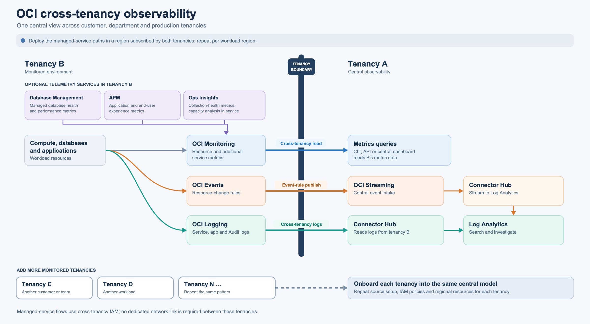

# Cross-Tenancy Observability: Centralize Control Over Your Tenancies

## Why centralize observability?

An organization may operate several OCI tenancies because it manages customer environments, separates departments or subsidiaries, or isolates production workloads for governance. A central operations team still needs a consistent way to inspect health, investigate incidents, and receive significant changes across those boundaries.

This guide uses **Tenancy A** for central operations and **Tenancy B** for a monitored customer or department. Repeat the B-side setup for each additional monitored tenancy. Cross-tenancy access is explicit: administrators in both tenancies agree to the relevant IAM **Endorse** and **Admit** policies. Oracle documents this model for [cross-tenancy access](https://docs.oracle.com/en-us/iaas/Content/Identity/policieshow/iam-cross-domain.htm).

## Architecture

[Open the full-size image](files/cross-tenancy-observability.png) · [Editable Mermaid source](files/cross-tenancy-observability.mmd)

The diagram shows three distinct data paths:

1. **Metrics:** resources in tenancy B emit metrics to OCI Monitoring. An authorized identity in tenancy A queries those metrics in tenancy B. This is a remote read; the metrics are not automatically copied into A's Monitoring service. Database Management, when enabled in tenancy B, contributes additional managed-database metrics to Monitoring. [Cross-tenancy metric access](https://docs.oracle.com/en-us/iaas/Content/Security/Reference/monitoring_security.htm), [Database Management metrics](https://docs.oracle.com/en-us/iaas/database-management/doc/database-management-metrics.html).
2. **Logs:** B's service, Audit, and custom logs are available in OCI Logging. A Connector Hub connector created in tenancy A reads the selected B log group and uploads the entries into a Log Analytics log group in tenancy A. The two log groups belong to different services. [Oracle's cross-tenancy log procedure](https://docs.oracle.com/en-us/iaas/log-analytics/doc/ingest-logs-from-other-oci-services-using-service-connector.html).
3. **Events:** an OCI Events rule in tenancy B matches resource changes and publishes to an OCI Streaming stream in tenancy A. If those event messages should also be searchable in Log Analytics, a **second connector in tenancy A** consumes the stream and sends it to Log Analytics, using a suitable source and JSON parser. Streaming does not feed Log Analytics directly in this design. [Events cross-tenancy policies](https://docs.oracle.com/en-us/iaas/Content/Events/Concepts/eventspolicy.htm), [Streaming-to-Log Analytics ingestion](https://docs.oracle.com/en-us/iaas/log-analytics/doc/ingest-custom-logs-from-oci-streaming-service-using-service-connector.html).

### Region and network requirements

Both tenancies must subscribe to the region that contains B's monitored resources. A and B may have different **home regions**. For this architecture, create A's regional stream, connectors, and Log Analytics destination in the workload region; repeat the setup for each additional workload region. Log Analytics is a regional service, so each enabled region is a separate instance. [Cross-tenancy region requirement](https://docs.oracle.com/en-us/iaas/Content/Identity/policieshow/iam-cross-domain.htm), [Log Analytics regional setup](https://docs.oracle.com/en-us/iaas/log-analytics/doc/enable-access-logging-analytics-its-resources.html).

**No dedicated network connection between the tenancies is required for these OCI managed-service paths.** This follows from the documented IAM-based cross-tenancy metric, log, and Events flows. Direct access from a collector in tenancy A to a private host or database endpoint in tenancy B is a different design and does require suitable network connectivity. Enabling optional services inside B may also require local connectivity from those services or agents to B's databases. [Cross-tenancy IAM](https://docs.oracle.com/en-us/iaas/Content/Identity/policieshow/iam-cross-domain.htm), [Ops Insights database network prerequisites](https://docs.oracle.com/en-us/iaas/operations-insights/doc/prerequisites-network-comms.html).

## Before you begin

Record the tenancy OCIDs for A and B, the workload region, the OCIDs of the relevant compartments and log groups, and the OCID of the IAM group in tenancy A that will administer the setup. Use separate compartments or log groups where different customers need separate access or retention policies. The policy examples below are templates; replace every angle-bracketed value with an actual OCID or name and scope access to the intended resources.

## 1. Centralize metric access

**In tenancy B:**

1. Confirm that the relevant resources emit metrics in the workload region. In OCI Monitoring, inspect **Service Metrics** for the resource compartment and namespaces such as oci_computeagent, oci_database, or oracle_oci_database when Database Management is enabled. [OCI Monitoring metric access](https://docs.oracle.com/en-us/iaas/Content/Security/Reference/monitoring_security.htm), [Database Management metrics](https://docs.oracle.com/en-us/iaas/database-management/doc/database-management-metrics.html).
2. Add an IAM policy that admits A's observation group to read metrics in the chosen B compartment:

       define tenancy TenantA as <A_TENANCY_OCID>
       define group CentralObservers as <A_GROUP_OCID>
       admit group CentralObservers of tenancy TenantA to read metrics in compartment <B_COMPARTMENT_NAME>

**In tenancy A:**

3. Add the matching endorsement for the same A group:

       define tenancy TenantB as <B_TENANCY_OCID>
       endorse group CentralObservers to read metrics in tenancy TenantB

4. Query B's metric compartment and region using a principal in CentralObservers through the OCI CLI, SDK, API, or a dashboard configured to make those cross-tenancy queries. Confirm that metric definitions and data points are returned. If desired, restrict B's policy further with a metric-namespace condition. Oracle provides the [Endorse/Admit pattern and namespace restriction](https://docs.oracle.com/en-us/iaas/Content/Security/Reference/monitoring_security.htm).

## 2. Enable Log Analytics in central Tenancy A

This onboarding is performed in **A**, because A holds the Log Analytics destination shown in the diagram.

1. Sign in to A as a member of the Administrators group and select the workload region. Log Analytics must be enabled separately in every region used by this architecture.
2. Open **Observability & Management → Log Analytics**. On first use in that region, select **Start Using Log Analytics**.
3. Review the onboarding dialog. Oracle creates the minimum required policies and a log group if they do not already exist. Decide whether to include A's local **_Audit** logs and subcompartments; this choice does not automatically collect B's Audit logs.
4. Finish the wizard and select **Take me to Log Explorer**. Create or select a dedicated Log Analytics log group for B's incoming data, and grant the central analysts the appropriate access to it.

If you configure access manually, Oracle requires a service-level policy such as:

    allow service loganalytics to READ loganalytics-features-family in tenancy

Review any policy already created by onboarding before adding a duplicate. [Oracle's Log Analytics enablement steps and IAM guidance](https://docs.oracle.com/en-us/iaas/log-analytics/doc/enable-access-logging-analytics-its-resources.html).

## 3. Centralize OCI logs

**In tenancy B:**

1. Enable the OCI service logs needed by the operations team and place them in an OCI Logging log group. For application or host files, first ingest them as **custom logs**, for example with the Unified Monitoring Agent. Confirm that new entries appear in tenancy B before configuring cross-tenancy collection. [OCI Logging overview](https://docs.oracle.com/en-us/iaas/Content/Logging/Concepts/loggingoverview.htm).
2. Create a tenancy-level policy that permits A's connector and its administrators to read B's OCI Logging data:

       define tenancy TenantA as <A_TENANCY_OCID>
       define group ALogAdmins as <A_LOG_ADMINS_GROUP_OCID>
       admit any-user of tenancy TenantA to read logging-family in tenancy where all {request.principal.type = 'serviceconnector'}
       admit group ALogAdmins of tenancy TenantA to read logging-family in tenancy

**In tenancy A:**

3. Create the corresponding endorsement and allow the connector to upload to the selected Log Analytics log group:

       define tenancy TenantB as <B_TENANCY_OCID>
       endorse any-user to read logging-family in tenancy TenantB where all {request.principal.type = 'serviceconnector'}
       endorse group ALogAdmins to read logging-family in tenancy TenantB
       allow any-user to {LOG_ANALYTICS_LOG_GROUP_UPLOAD_LOGS} in compartment id <A_LA_COMPARTMENT_OCID> where all {request.principal.type = 'serviceconnector', target.loganalytics-log-group.id = '<A_LA_LOG_GROUP_OCID>', request.principal.compartment.id = '<A_CONNECTOR_COMPARTMENT_OCID>'}
       allow group ALogAdmins to manage serviceconnectors in tenancy

4. Create the connector **in tenancy A, in the workload region**, with **Logging** as source and **Log Analytics** as target. Oracle's cross-tenancy example uses the CLI because the source log group OCID belongs to B:

       oci --profile <A_PROFILE> --region <WORKLOAD_REGION> sch service-connector create \
         --display-name B-to-A-logs \
         --compartment-id <A_CONNECTOR_COMPARTMENT_OCID> \
         --source '{"kind":"logging","logSources":[{"compartmentId":"<B_LOG_GROUP_COMPARTMENT_OCID>","logGroupId":"<B_LOG_GROUP_OCID>"}]}' \
         --target '{"kind":"loggingAnalytics","logGroupId":"<A_LA_LOG_GROUP_OCID>"}'

5. Generate a fresh log entry in tenancy B and search A's Log Analytics group. Filter **Log Origin** by the connector OCID to isolate this flow. If B's **Audit** events are included, add the additional cross-tenancy audit-events policies in Oracle's procedure. The connector's Logging source has a **24-hour recovery window**, so validate soon after creation. [Cross-tenancy log IAM, CLI, and verification](https://docs.oracle.com/en-us/iaas/log-analytics/doc/ingest-logs-from-other-oci-services-using-service-connector.html), [Connector Hub Logging retention](https://docs.oracle.com/en-us/iaas/Content/connector-hub/create-service-connector-logging-source.htm).

## 4. Centralize Events

1. In tenancy A, create a Streaming stream in the workload region for central event intake. Record its OCID.
2. In tenancy B, create an OCI Events rule in the relevant compartment. Choose the event types or attributes to monitor, then set the A stream as the action. The rule must cover the resource compartment and have at least one action. [Creating Events rules](https://docs.oracle.com/en-us/iaas/Content/Events/Task/managingrules.htm).
3. Add the paired policies below. Oracle's published cross-tenancy example includes both STREAM_READ and STREAM_PRODUCE; adapt the scope to the action and compartment used in your implementation. [Events IAM policy reference](https://docs.oracle.com/en-us/iaas/Content/Events/Concepts/eventspolicy.htm).

   In tenancy B, where the rule resides:

       define tenancy TenantA as <A_TENANCY_OCID>
       endorse any-user to {STREAM_READ, STREAM_PRODUCE} in tenancy TenantA where request.principal.type = 'eventrule'

   In tenancy A, where the stream resides:

       define tenancy TenantB as <B_TENANCY_OCID>
       admit any-user of tenancy TenantB to {STREAM_READ, STREAM_PRODUCE} in tenancy where request.principal.type = 'eventrule'

4. Trigger a matching test event, verify that it reaches A's stream, and inspect the rule's **DeliveryFailedEvents** metric if delivery fails. [Events metrics](https://docs.oracle.com/en-us/iaas/Content/Events/Reference/eventsmetrics.htm).
5. **Optional, shown in the diagram:** to investigate event messages in Log Analytics, create a second connector in tenancy A with **Streaming** as source and **Log Analytics** as target. Define a JSON parser and Log Analytics source for the event payload, grant the connector stream read/consume and Log Analytics upload permissions, then test a new event end to end. [Oracle's Streaming-to-Log Analytics steps](https://docs.oracle.com/en-us/iaas/log-analytics/doc/ingest-custom-logs-from-oci-streaming-service-using-service-connector.html).

## 5. Extend telemetry in monitored Tenancy B

Enable additional services **in tenancy B**, close to the resources they monitor. Cross-tenancy **read metrics** permission can expose their OCI Monitoring metric namespaces to A, but it does not by itself grant access to each service's own console, traces, SQL analysis, or configuration APIs.

| Service in tenancy B | What it adds | OCI Monitoring metric namespace | Enablement |
| --- | --- | --- | --- |
| **Database Management** | Database performance and health metrics for supported managed databases | Typically **oracle_oci_database**; other namespaces depend on database/system type | Enable **Diagnostics & Management** for the selected databases and satisfy its credential, permission, and connectivity prerequisites. [Enablement](https://docs.oracle.com/en-us/iaas/database-management/doc/enable-database-management.html) · [Metrics](https://docs.oracle.com/en-us/iaas/database-management/doc/database-management-metrics.html) |
| **Application Performance Monitoring (APM)** | Application-server, user-experience, and synthetic availability metrics | **oracle_apm_monitoring**, **oracle_apm_rum**, **oracle_apm_synthetics** | Create an APM domain in tenancy B and configure the relevant Java/.NET, browser, or synthetic data sources. [APM setup](https://docs.oracle.com/en-us/iaas/application-performance-monitoring/doc/get-started-application-performance-monitoring.html) · [Metrics](https://docs.oracle.com/en-us/iaas/application-performance-monitoring/doc/application-performance-monitoring-metrics.html) |
| **Ops Insights** | Capacity and resource-usage analysis for enabled databases and hosts; Monitoring metrics mainly cover Ops Insights data flow and collection health | **oci_operations_insights** | Enable the selected resources in tenancy B and complete the service-specific prerequisites. Full capacity and SQL insights remain in Ops Insights and require their own permissions. [Enable resources](https://docs.oracle.com/en-us/iaas/operations-insights/doc/working-operations-insights-resources.html) · [Metrics](https://docs.oracle.com/en-us/iaas/operations-insights/doc/operations-insights-metrics.html) |

For each new namespace, confirm that B emits data in the expected compartment and region, then test A's cross-tenancy metric query. Keep the service-specific access model separate from the Monitoring read policy.
