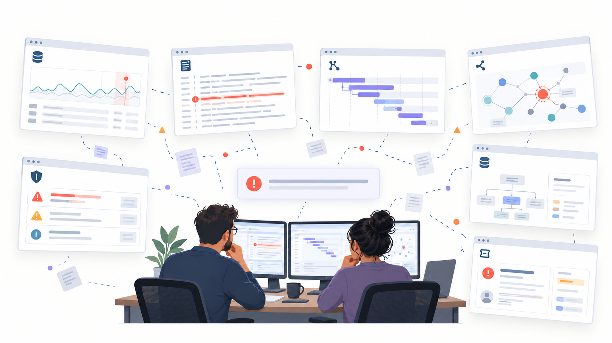
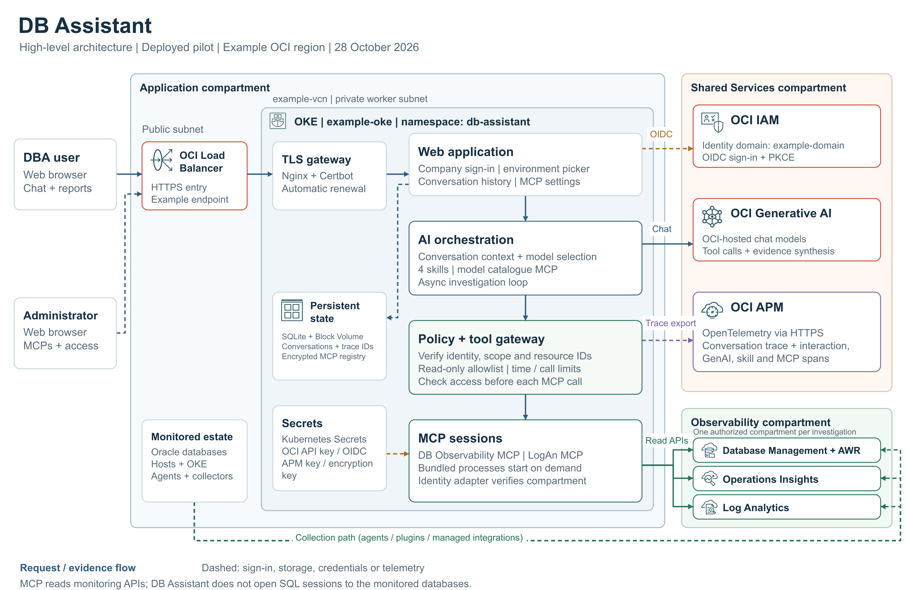
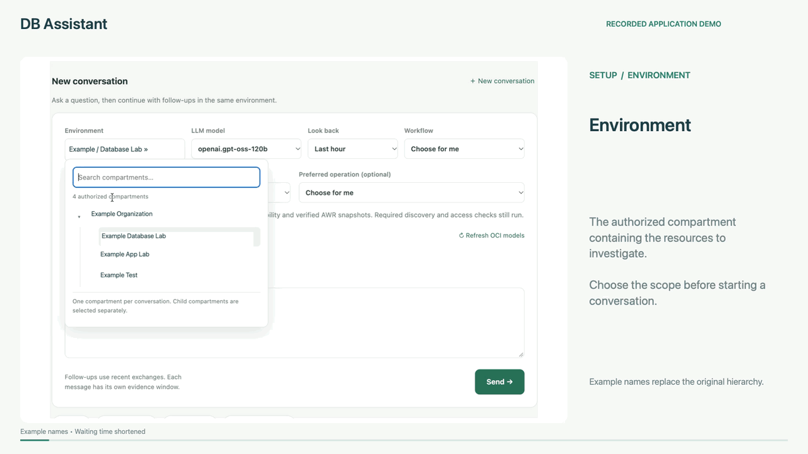
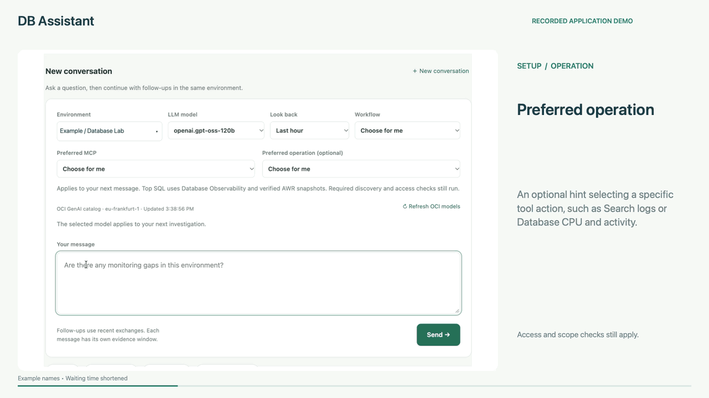
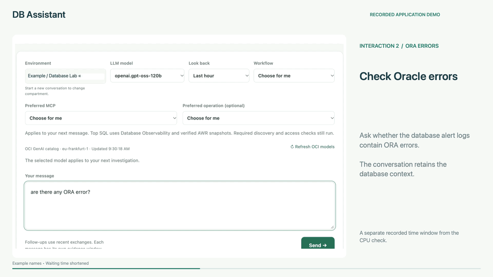
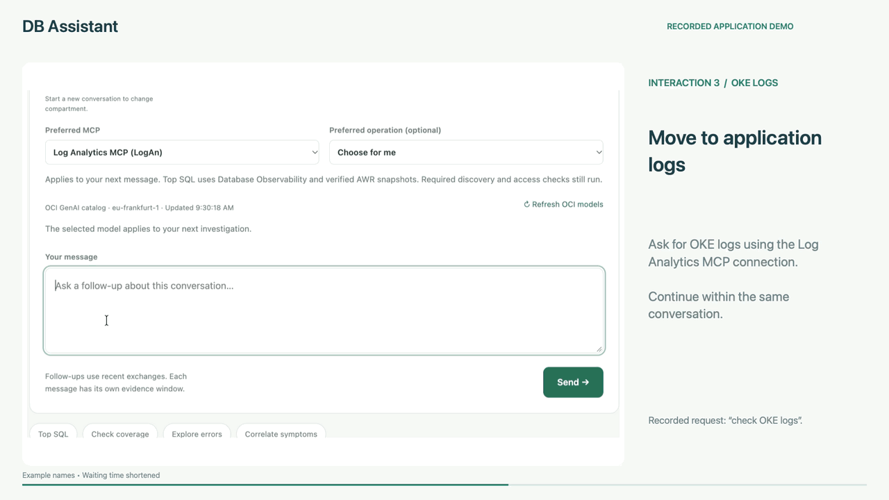
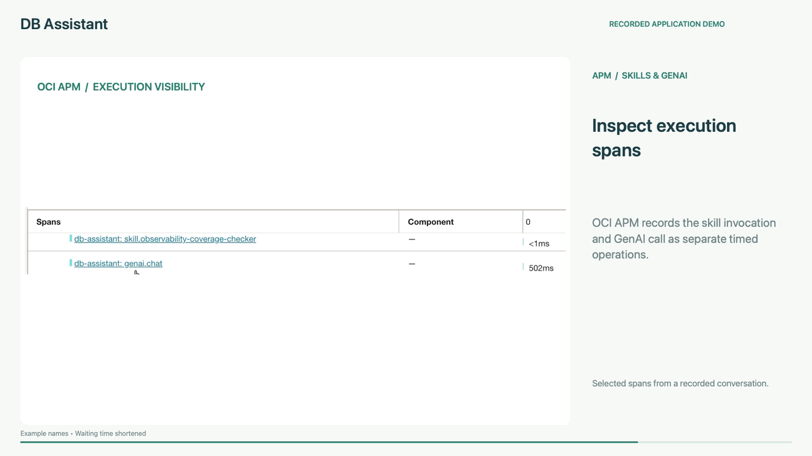

# GenAI Observability (R)evolution: From Dashboards to Answers

*How OCI Generative AI, MCP and reusable skills can connect an Oracle database observability environment—and provide a foundation for broader enterprise operations.*

## The problem: the evidence is spread across tools



An organization might begin with one or two monitoring tools. As its technology estate grows, it adds database monitoring, infrastructure metrics, application tracing, log analytics, security platforms, configuration inventories and service management systems. In a large enterprise, the landscape can expand to dozens or even hundreds of tools and integrations.

Each tool answers part of an operational question. The difficult work happens between them.

A DBA investigating a performance problem may open one console to inspect database activity, another to compare historical utilization, and a third to search alert logs. An application specialist checks traces. Someone else looks up ownership and dependencies in the CMDB. The team must reconcile resource names, timestamps, access permissions and incomplete evidence before it can agree on the next step.

Consider a question such as:

> Which databases were under the most pressure in the last two days, which SQL statements contributed to that pressure, and were there database errors during the same period?

Answering it requires several decisions: which sources contain the relevant information, which resources are in scope, which measurements are comparable, and whether the data is complete enough to support a conclusion.

Centralized monitoring platforms and data lakes can bring valuable consistency to this environment. Another architectural option is to build an application that connects to the existing tools, retrieves evidence when needed and uses generative AI to coordinate the investigation.

The operator asks a question. The application selects appropriate tools, gathers evidence and explains what it can establish.

Dashboards remain useful for visualization and detailed inspection. A conversational application gives teams an additional way to work across those views and capture repeatable investigation procedures.

## What this article demonstrates

This article explains how that approach can be implemented for Oracle database environments using native Oracle Cloud Infrastructure services: **Ops Insights, Database Management, Log Analytics, Generative AI and Application Performance Monitoring**. These services form part of Oracle's broader [Observability and Management platform](https://www.oracle.com/manageability/).

The example is **DB Assistant**, a custom web application deployed on Oracle Kubernetes Engine (OKE). It uses OCI Generative AI for model inference and Model Context Protocol (MCP) servers to retrieve operational evidence. Its orchestration and access controls are implemented in the application.

The same pattern can extend to an organization's own tools. A tool needs an approved integration path: a compatible MCP server, or an API that can be exposed through an MCP adapter. The application then needs appropriate contracts, permissions, routing and investigation instructions for that integration.

The prototype described here performs governed, read-only investigations. Remediation and unattended operations are future extensions discussed later in the article.

## The reference architecture



*Figure 1. The DB Assistant prototype. Generic compartment and resource names are used, with service icons from the [Oracle OCI architecture toolkit](https://docs.oracle.com/en-us/iaas/Content/General/Reference/graphicsfordiagrams.htm). [Editable draw.io diagram](assets/db-assistant-architecture.drawio) · [Vector image](Files/db-assistant-architecture.svg) · [High-level design](assets/db-assistant-high-level-design.pdf).*

The architecture has three connected paths:

1. **User access:** browser, HTTPS entry point, company sign-in and an authorized environment.
2. **Investigation:** application orchestration, skills, model requests, policy checks, MCP calls and returned evidence.
3. **Application observability:** traces that explain how the assistant itself handled the conversation.

Operational collection continues independently. Database monitoring integrations, Management Agents and log collectors populate the underlying services. The assistant queries the evidence those services actually have.

Connecting an MCP does not enable monitoring on every target, repair a parser or guarantee that historical samples exist. Collection quality remains part of the investigation.

## The extension architecture: one brain across operational domains

The **brain** represents GenAI together with conversation context and orchestration. It provides a simple way to explain a shared assistant that can work across several operational domains. The software application and its backend controls still provide the execution environment behind that symbol.

Each domain adds a repeatable pattern:

- **A skill** describes the investigation method: SQL analysis, application latency, network connectivity, security exposure, platform health or service ownership.
- **An approved connection** reaches the relevant tool through MCP or an API adapter.
- **An environment** identifies the monitored targets, credentials, region and permitted scope.

The policy and gateway remain the execution boundary for all of those paths. The brain selects a relevant workflow and requests evidence; backend code checks each operation before the connection reaches a target. Returned evidence can then be correlated with findings from other authorized domains.

For example, an investigation into a slow service could combine application traces, database performance evidence, DNS or routing checks, infrastructure measurements and recorded deployment changes. A service-context integration could identify the owner and affected dependencies. Those additional paths require their own integrations, permissions and validation.

The current pilot retrieves operational evidence through MCP. The broader API-adapter paths in this picture are architectural extensions, and the existing configuration page does not automatically enable every illustrated tool type.

The lower lane shows a further evolution: agents check a target, investigate a problem, obtain any required approval, execute a bounded runbook and verify recovery. Verified recovery can close the loop. Unresolved problems, uncertain results or required approvals lead to a human with the evidence already collected. These action and agent capabilities are prospective.

## The Oracle services: different sources for different questions

| Component | Contribution to an investigation | Example question |
|---|---|---|
| **OCI Database Management** | Database inventory and supported runtime/performance information; the prototype also retrieves selected AWR evidence. | Which SQL statements consumed the most elapsed time in the available AWR interval? |
| **OCI Ops Insights** | Historical resource utilization and capacity analysis for enrolled databases and hosts. | How has resource consumption changed over the selected period? |
| **OCI Log Analytics** | Searchable database, host and application logs collected and parsed for the selected scope. | Which errors were recorded, and when? |
| **OCI Generative AI** | Model inference for interpreting the question, proposing tool calls and explaining retrieved evidence. | What should be checked next, and what do the results support? |
| **OCI APM** | Traces and spans for the assistant's own execution. | Where did this investigation spend time or fail? |

The service roles are documented in the official guides for [Database Management](https://docs.oracle.com/en-us/iaas/database-management/), [Ops Insights](https://docs.oracle.com/en-us/iaas/operations-insights/doc/operations-insights.html), [Log Analytics](https://docs.oracle.com/en-us/iaas/log-analytics/home.htm), [OCI Generative AI](https://docs.oracle.com/en-us/iaas/Content/generative-ai/overview.htm) and [APM](https://docs.oracle.com/en-us/iaas/application-performance-monitoring/home.htm). The prototype exposes a selected subset of these services' capabilities.

## The application: a shared place to investigate

The web application makes the assistant available to colleagues through a browser. They can sign in, choose an authorized environment, select an available model, ask a question and continue the conversation.

The application is also responsible for the work surrounding inference:

- Managing investigation jobs and conversation ownership.
- Supplying bounded history for follow-up questions.
- Recording each interaction's model, evidence window and outcome.
- Starting or connecting to the assigned MCP servers.
- Enforcing execution limits and presenting partial or failed investigations clearly.

Saved history gives a DBA useful continuity. A follow-up such as “Now check the logs for that database” can reuse the discussion. Historical answers retain their original time windows; current operational claims require fresh evidence.

A conversation remains bound to its authorized environment and MCP connection assignment. Changing that binding requires a new conversation.

### Choosing the investigation controls



*Recorded walkthrough, accelerated and anonymized.* **Environment** defines the authorized compartment; **LLM model** selects the reasoning model; **Look back** sets the evidence period; **Workflow** guides the investigation through skills; **Preferred MCP** selects a connection; and **Preferred operation** suggests a specific tool action. Leaving a choice on “Choose for me” allows automatic selection within the backend controls.

## GenAI: interpreting questions and choosing the next step

OCI Generative AI provides model inference. In this implementation, the application sends the selected model the user's question, relevant context, workflow instructions and approved tool definitions.

The model can propose an operation and its arguments. The application validates and executes that proposal, then returns the result to the model. Several iterations may be needed before an answer is ready.

This gives the model a practical role: decide which evidence to request and explain what it finds. Credentials and execution authority remain in the backend.

The prototype's model menu is populated from an OCI catalog integration and restricted to eligible OCI-hosted chat models supported by the application. Selection is recorded per interaction; the application does not silently switch providers when a model fails.

Model quality still matters. A model can choose an unsuitable operation, omit a prerequisite or produce an incomplete explanation. Contract validation, bounded correction attempts and explicit limitations help make those failures visible.

## Policy and gateway: deciding what may execute

Natural language is flexible. Operational access needs explicit boundaries.

The **policy layer** decides whether the signed-in user may investigate the selected environment. The **tool gateway** applies the permitted operations, arguments and resource boundaries when a tool call is proposed.

In DB Assistant, these checks include:

- One exact compartment and the interaction's time window.
- Approved read-only operations and schemas.
- Resource identifiers established through inventory or discovery.
- Query, result-size, time and call limits.
- Current environment access and connection status before subsequent calls.

This also improves the quality of the answer. A top-SQL question is routed to database performance evidence. A count of log messages cannot substitute for a SQL ranking.

The model sees a curated interface such as `load_skill`, `db_catalog`, `db_read` and `log_query`. The backend maps these operations to the relevant MCP calls and validates their inputs.

Human sign-in and backend service authentication are separate. The pilot uses an API-only service identity for its built-in OCI connections, while portal grants restrict individual users. Signing in does not delegate the person's entire OCI console access to the model. OCI IAM permissions provide a further access boundary.

## MCP: making the tools callable

MCP provides a standard way for an application to discover and invoke capabilities exposed by servers. The application acts as the MCP host and manages client connections to those servers. MCP defines the exchange; the application supplies its orchestration and governance. See the [MCP architecture documentation](https://modelcontextprotocol.io/docs/learn/architecture).

The prototype uses two main data integrations:

### Oracle Database Observability MCP

`oracle.oci-db-observability-mcp-server` provides access to Oracle database observability workflows. Its discovery interface lets a client find capability categories, discover operations, inspect their schemas and invoke a chosen operation.

The project is documented in the [Oracle Database Observability MCP README](https://raw.githubusercontent.com/oracle/mcp/main/src/oci-db-observability-mcp-server/README.md). DB Assistant allows a smaller, explicitly approved set of operations from this server.

### LogAn MCP for OCI Log Analytics

`oci-logan-mcp` exposes log capabilities through MCP. DB Assistant uses bounded, scoped log queries to collect evidence for its investigation workflows.

The [LogAn MCP repository](https://github.com/rishabh-ghosh24/logan-mcp-server) is a separate community project. Its full capabilities are broader than the query interface exposed by this prototype. **LogAn** is the name used for the log-AI integration in this demonstration.

The application also uses project-owned identity and model-catalog MCP adapters. These support compartment verification and model discovery; they should be distinguished from Oracle's published reference servers.

## Skills: capturing how a DBA investigates

A tool describes an operation that can be called. A skill captures a repeatable investigation procedure: when to use it, which evidence to collect, how to handle gaps and what the answer should contain.

DB Assistant has four application workflows:

- **Monitoring coverage:** identify missing, stale or unqueried evidence.
- **Application errors:** examine relevant logs and recurring exceptions.
- **Incident correlation:** align evidence across verified resources and a shared timeline.
- **SQL performance:** retrieve appropriate database performance evidence, including available AWR intervals.

These workflows are versioned instructions loaded by the application. They are separate from the capability-category metadata that a database MCP server may also call “skills.”

For example, an illustrative coverage skill could read:

```markdown
# Monitoring coverage check

## Use when
The user asks whether database metrics or logs are available and current.

## Procedure
1. Verify the authorized environment and establish the UTC window.
2. Discover database, database-insight and host-insight inventories separately.
3. Query relevant log sources and their last-seen timestamps.
4. Classify each path as observed, empty, stale, disabled, blocked,
   unsupported or not queried, according to the evidence returned.
5. Explain the next useful check for each gap.

## Answer requirements
State scope, time window, data source, coverage and limitations.
An empty response does not prove healthy targets or disabled collection.
```

That skill can be reviewed and improved as the team gains experience. It captures institutional knowledge alongside the tool contracts and access rules. Its instructions cannot grant permissions or override the gateway.

## The complete flow: from a question to an answer

Consider this request:

> For the selected environment, compare database utilization over the last 48 hours and check whether errors were recorded for the same databases.

The investigation can develop across several interactions. In this pilot, a top-SQL interaction is deliberately restricted to database evidence; log analysis can run in another interaction in the same conversation. A suitable sequence is:

1. **Establish access and scope.** The application verifies the session, selected environment, assigned MCP connections and requested window.
2. **Choose the workflow.** The orchestrator supplies relevant skills, recent conversation context and permitted tool definitions to the selected model.
3. **Verify resources.** Identity and inventory calls establish the compartment and actual database identifiers. A name mentioned in conversation is resolved against evidence.
4. **Retrieve utilization evidence.** The model requests supported metrics or trends through the database MCP. The gateway validates scope, arguments and resource types.
5. **Assess comparability.** The assistant checks metric definitions, units, sample coverage and freshness before ranking databases. Missing samples remain a stated gap.
6. **Query relevant logs.** LogAn retrieves bounded results for the selected compartment and time window. Database/entity mappings and timestamps guide the comparison.
7. **Ask a focused SQL follow-up.** For the relevant database, the user can request top SQL through the database workflow. The prototype discovers AWR identifiers and completed snapshots, then requests an approved report. The answer states the actual AWR interval and any truncation; that interval cannot be presented as complete coverage of the entire 48 hours.
8. **Explain the findings.** The response identifies observations, likely interpretations, unanswered questions and next checks. Events occurring together establish a correlation to investigate, rather than proof of causation.
9. **Save and trace the interaction.** The application records the result and provenance, and exports execution metadata to APM. A follow-up continues within the same authorized conversation.

The sequence is an example workflow, not a claim that every database has complete metrics, usable snapshots or relevant logs. A reliable response may conclude that the available evidence cannot support a ranking or explanation.

## A typical interaction: CPU, Oracle errors and OKE logs

The following excerpts show three completed interactions from the recorded prototype. Names and identifiers are masked, and waiting time is shortened. Each answer retains its own evidence window; these examples do not establish a shared incident or a causal connection between database and application symptoms.

[Watch or download the full 2:30 demo](Files/db-assistant-demo.mp4), including the reference architecture, control selection, the three investigations, APM execution visibility and the extension architecture.

### 1. Check database CPU



The recorded answer reports **0.667% average CPU and 1.03% peak CPU for DB01**, using Database Management home metrics. CPU percentages are unavailable for other targets in that response, so the result does not establish their utilization.

### 2. Inspect Oracle alert-log errors



The next investigation returns **one ORA-00800 entry** from Database Alert Logs for DB01. The excerpt includes “Set Priority Failed” and VKTM. The response identifies its source and time window; other sources and periods require separate checks.

### 3. Inspect OKE application logs



The OKE response reports **2,733 generic container-log records** and displays sample messages including a `NullPointerException` and an external-service timeout. The source count spans container logs; it is neither an error total nor a count for one application. A workload-specific filter is needed to isolate an application's records.

## Observing the assistant itself

An operational assistant needs its own observability. Teams should be able to inspect which workflow ran, which model was selected, which tools were called and where execution failed.

The prototype uses OpenTelemetry with OCI APM:

```text
Conversation trace
├── Interaction 1
│   ├── GenAI call
│   ├── Skill load
│   ├── MCP identity / discovery calls
│   ├── MCP database or log calls
│   └── GenAI evidence synthesis
└── Interaction 2: follow-up
    ├── GenAI call
    ├── Skill load, if required
    └── Further approved MCP calls
```

Each conversation has a persisted trace ID. Each interaction has its own span, with child spans for model requests, skill loads and MCP activity. Later interactions can join the conversation's trace after an application restart.



*Inspecting the assistant's execution.* The recorded APM excerpt shows separate skill and model spans, MCP operations and connection children, and topology timing. The displayed seven calls and zero errors belong to the selected tool operation; they are not an overall success measure for the conversation.

The portal stores conversation content separately from its tracing metadata. Prompts, answers, raw logs, credentials and tool arguments are excluded from APM span attributes in this implementation. Export is asynchronous, so ingestion should be checked rather than assumed.

The current APM connection observes DB Assistant's execution. Querying application traces as investigation evidence would require an additional approved integration.

## Extending the prototype across tools and systems


*Figure 2. How the architecture can expand beyond the database prototype. Solid borders identify the Oracle pilot foundation; dashed borders identify conceptual extensions. [Editable draw.io diagram](assets/genai-observability-extension.drawio) · [Vector image](Files/genai-observability-extension.svg).*

The administration page can register additional **Database Observability** or **LogAn** connections. An administrator provides connection details, performs a scoped read test, assigns the connection to an environment and grants access to users or groups.

Bundled MCP processes start on demand inside the assistant's runtime. An existing remote MCP must already be running and meet the portal's supported HTTPS transport and authentication requirements. Connections paired in one environment must use the same tenancy and region.

Adding a monitoring tenancy does not move model processing into that tenancy. Selected evidence continues to be processed by the platform's configured OCI GenAI service. That data flow must be considered when authorizing the connection.

A broader enterprise rollout could add:

| Additional integration | New investigation opportunity |
|---|---|
| APM or another tracing platform | Connect a slow request to its downstream services and database calls. |
| CMDB and service inventory | Identify ownership, service dependencies and affected business systems. |
| Security monitoring | Compare operational events with relevant security findings. |
| Change and deployment systems | Determine which recorded changes preceded an incident. |
| Network and infrastructure monitoring | Examine connectivity, host or capacity evidence alongside database symptoms. |
| Other database platforms | Apply equivalent workflows to additional supported engines and environments. |

Each connection needs compatible operations, trustworthy resource mappings, permissions and useful evidence. Broader visibility becomes valuable when those relationships are established.

The current configuration page supports the two implemented MCP types. Supporting a new category, such as CMDB or security, requires extending the backend's curated contracts, routing, authorization and skills. Registering an arbitrary endpoint alone does not make it a governed integration.

## From investigation to governed remediation

Once evidence retrieval is reliable, the architecture can evolve toward controlled action.

A future remediation workflow could follow this cycle:

```text
Detect or receive a problem
    → verify target and current state
    → gather evidence and choose an approved runbook
    → check action policy and obtain approval when required
    → execute a bounded action
    → verify recovery and affected dependencies
    → close with evidence, roll back, or escalate to a human
```

For example, a scheduled agent could detect an unhealthy application component, verify that it is an eligible development target and invoke an approved restart runbook. It would then check readiness and a functional request. A successful restart command would be only one piece of the recovery evidence.

Different actions need different permissions and approval requirements. An eligible service restart, a session termination, a database configuration change and a schema change have different effects and risks. The action interface should expose explicit, limited runbooks with preconditions, execution budgets and post-action checks.

A human should be involved whenever policy requires approval, evidence is insufficient, a proposed action exceeds the permitted scope, recovery fails, or the verification result is uncertain. Repeated automatic attempts need a stopping condition.

Escalation should include the affected targets, timeline, evidence, actions attempted, verification results and an owner or routing destination. The human receives the investigation context already collected.

The current DB Assistant pilot remains read-only. Scheduled agents, remediation, rollback and human-notification workflows require additional design, permissions, implementation and testing.

## What the prototype establishes—and what remains

The lab has validated managed database and LogAn MCP connections, environment grants, conversation binding and a real inventory investigation. The configuration also supports remote HTTPS connections, but a customer's external endpoint and a second tenancy have not been live-validated in this demonstration.

The pilot has one backend replica, SQLite storage and in-process investigation jobs. Production scaling requires shared transactional state, durable job execution, coordinated workers and defined recovery objectives. Security review, credential lifecycle, retention, model/tool regression tests and cost controls remain part of that work.

Oracle's MCP repository explicitly describes its servers as reference implementations for exploration and prototyping. Deployment decisions should reflect that status and the requirements of each selected server. See the [Oracle MCP repository](https://github.com/oracle/mcp).

## Conclusion: a growing operational capability

The observability (r)evolution begins with a useful question and access to the evidence needed to answer it.

OCI's native database and log services provide the foundation for this prototype. MCP makes their selected capabilities callable. Skills capture the investigation method. OCI Generative AI helps choose the next step and explain the findings. The application, policy and gateway keep the process within explicit boundaries.

An organization can extend the same pattern across more tools and monitored systems, then develop broader workflows around their verified relationships. Over time, that can support approved remediation and agents that check targets, attempt permitted recovery and involve a human whenever intervention or approval is needed.

The measure of progress is the team's ability to answer a meaningful question, show the supporting evidence and take the appropriate next step.

## Deploy your own DB Assistant

This is my own prototype, shared so you can try the idea and build on it. It may need changes to work in your tenancy, and it is not an Oracle-supported solution. If you want to give it a try, see the [how-to guide](Deploy-DB-Assistant-on-OCI.md).

## References and further reading

### Oracle observability and AI services

- [Oracle Observability and Management](https://www.oracle.com/manageability/)
- [OCI Ops Insights documentation](https://docs.oracle.com/en-us/iaas/operations-insights/doc/operations-insights.html)
- [OCI Database Management documentation](https://docs.oracle.com/en-us/iaas/database-management/)
- [OCI Log Analytics documentation](https://docs.oracle.com/en-us/iaas/log-analytics/home.htm)
- [OCI Generative AI overview](https://docs.oracle.com/en-us/iaas/Content/generative-ai/overview.htm)
- [OCI Application Performance Monitoring documentation](https://docs.oracle.com/en-us/iaas/application-performance-monitoring/home.htm)

### MCP integrations and additional Oracle options

- [MCP architecture](https://modelcontextprotocol.io/docs/learn/architecture): protocol participants, discovery and client/server interactions.
- [Oracle Database Observability MCP](https://raw.githubusercontent.com/oracle/mcp/main/src/oci-db-observability-mcp-server/README.md): discovery and invocation of Oracle database observability operations.
- [LogAn MCP for OCI Log Analytics](https://github.com/rishabh-ghosh24/logan-mcp-server): the community log integration used by this prototype.
- [Oracle MCP server repository](https://github.com/oracle/mcp): additional Oracle and OCI reference integrations.
- [OCI Cloud MCP Server](https://github.com/oracle/mcp/blob/main/src/oci-cloud-mcp-server/README.md): a broader OCI integration to evaluate for separately governed workflows.
- [Oracle Database MCP options](https://www.oracle.com/mcp/): Oracle's overview of SQLcl, OCI Database Tools and ORDS integration paths.
- [SQLcl MCP documentation](https://docs.oracle.com/en/database/oracle/sql-developer-command-line/25.4/sqcug/starting-and-managing-sqlcl-mcp-server.html): an additional database-access option. It is not enabled in this prototype; direct database query/command capabilities require their own permissions and controls. Consult the documentation matching the installed version.

---

*Implementation baseline: DB Assistant lab prototype and architecture design, 28 October 2026. Example questions and future workflows are illustrative; no performance improvement percentage or autonomous-remediation result is claimed. Product and MCP capabilities should be checked against the versions selected for deployment.*
