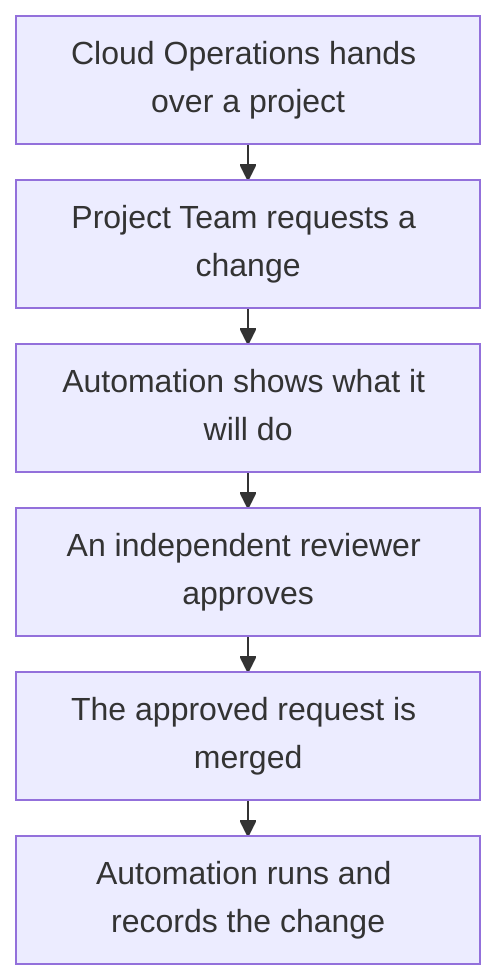

# How the Control Plane works

When each cloud has its own tools and steps, teams have to relearn how to ask for a change. Reviewers have to look in different places to see what will happen and whether it worked. The Multi-Cloud Control Plane (MCCP) gives teams one way to request a change, get it reviewed and find the result.

MCCP is a reference implementation that customers can install on their existing cloud foundation. Cloud Operations connects the foundation references, cloud access, state storage and trusted runners. Project Teams can then start with the included catalog and request changes within their approved scope.

## One process across clouds

Imagine two teams need a database. One chooses a private Autonomous Database in Oracle Cloud Infrastructure (OCI). The other chooses an Autonomous Database on Azure. Each team picks an approved option from the catalog and opens its own request. Both teams can see what is planned, who approved it and what happened in GitHub.

The [capability matrix](support.md) shows the current coverage: resources in OCI, Azure and Google Cloud, plus selected OCI operations. Customers can extend the reference for their needs. AWS is one possible future integration; Cloud Operations would first need to implement and review its delivery path.

## Governed request flow

- **Cloud Operations** prepares the project, the approved options and the automation with cloud access.
- **Project Team** chooses an approved option and submits it as a pull request, a proposed change in GitHub.
- **The reviewer** checks the proposal and what the automation plans to do. Merging adds the approved change to the project repository so the automation can run it.

## Where to go next

- **See what you can request.** [Reference capabilities](support.md)
- **Make your first request.** [Project Team guide](../usage/README.md)
- **Set up MCCP.** [Installation runbook](../installation/installation-runbook.md)
- **Add a resource, operation or cloud integration.** [Extending MCCP](architecture-details.md#extension-model)

## Technical reference

- [Repositories and environments](architecture-details.md#repository-model)
- [Execution and trust](architecture-details.md#execution-and-trust-boundary)
- [Cloud Operations and Project Team boundaries](architecture-details.md#target-operating-model)
- [Extending MCCP](architecture-details.md#extension-model)
- [Security and GitHub controls](security.md)
