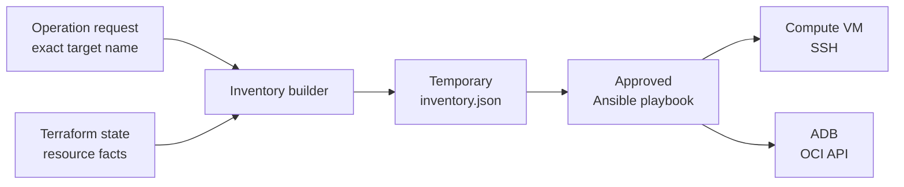

# Platform CI

This Cloud Operations-owned repository contains the reusable GitHub Actions workflows that validate and execute reviewed project changes. Project repositories call its Cloud Operations-controlled `main` branch with GitHub's scoped temporary token; they do not need a deploy key or personal access token for Platform CI.

## Published workflows

| Workflow | Purpose |
| --- | --- |
| `.github/workflows/terraform-shared.yaml` | Validate and plan resource requests on pull requests; after merge, plan again against current state and apply that plan |
| `.github/workflows/ansible-shared.yaml` | Check supported lifecycle requests on pull requests; execute them after merge |

The workflows receive an explicit cloud, environment, region, runner boundary, state location, manifest reference, and pinned orchestrator revision from the project caller.

## Runner contract

Use a trusted Linux self-hosted runner with:

- Git, `jq`, `rg`, and Python 3.11, available as `python3.11`, with `pip`.
- Outbound HTTPS access to install the pinned Terraform 1.12.1 runtime.
- OCI CLI on `PATH`, with OCI Instance Principal access to the state bucket and, when required, the approved project/environment Vault secrets.
- `STATE_NAMESPACE`, `STATE_REGION`, and `OCI_CLI_AUTH=instance_principal` in the runner environment.
- The target-cloud authentication required by each enabled profile.

Azure needs `ARM_CLIENT_ID`, `ARM_TENANT_ID`, and `ARM_SUBSCRIPTION_ID`. For Terraform certificate authentication, set `ARM_CLIENT_CERTIFICATE_PATH` to a protected PKCS#12/PFX file and, when encrypted, supply `ARM_CLIENT_CERTIFICATE_PASSWORD` through the runner service environment. Certificate mode uses AzureRM directly, disables CLI fallback, clears a legacy client secret for the job, and fails if the file is missing or unreadable. It does not require Azure CLI or a cached CLI session. Existing installations may continue using Azure CLI and `ARM_CLIENT_SECRET` instead. Azure CLI certificate-login preflight is a separate operator check using the PEM file with `az login --service-principal --username "$ARM_CLIENT_ID" --certificate /protected/path/certificate.pem --tenant "$ARM_TENANT_ID"`; the PEM and PFX contain private keys and must stay outside Git with restrictive permissions. Google needs `GOOGLE_CREDENTIALS`, `GOOGLE_APPLICATION_CREDENTIALS`, or Application Default Credentials. Keep all credential values outside Git.

The reference can share one trusted runner and OCI identity across the approved dev project repositories. Resolver and execution jobs can use that same host. Scope its permissions to the approved dev state, workloads, and Vault secrets; do not claim per-project IAM isolation on a shared identity. Restrict runner access to the approved repositories and keep production on a separate identity and host. Labels route jobs; they do not isolate permissions. Keep the existing separate non-production/production SSH keys. Separate project/environment instances are an optional stronger boundary, not a Vault prerequisite.

## Terraform contract

State is isolated by GitHub repository, cloud, environment, and region in OCI Object Storage. The selected region comes from the changed `{cloud}/{environment}/{region}/` path.

OCI ADB uses the native `admin_password_secret_id` field with a distinct Vault secret OCID per database in the deployment region. The module reads `CURRENT` using Instance Principal. Google ADB retains its provider-native `properties.secret_id` reference. Both use native secret references.

Azure ADB uses the same project-facing `admin_password_secret_id` field as OCI. `prepare_var_files.py` validates all metadata against handoff 5 at the trusted revision, uses its OCI region and then reads `CURRENT` with OCI CLI Instance Principal. Access is controlled by the runner's existing OCI IAM permissions, with no per-project mapping file, per-secret binding or additional onboarding registration. Only the private temporary var-file receives `admin_password`; the checked-out manifest stays unchanged and the secret-reference field is removed from that temporary copy. The Azure adapter and upstream module remain unchanged. Azure ADB passwords and runtime tokens are rejected, with no compatibility fallback. Requests without Azure ADB entries make no secret lookup. A shared runner identity does not provide per-project IAM isolation; use separate scoped identities if that boundary is required.

Azure and Google VM manifests contain the approved SSH public key directly. `prepare_var_files.py <config-dir> <output-dir> <environment> <cloud> <region>` rejects every unresolved placeholder and does not read runtime binding files or secret-value environment bundles. Existing token-based manifests must be rendered before their next request. Passwords and private keys stay outside Git.

Prepared JSON lives in a unique private job directory with file mode `0600`; the checked-out manifests are unchanged. Unresolved placeholders and missing, empty or invalid Azure secret content fail closed. Decoded Azure ADB passwords and their Base64 representation are masked with escaped Actions commands. Native Vault data sources are not assumed to mask their Base64 content: raw plan/apply diagnostics are kept private, and managed-resource addresses/actions and changed top-level attribute names are published; values and nested tag keys stay private. The manifest diff supplies declared settings; it does not establish resolved defaults or previous cloud values. The public report is an action-and-attribute review, not a full before/after configuration diff. Failed plans and applies publish their exit code and possible cause categories from a fixed list, never provider text. An unclassified failure remains a failure. Binary plans, plan JSON and var-files are sensitive and are deleted with the disposable orchestrator checkout after success or failure. Abrupt runner loss requires operator cleanup before reuse.

Terraform does not deep-merge repeated root variables. Keep each root configuration in one regional file, including OCI project NSGs in `oci/{environment}/{region}/network/project-nsgs.json` and Google ADB-S resources in `gcp/{environment}/{region}/workloads/adb.json`.

## Ansible contract

The workflow accepts only explicitly supported operation types and maps each one to an allow-listed playbook. Project input cannot select a playbook path or Ansible tag. The supplied operations are:

- OCI Autonomous Database start or stop.
- OCI Compute `deploy-agent` over SSH, a worked example that writes an installation marker rather than installing third-party software.

Lifecycle operation manifests belong under `oci/{environment}/{region}/lifecycle_operations/{operation}.json`. Operations must resolve an exact display name in Terraform state. Azure and Google Cloud lifecycle operations are not available.

The shared Ansible workflow queues jobs for each project, cloud, and environment. Before running an approved ADB start or stop, it checks the current project `main`. Execution stops if the request was edited or cleared after approval, or if a later request targeted any of the same ADBs in that region. This check also applies when the job is rerun. Changes outside that scope do not make the request stale.

Each operation playbook uses explicit `precheck`, `apply`, and `verify` phases. Common tasks live under `ansible/playbooks/common/oci/<operation>/`.

### Terraform state as dynamic inventory

The operation request supplies the exact display names to target. Platform CI reads the Terraform state for the same project, cloud, environment, and region, selects only matching resources, and writes a temporary Ansible inventory on the trusted runner. The state is read-only, and the generated inventory is not committed to Git.

Compute inventory entries use the state-backed private IP for SSH. ADB inventory entries use the state-backed OCID with the OCI Ansible collection running on the trusted runner. The operation stops before execution when a target cannot be resolved or required connection data is missing.

For `deploy-agent`, the action downloads the Terraform state object at `<bucket>/<owner>/<project>/<cloud>/<environment>/<region>/terraform.tfstate`, indexes `oci_core_instance` resources by exact `display_name`, selects only the manifest targets, and writes `$WORK_TEMP/inventory.json`. Each selected host receives its state-backed private IP and OCID plus the validated agent type and version. The state is read-only and is never modified by Ansible.

The default SSH user is `opc` and the default private key is `/home/github-runner/.ssh/oci_vm_key`. Cloud Operations creates and protects this key for the `github-runner` service account; project repositories never contain it. Override the defaults with `COMPUTE_ANSIBLE_USER` and `COMPUTE_SSH_PRIVATE_KEY_FILE` on the runner. Verify SSH host trust and protect the private key.

## Change boundary

When you add a step, pass values in through `env:` and reference them as shell variables, using the same constrained-input boundary as the existing actions. Interpolating `${{ }}` into a `run:` body works only while every input stays constrained by the caller, and a new step is exactly where that stops being true. Read files through `sys.argv`, never by interpolating a path into Python source. Assign a command substitution to a variable before parsing it: `read` from an empty here-string succeeds with empty values and swallows the failure.

Do not add a generic task runner, accept executable paths from project input, or enable a resource or operation by changing only this repository. An extension must update the catalog, validation, execution mapping, permissions, and documentation together. See the canonical [extension model](https://github.com/oracle-devrel/technology-engineering/blob/main/oci-and-db/foundation/operations-advisory/multi-cloud-operating-models/multi-cloud-control-plane/docs/reference/architecture.md#extension-model).

## License

Copyright (c) 2026 Oracle and/or its affiliates. Licensed under the Universal Permissive License, Version 1.0. See [LICENSE](LICENSE).

The shared workload Vault belongs to environment security. Each project owns its AES-256 HSM key and secrets in Database; the key OCID is a reference and key material remains in HSM. Project Team prepares each database's independent secret using the handoff references, through separately confirmed Codex preparation or its approved manual process. The manifest keeps the same `admin_password_secret_id` field. The optional UI requires an existing secret OCID. Platform CI validates these references independently of how the secrets were prepared.

Platform CI checks all ADB secret metadata before reading any value, initializing Terraform or accessing its backend. The authorization handoff is `environments/<environment>/environment_information.md` from the immutable PR base for plan and merged commit for apply. The request branch cannot replace that authorization. Compartment, Vault, key, OCI region and ACTIVE state must all match; query failures stop the run. OCI retains the native secret OCID; Azure resolves `CURRENT` into private temporary variables only after all references pass. Azure location does not select the OCI Vault region. There are no additional project scope files or bindings.

These checks protect the governed workflow. They do not create IAM isolation between executions using the shared runner identity. Keep secret values, raw Terraform diagnostics and private temporary variables out of Git and PR comments. CloudOps retains the Vault during project retirement and manually completes project-secret and key removal first.
