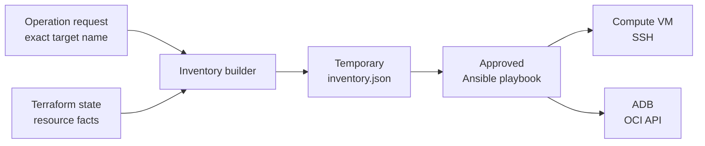

# Platform CI

Platform CI checks project requests before merge and executes approved changes afterward. Cloud Operations maintains the reusable workflows. Project repositories call its controlled `main` branch with GitHub's scoped temporary token.

## Published workflows

| Workflow | Purpose |
| --- | --- |
| `.github/workflows/terraform-shared.yaml` | Validate and plan before merge. After merge, plan against current state and apply that plan. |
| `.github/workflows/ansible-shared.yaml` | Check supported operations before merge and execute them after merge. |

Both workflows receive the cloud, environment, runner labels, state bucket and validated manifest revision from the project caller. Terraform also receives the region and pinned orchestrator revision. Ansible receives the operation file path and reads the region from it.

## Runner contract

Use a trusted Linux self-hosted runner with:

- Git, `jq`, `rg`, and Python 3.11, available as `python3.11`, with `pip`.
- Outbound HTTPS access to install the pinned Terraform 1.12.1 runtime.
- OCI CLI on `PATH`, with OCI Instance Principal access to the state bucket and, when required, the approved project/environment Vault secrets.
- `STATE_NAMESPACE`, `STATE_REGION`, and `OCI_CLI_AUTH=instance_principal` in the runner environment.
- The target-cloud authentication required by each enabled profile.

| Cloud | Runner settings |
| --- | --- |
| OCI | Instance Principal permissions for the approved workloads and Vault scope. |
| Azure | `ARM_CLIENT_ID`, `ARM_TENANT_ID`, `ARM_SUBSCRIPTION_ID` and `ARM_CLIENT_CERTIFICATE_PATH` to a protected PFX. Set `ARM_CLIENT_CERTIFICATE_PASSWORD` when encrypted. |
| Google Cloud | `GOOGLE_CREDENTIALS`, `GOOGLE_APPLICATION_CREDENTIALS` or Application Default Credentials. |

Azure certificate mode uses AzureRM directly. It disables CLI fallback, clears a legacy client secret for the job and fails if the PFX is missing or unreadable. Existing Azure CLI and `ARM_CLIENT_SECRET` deployments remain supported. For a separate operator CLI preflight, use `az login --service-principal --username "$ARM_CLIENT_ID" --certificate /protected/path/certificate.pem --tenant "$ARM_TENANT_ID"`. Keep PEM and PFX files private, with restricted access.

Restrict trusted runners to their approved repositories. Resolver and execution jobs can share a dev host, and workloads on that host share its cloud identity. Runner labels route jobs. Separate identities establish separate IAM boundaries. Use separate production hosts, identities and SSH keys.

## Terraform contract

State in OCI Object Storage is separate by repository, cloud, environment and region. The changed `{cloud}/{environment}/{region}/` path selects the deployment scope. Keep each Terraform root configuration in one regional file, including OCI project NSGs in `oci/{environment}/{region}/network/project-nsgs.json` and Google ADB-S in `gcp/{environment}/{region}/workloads/adb.json`.

### Prepare variables and secrets

`prepare_var_files.py <config-dir> <output-dir> <environment> <cloud> <region>` prepares private copies and rejects unresolved placeholders. Azure and Google Cloud VM manifests contain approved SSH public keys. Workload passwords use native references.

| Request | Secret handling |
| --- | --- |
| OCI ADB | Use a dedicated Vault secret OCID in `admin_password_secret_id`. The module reads `CURRENT` using Instance Principal. |
| Azure ADB | Use the same field. Platform CI reads `CURRENT` with OCI CLI Instance Principal in the handoff's OCI region. The private variable file gets `admin_password` and omits the reference field. |
| Google Cloud ADB | Use the native `properties.secret_id` reference. |

For OCI and Azure ADB, Platform CI checks every secret against handoff 5 at `environments/<environment>/environment_information.md` from the immutable PR base for plan or the merged commit for apply. Compartment, Vault, project HSM key, OCI region and ACTIVE state must match before content access, Terraform init or backend access. Query errors stop the run. Azure reads secret content only when the request includes Azure ADB entries and all metadata checks pass. Keep passwords, legacy tokens and per-secret bindings out of manifests.

### Review output and cleanup

Prepared JSON is written to a unique job directory with file mode `0600`. The original manifests stay intact. Missing, empty or invalid Azure secret content stops the job. Azure passwords and their Base64 values are masked in GitHub Actions. Treat raw diagnostics, binary plans, plan JSON, state and variable files as sensitive.

The PR report shows resource addresses, actions and changed top-level attribute names. Values and nested tag keys stay private. Use the manifest diff for declared settings. Failures report an exit code and fixed diagnostic categories, with provider output kept private. The job removes its private workspace and temporary files at the end, including on failure. Check for leftover files after abrupt runner loss before reuse.

## Ansible contract

The workflow accepts only explicitly supported operation types and maps each one to an allow-listed playbook. Project input cannot select a playbook path or Ansible tag. The supplied operations are:

- OCI Autonomous Database start or stop.
- OCI Compute `deploy-agent` over SSH, a worked example that writes an installation marker rather than installing third-party software.

Lifecycle operation manifests belong under `oci/{environment}/{region}/lifecycle_operations/{operation}.json`. Operations must resolve an exact display name in Terraform state. Azure and Google Cloud lifecycle operations are not available.

The shared Ansible workflow queues jobs for each project, cloud, and environment. Before running an approved ADB start or stop, it checks the current project `main`. Execution stops if the request was edited or cleared after approval, or if a later request targeted any of the same ADBs in that region. This check also applies when the job is rerun. Changes outside that scope do not make the request stale.

Each operation playbook uses explicit `precheck`, `apply`, and `verify` phases. Common tasks live under `ansible/playbooks/common/oci/<operation>/`.

### Terraform state as dynamic inventory

The operation request supplies the exact display names to target. Platform CI reads the Terraform state for the same project, cloud, environment, and region, selects only matching resources, and writes a temporary Ansible inventory on the trusted runner. The state is read-only, and the generated inventory is not committed to Git.

Compute inventory entries use the state-backed private IP for SSH. ADB inventory entries use the state-backed OCID with the OCI Ansible collection running on the trusted runner. The operation stops before execution when a target cannot be resolved or required connection data is missing.

For `deploy-agent`, the action downloads the Terraform state object at `<bucket>/<owner>/<project>/<cloud>/<environment>/<region>/terraform.tfstate`, indexes `oci_core_instance` resources by exact `display_name`, selects only the manifest targets, and writes `$WORK_TEMP/inventory.json`. Each selected host receives its state-backed private IP and OCID plus the validated agent type and version. The state is read-only and is never modified by Ansible.

The default SSH user is `opc` and the default private key is `/home/github-runner/.ssh/oci_vm_key`. Cloud Operations creates and protects this key for the `github-runner` service account; project repositories never contain it. Override the defaults with `COMPUTE_ANSIBLE_USER` and `COMPUTE_SSH_PRIVATE_KEY_FILE` on the runner. Verify SSH host trust and protect the private key.

## Change boundary

When you add a step, pass values in through `env:` and reference them as shell variables, using the same constrained-input boundary as the existing actions. Interpolating `${{ }}` into a `run:` body works only while every input stays constrained by the caller, and a new step is exactly where that stops being true. Read files through `sys.argv`, never by interpolating a path into Python source. Assign a command substitution to a variable before parsing it: `read` from an empty here-string succeeds with empty values and swallows the failure.

Add new resources and operations through the full reviewed chain of catalog, validation, execution mapping, permissions and documentation. Use explicit platform-owned mappings for executable code. [Extension model](https://github.com/oracle-devrel/technology-engineering/blob/main/oci-and-db/foundation/operations-advisory/multi-cloud-operating-models/multi-cloud-control-plane/docs/reference/architecture.md#extension-model)

## License

Copyright (c) 2026 Oracle and/or its affiliates. Licensed under the Universal Permissive License, Version 1.0. See [LICENSE](LICENSE).
