<div align="center">

# Deploying Red Hat OpenShift on OCI<br/>using the Agent-Based Installer

**Build an OpenShift cluster on Oracle Cloud Infrastructure: containers and VMs on one platform.**

`Red Hat OpenShift` · `Oracle Cloud Infrastructure` · `Agent-Based Installer` · `Terraform` · `Resource Manager`

</div>

---

## 📑 Table of Contents

- [Overview](#-overview)
- [Architecture](#%EF%B8%8F-architecture)
- [Before We Begin](#-before-we-begin)
- [The Journey at a Glance](#%EF%B8%8F-the-journey-at-a-glance)
- [Step 1: Create the Tag Namespace](#%EF%B8%8F-step-1--create-the-tag-namespace)
- [Step 2: Create the OpenShift Cluster Stack](#%EF%B8%8F-step-2--create-the-openshift-cluster-stack)
- [Step 3: Prepare the ISO](#-step-3--prepare-the-iso)
- [Step 4: Deploy the Cluster](#-step-4--deploy-the-cluster)
- [Wrapping Up](#-wrapping-up)

---

## 🌟 Overview

**Red Hat OpenShift** is an enterprise-grade Kubernetes platform. It lets organizations build, deploy and manage **both containerized applications and virtual machines** on one platform.

OpenShift is **officially certified on Oracle Cloud Infrastructure (OCI)**. It is fully supported and optimized for OCI's high-performance virtual machine and bare metal shapes. You also get native OCI integrations:

| 🔌 Integration | 💡 What it gives you |
|---|---|
| **Block Storage** | Persistent volumes for your workloads |
| **Load Balancer** | Highly available API and application ingress |
| **Object Storage** | Storage for installation images and artifacts |
| **Identity Services** | Enterprise-grade access control and security |
| **File Storage** | Use the OCI CSI Driver to dynamically provision and mount OCI File Storage (FSS)

Running OpenShift on OCI gives you a **consistent hybrid and multi-cloud experience**. You can modernize applications, bring legacy VMs onto the same platform and move faster.

> 🎯 **What you'll build:** This tutorial walks through architecture, networking, storage, installation and the key configuration steps. By the end, you'll have a **working OpenShift cluster on Oracle Cloud** that runs both containers and VMs. OpenShift VM's are supported on BareMetal worker nodes only.

---

## 🏗️ Architecture

The deployment consists of:

- 🧠 **3 × Control Plane (Master) nodes**, spread across availability domains
- ⚙️ **3 × Compute (Worker) nodes**, on VM or Bare Metal shapes (spread across availability domains)
- 🖥️ **A Management / Web Server host** in the public subnet
- ⚖️ **Internal and External Load Balancers**
- 💾 **OCI Block Volume** for storage

> 💡 **Plan ahead:** Decide on your **compartment structure**, **VCN CIDR range** and **where each component will sit** before you start. Changing these later is much harder than getting them right up front.

<p align="center">
  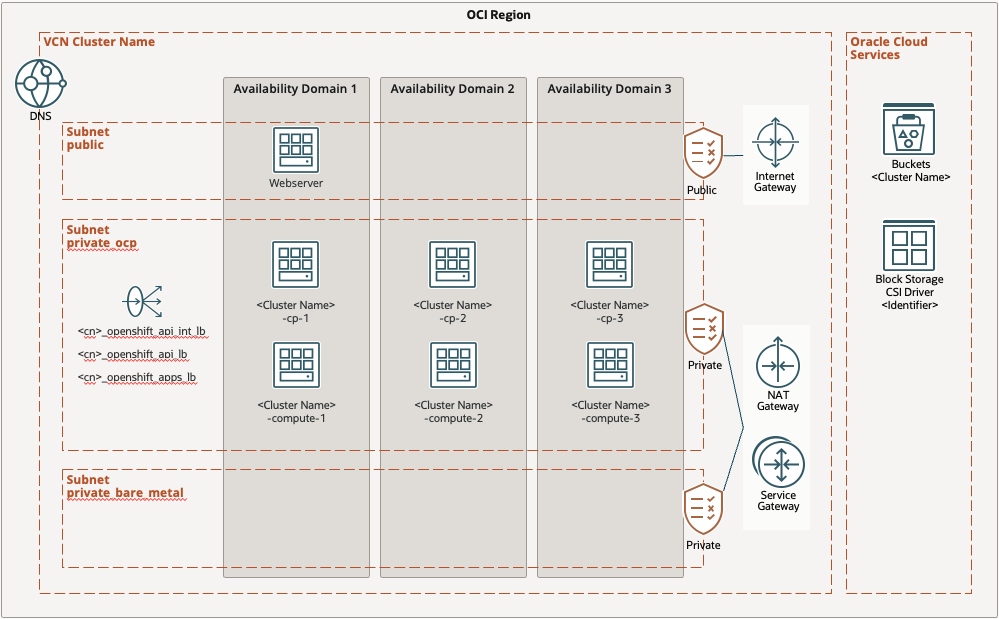
  <br/><em>Figure 1: Reference architecture for OpenShift on OCI (Agent-Based)</em>
</p>

---

## ✅ Before We Begin

Make sure you have the following:

- [ ] 🟥 An active **Red Hat account**
- [ ] ☁️ Access to the **OCI Console** with the right privileges. See the [Oracle documentation](https://docs.oracle.com/en-us/iaas/Content/openshift-on-oci/install-prereq.htm#install-prereq-account)
- [ ] 🔑 An **SSH key pair**
- [ ] 🌐 A **domain name**
- [ ] 📁 A decision on **which compartment(s)** to deploy into

> 📝 **In this walkthrough**, everything is deployed in a single compartment called **`vaibhav-demo`**. You can split resources across several compartments if your organization needs to.

---

## 🗺️ The Journey at a Glance

| Step | What we do | Where |
|:---:|---|---|
| **1** | 🏷️ Create the resource attribution **tag namespace** | OCI Resource Manager |
| **2** | 🛠️ Run the **OpenShift cluster stack** (web server, VCN, DNS, bucket settings) | OCI Console |
| **3** | 💿 **Generate the agent ISO** on the web server and upload it to Object Storage | Web Server + Object Storage |
| **4** | 🚀 **Deploy the cluster**, watch the install and validate it | OCI Console + Web Server + Red Hat Console |

---

## 🏷️ Step 1 – Create the Tag Namespace

OpenShift on OCI uses a set of **resource attribution tags**. We create them first with a small Terraform stack. We need to run this stack only once per tenancy, before deploying the first OpenShift cluster. For subsquent clusters, we do not need to run this stack again.

**1.** Go to the [oracle-quickstart/oci-openshift releases](https://github.com/oracle-quickstart/oci-openshift/releases) page and download the latest **resource attribution tag** package.

> ℹ️ At the time of writing, the latest version is **`create-resource-attribution-tags-v1.6.1.zip`**.

**2.** Click the file name to download it.

<p align="center">
  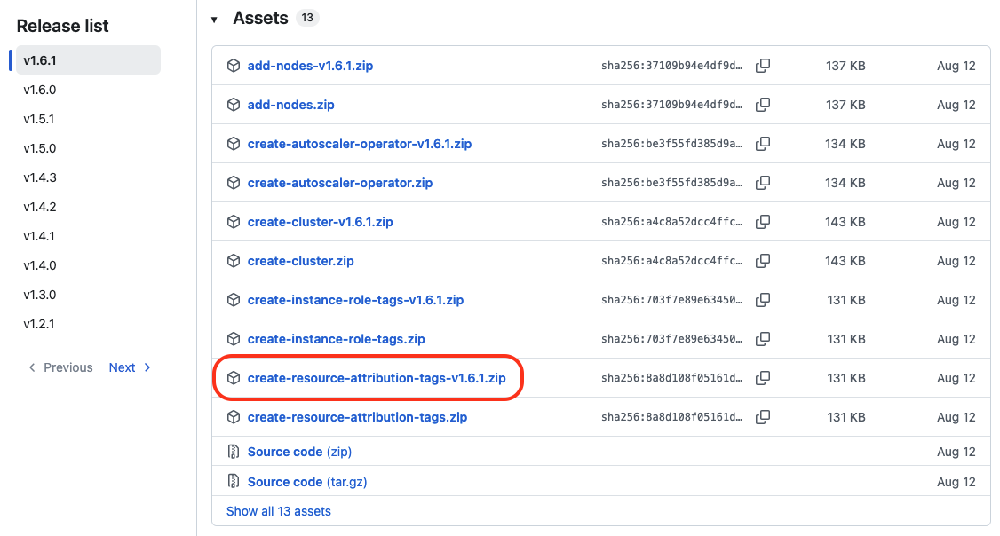
  <br/><em>Downloading the resource attribution Terraform stack</em>
</p>

**3.** Log in to your OCI tenancy. From the navigation menu, open **Developer Services** → **Resource Manager** → **Stacks**.

**4.** Click **Create stack**, select the zip file you just downloaded and click **Next**.

<p align="center">
  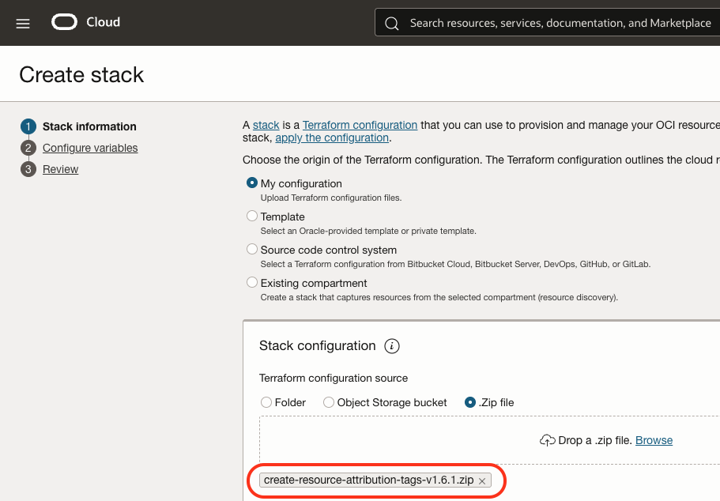
  <br/><em>Creating the stack from the downloaded zip</em>
</p>

**5.** Select your compartment (`vaibhav-demo` here) and click **Next**. Tick **Run apply** and click **Create**.

<p align="center">
  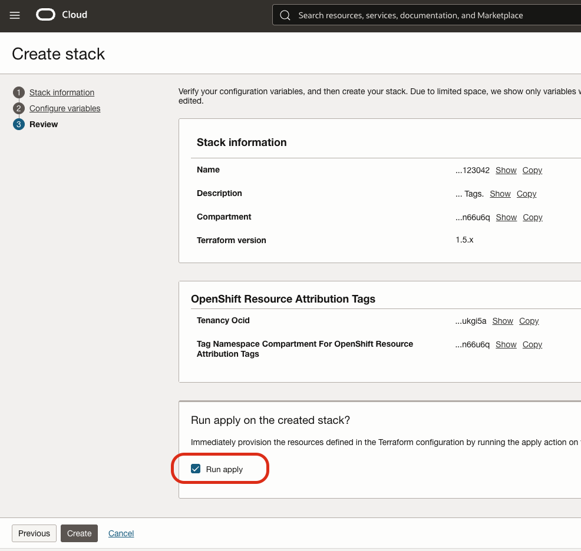
  <br/><em>Select the compartment and run apply</em>
</p>

**6.** When the stack job finishes, open **Governance & Administration** → **Tenancy Management** → **Tag Namespaces**.

**7.** Choose your compartment. You should see the **`openshift-tags`** namespace. ✅

<p align="center">
  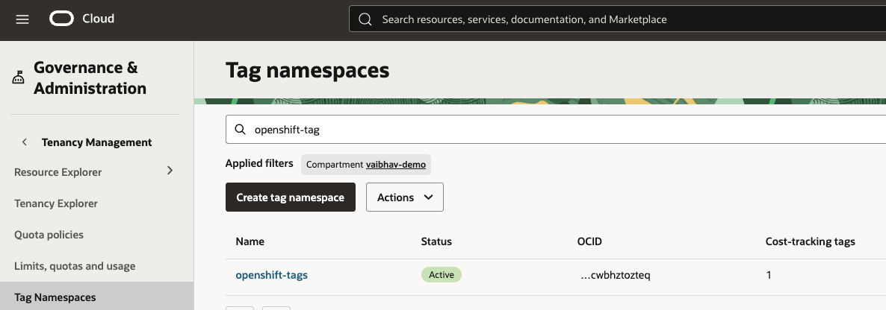
  <br/><em>The <code>openshift-tags</code> namespace is ready</em>
</p>

---

## 🛠️ Step 2 – Create the OpenShift Cluster Stack

### 🅰️ Create a Repository for the Oracle Cloud Agent *(Optional)*

**1.** In the OCI Console, open **Marketplace** → **All Applications**.

**2.** Search for **Cloud Agent** and click the Terraform stack.

**3.** Click **Export** on the far right.

<p align="center">
  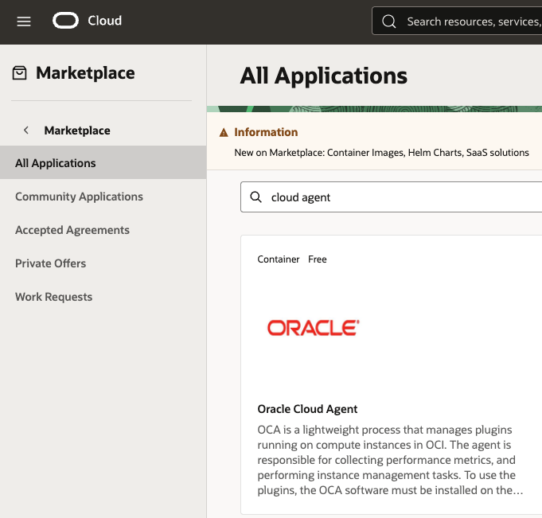
  &nbsp;&nbsp;
  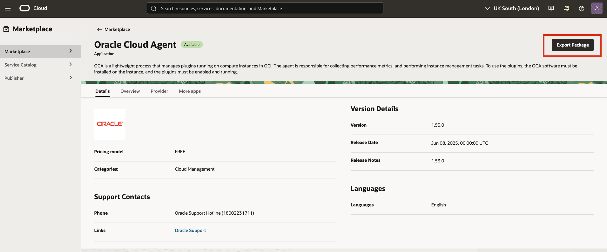
  <br/><em>Oracle Cloud Agent in the Marketplace (left) and its listing details (right)</em>
</p>

**4.** Choose your compartment and **create a new public repository**. Accept the terms and click **Export package** at the top right.

**5.** Check that the work request completes successfully.

<p align="center">
  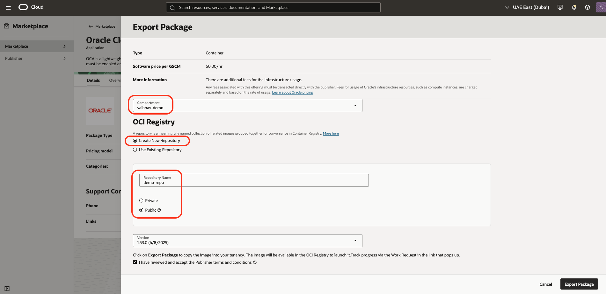
  &nbsp;&nbsp;
  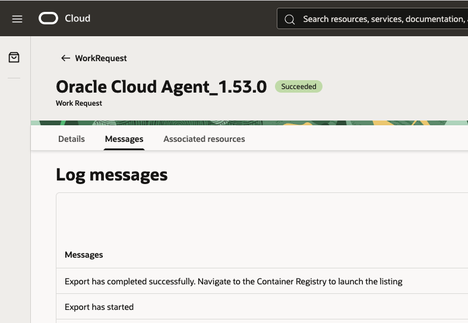
  <br/><em>Exporting the package (left) and the finished work request (right)</em>
</p>

### 🅱️ Run the Cluster Wizard

**1.** From the navigation menu, open **Developer Services** → **Red Hat OpenShift**.

<p align="center">
  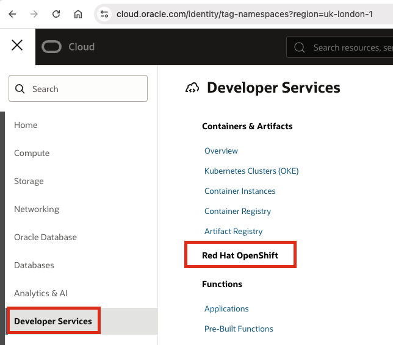
  <br/><em>Launching the Red Hat OpenShift wizard</em>
</p>

**2.** You'll be taken to a Terraform stack that starts the cluster deployment. Click **Next**.

**3.** Fill in the stack variables:

#### 🔧 Cluster basics

| | Setting | Value |
|:---:|---|---|
| a | **Compartment** | Your target compartment (`vaibhav-demo`) |
| b | **Cluster Name** | A DNS-compatible name, e.g. `tc-150` |
| c | **Installation Method** | `Agent-Based` |
| d | **Create OpenShift Image and Instances** | ☐ **Unchecked** for now |

<p align="center">
  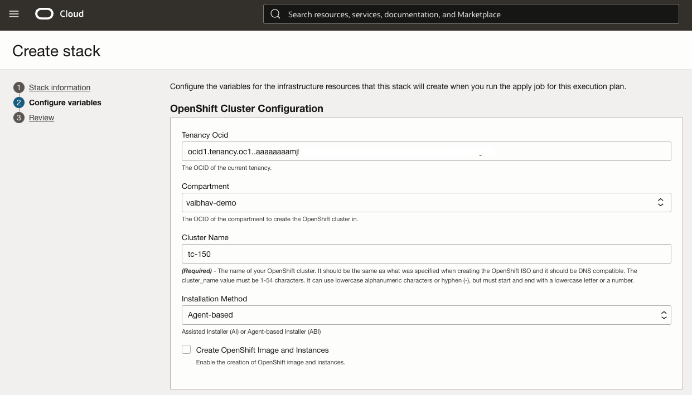
  <br/><em>Cluster basics: name, compartment and Agent-Based install method</em>
</p>

**e.** Select the compartment where you created the **resource attribution tag** in [Step 1](#%EF%B8%8F-step-1--create-the-tag-namespace).

<p align="center">
  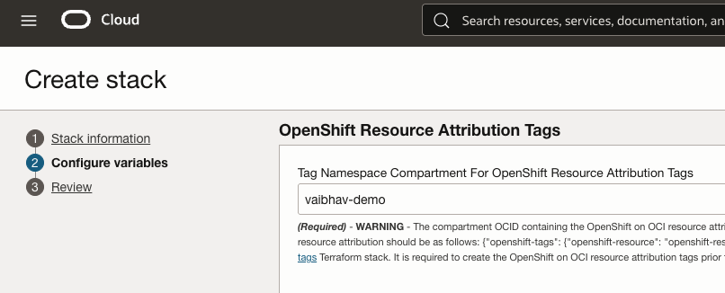
  <br/><em>Pointing the stack at the tag namespace compartment</em>
</p>

#### 🧭 Agent-based settings

**f.** Enter the **Rendezvous IP** and tick **Is Disconnected Agent-Based Installation**.

**g.** Tick **Set OpenShift Installer Version** and enter the version.

<p align="center">
  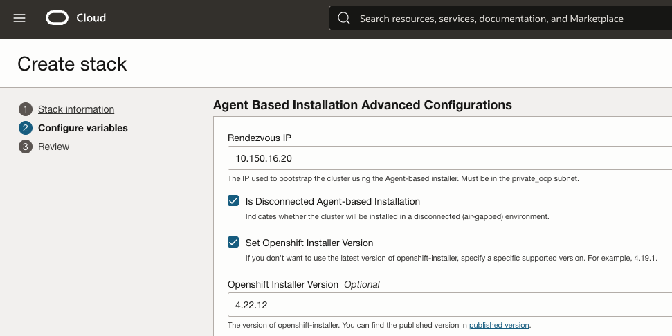
  <br/><em>Rendezvous IP and OpenShift installer version</em>
</p>

> 💡 **Tip: find the latest stable OpenShift version**
>
> **🐧 Linux / 🍎 macOS**
> ```bash
> curl -s https://mirror.openshift.com/pub/openshift-v4/clients/ocp/stable/release.txt | awk '/^Name:/{print $2}'
> ```
>
> **🪟 Windows (PowerShell)**
> ```powershell
> ((Invoke-RestMethod "https://mirror.openshift.com/pub/openshift-v4/clients/ocp/stable/release.txt") -split "`n" | Where-Object { $_ -match '^Name:' }) -replace 'Name:\s*',''
> ```

<p align="center">
  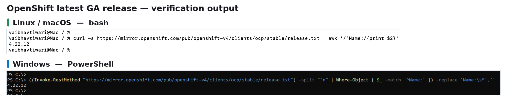
  <br/><em>Both commands return the current GA release</em>
</p>

**h.** Paste your **SSH public key** and then your **Red Hat pull secret**.

> 🔗 Get your pull secret here: **<https://console.redhat.com/openshift/install/pull-secret>**

**i.** **Create an OCI Object Storage bucket** yourself. Open the bucket, copy its **Namespace** and enter the bucket details in the stack.

<p align="center">
  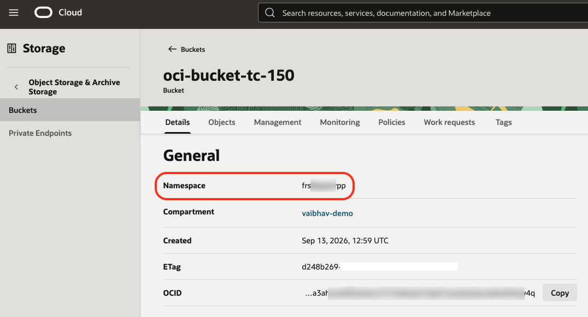
  &nbsp;&nbsp;
  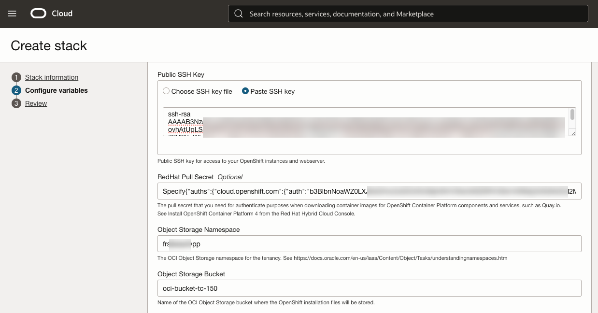
  <br/><em>Bucket namespace (left) entered into the stack (right)</em>
</p>

#### 🖥️ Web Server settings

**j.** Enter the web server's **IP address** and choose the **OCI shape**.

**k.** Pick the latest **Oracle Linux image** and set the **OCPUs** and **memory**.

<p align="center">
  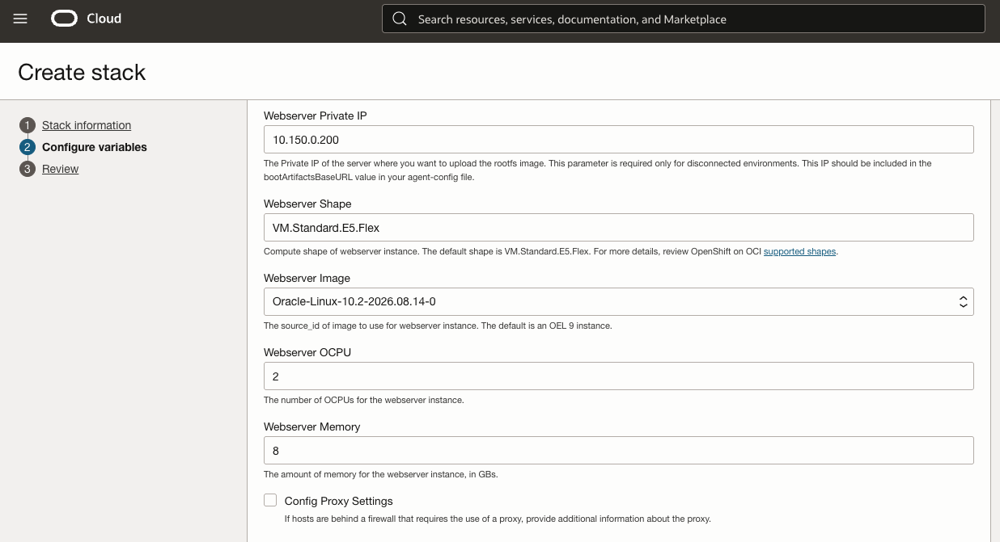
  <br/><em>Web server shape, image and sizing</em>
</p>

#### 🌐 Networking and DNS

- Leave **Auto-Scaling** ☐ **unchecked**
- Tick ☑ **Create Private DNS** and enter the **zone DNS name**

<p align="center">
  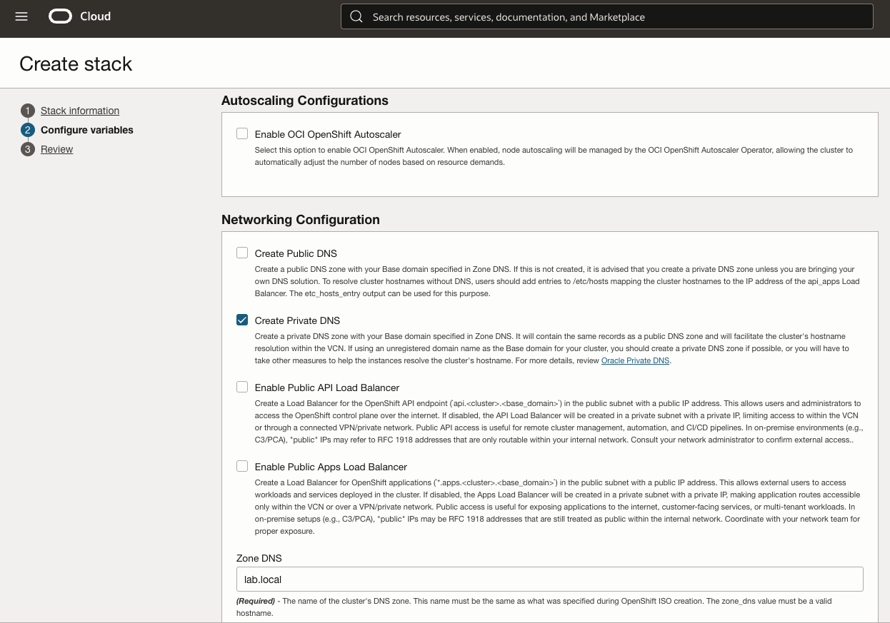
  <br/><em>Private DNS configuration</em>
</p>

- Enter the **VCN details** that the stack will create

<p align="center">
  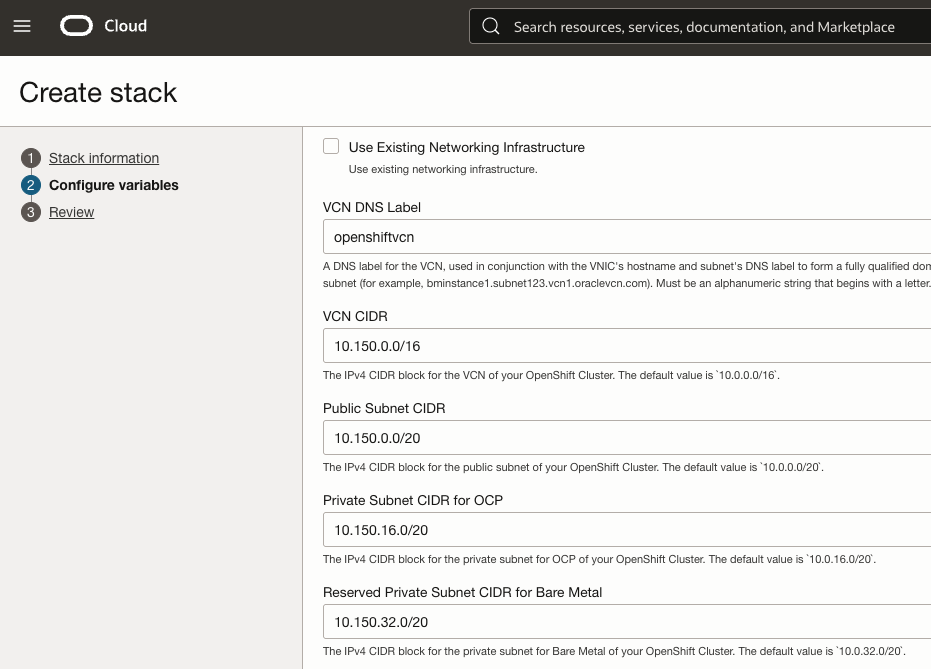
  <br/><em>VCN settings</em>
</p>

#### 🧩 Drivers and agent

- Choose the **CCM and CSI driver version** from the dropdown
- Enable the **Oracle Cloud Agent** and enter the **repository name** from [Part A](#%EF%B8%8F-create-a-repository-for-the-oracle-cloud-agent-optional)

<p align="center">
  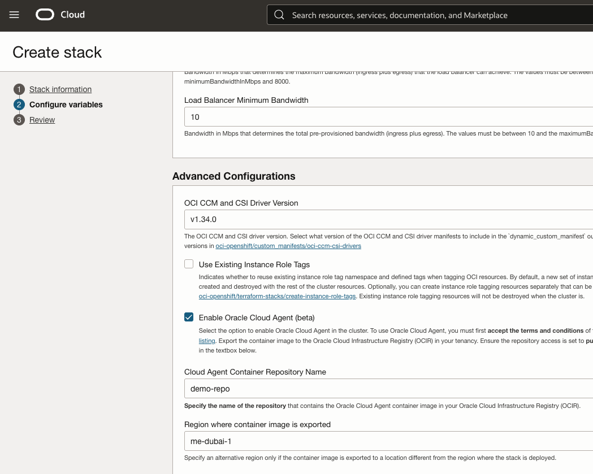
  <br/><em>CCM/CSI drivers and Oracle Cloud Agent</em>
</p>

#### ▶️ Review and apply

Review the details and click **Next**. Tick ☑ **Run apply** and click **Create**.

<p align="center">
  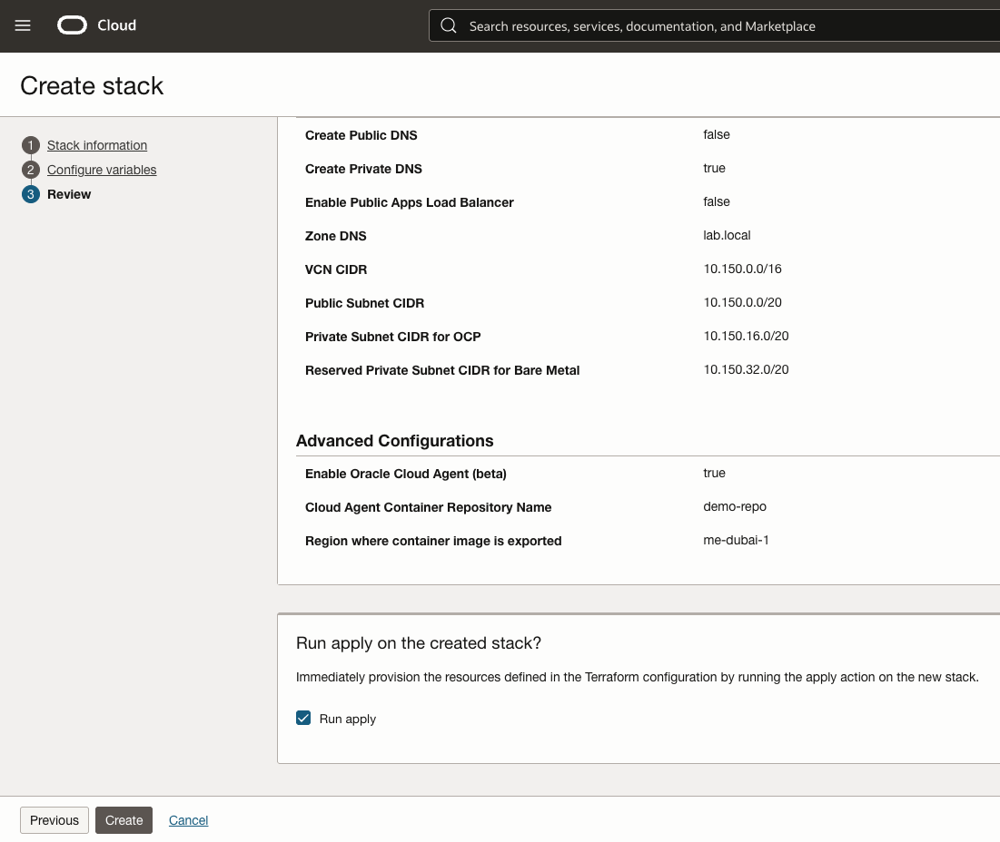
  <br/><em>Review, run apply and create</em>
</p>

---

## 💿 Step 3 – Prepare the ISO

When the Terraform stack from Step 2 finishes, it will have created a few resources. Let's check them and build the installation ISO.

**1.** The **web server** is up and has a **public IP** attached.

<p align="center">
  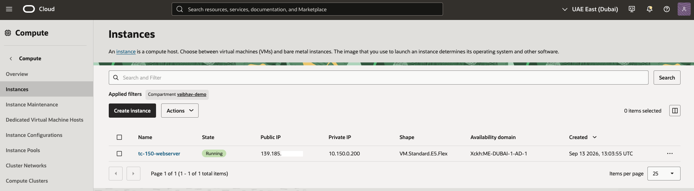
  <br/><em>Web server running with a public IP</em>
</p>

**2.** Open the **Object Storage bucket**. It should contain these generated files:

| 📄 File | Purpose |
|---|---|
| `agent-config.yaml` | Host and network settings for the agent-based installer |
| `install-config.yaml` | Cluster-wide installation settings |
| `dynamic-custom-manifest.yaml` | OCI-specific manifests (CCM/CSI and so on) |

<p align="center">
  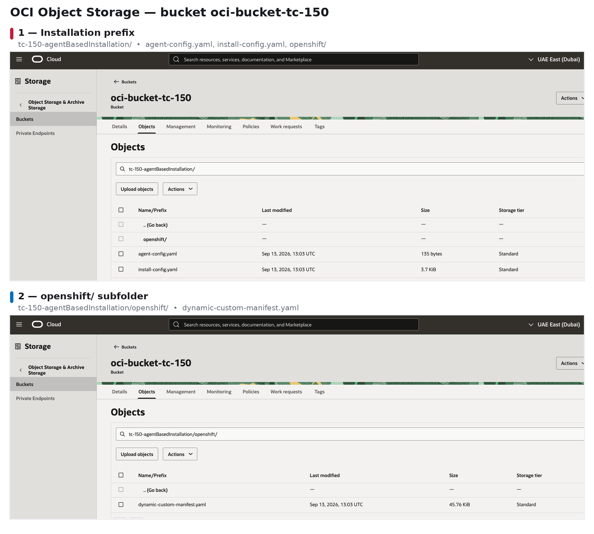
  <br/><em>Installation manifests in Object Storage</em>
</p>

**3.** **Copy the files to the web server.** Place `dynamic-custom-manifest.yaml` in an `openshift/` subfolder:

```text
/home/opc/tc-150-agentBasedInstallation/
├── agent-config.yaml
├── install-config.yaml
└── openshift/
    └── dynamic-custom-manifest.yaml
```

> 🛟 **Pro tip:** Keep a **backup copy** of this folder, as shown below. The installer **consumes (deletes)** these files when it builds the image.

<p align="center">
  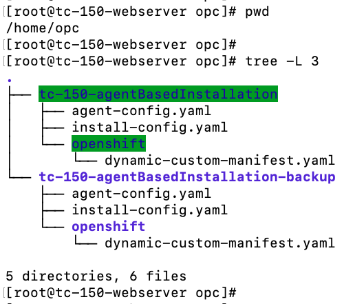
  <br/><em>Working folder and backup copy on the web server</em>
</p>

**4.** **Generate the agent ISO:**

```bash
openshift-install agent create image \
  --dir /home/opc/tc-150-agentBasedInstallation \
  --log-level info
```

<p align="center">
  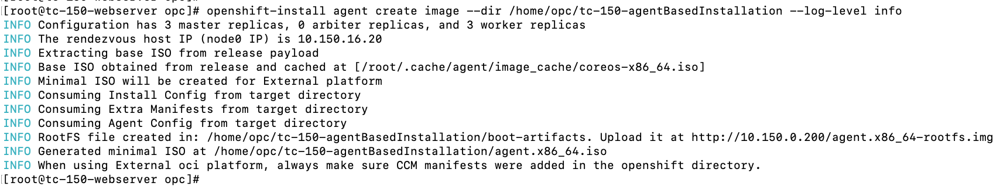
  <br/><em>Building the agent ISO and rootfs image</em>
</p>

**5.** **Check the generated assets.** You should see the ISO, the `rootfs` image, the `auth/` folder and the `rendezvousIP` file.

```text
.
├── agent.x86_64.iso              # 126M – boot ISO
├── auth/
│   ├── kubeadmin-password
│   └── kubeconfig
├── boot-artifacts/
│   └── agent.x86_64-rootfs.img   # 1.2G – served over HTTP
└── rendezvousIP
```

<p align="center">
  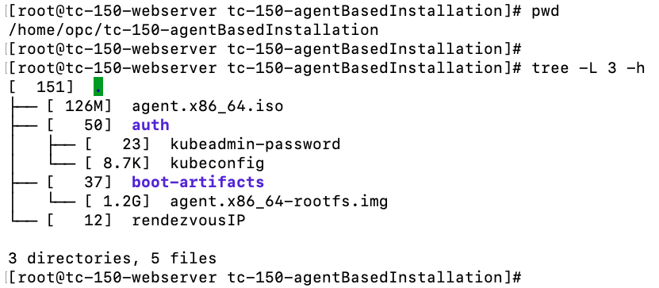
  <br/><em>Generated installation assets</em>
</p>

**6.** **Copy the rootfs image to the web root** so the nodes can download it while they boot:

```bash
cp /home/opc/tc-150-agentBasedInstallation/boot-artifacts/agent.x86_64-rootfs.img /var/www/html/
ls -lth /var/www/html/
```

<p align="center">
  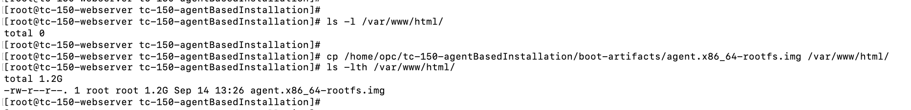
  <br/><em>rootfs image published to the web server</em>
</p>

**7.** **Check that the rootfs image is reachable.** You're looking for `HTTP/1.1 200 OK`:

```bash
curl -I http://10.150.0.200/agent.x86_64-rootfs.img
```

<p align="center">
  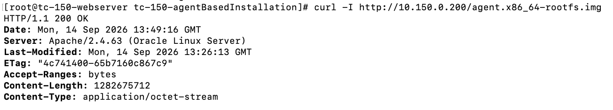
  <br/><em>HTTP 200: the image can be reached</em>
</p>

**8.** **Upload `agent.x86_64.iso` to OCI Object Storage** and create a **Pre-Authenticated Request (PAR)** link for it.

<p align="center">
  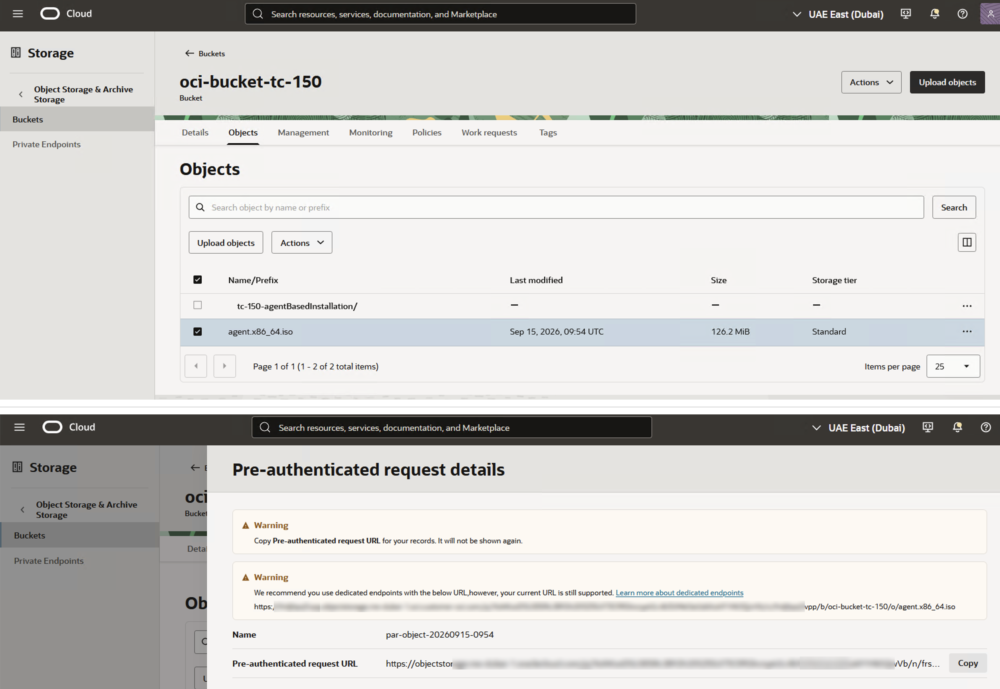
  <br/><em>ISO uploaded and PAR link created</em>
</p>

> ⚠️ **Treat the PAR URL like a secret.** Anyone with the link can download the ISO. Set a sensible expiry date.

---

## 🚀 Step 4 – Deploy the Cluster

Time for the main event. 🎉

**1.** **Edit the Terraform stack.** Now tick ☑ **Create OpenShift Image and Instances** and paste the **ISO PAR link** into **OpenShift Image Source URI**.

<p align="center">
  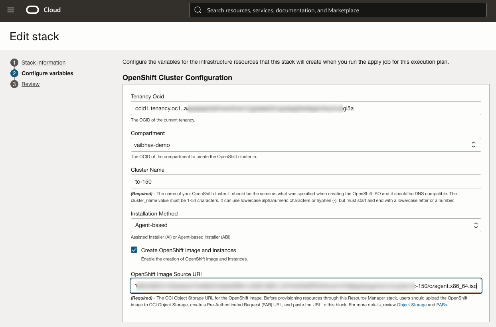
  <br/><em>Adding the ISO PAR URL to the stack</em>
</p>

**Before you apply, review the node sizing.** 🔍 Scroll further down the same **Edit stack** page to the **Control Plane Node Configuration** and **Compute Node Configuration** sections. This is where you decide exactly what gets deployed, so double-check these values against your requirements (and your tenancy's service limits) before clicking apply:

| Setting | Control plane nodes | Compute (worker) nodes |
|---|---|---|
| **Shape** | `VM.Standard.E5.Flex` | `VM.Standard.E5.Flex` |
| **Node count** | 3 | 3 |
| **OCPUs per node** | 4 | 6 |
| **Memory per node (GB)** | 24 | 32 |
| **Boot volume (GB)** | 1024 | 300 |
| **Boot volume VPUs/GB** | 100 | 30 |
| **Distribute across ADs** | ✅ | ✅ |

<p align="center">
  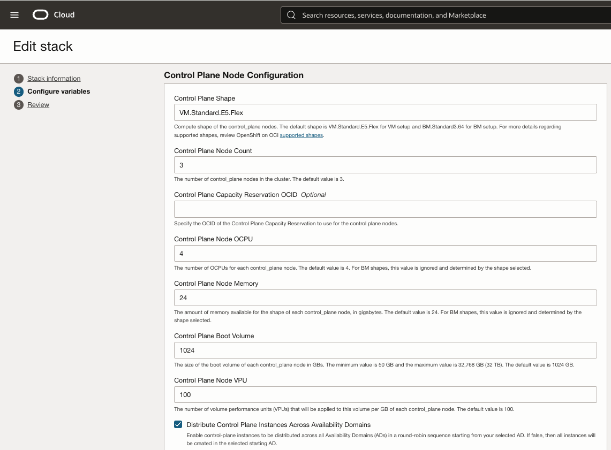
  <br/><em>Control plane node configuration – shape, count, OCPUs and memory</em>
</p>

<p align="center">
  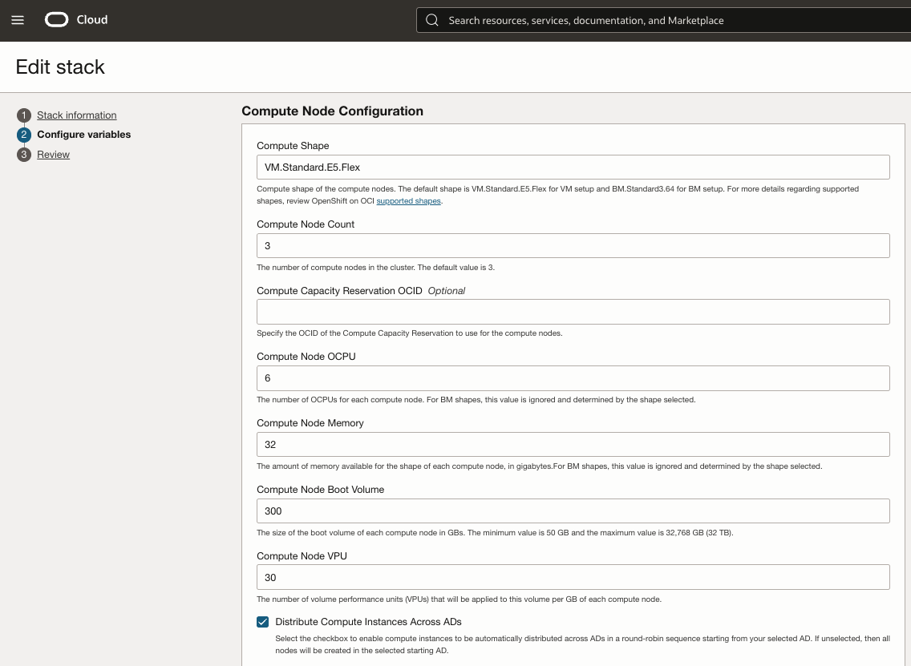
  <br/><em>Compute node configuration – shape, count, OCPUs and memory</em>
</p>

> 💡 **Tip:** The values above are the ones used in this walkthrough. Size them for your workload — for flex shapes you set OCPUs and memory yourself, while for bare-metal (BM) shapes these are ignored and determined by the shape. Make sure your tenancy has enough quota for the total OCPUs (here 3 × 4 + 3 × 6 = **30 OCPUs**), otherwise the apply job will fail.

Once you're happy with the configuration, **Save** and **apply** the stack.

**2.** **Watch the installation** from the web server:

```bash
# Wait for the bootstrap phase to finish
openshift-install agent wait-for bootstrap-complete \
  --dir /home/opc/tc-150-agentBasedInstallation

# Wait for the full installation to finish
openshift-install agent wait-for install-complete \
  --dir /home/opc/tc-150-agentBasedInstallation
```

<p align="center">
  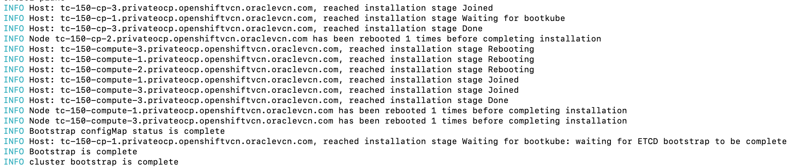
  <br/><em>Nodes join, reboot and finish bootstrap</em>
</p>

<p align="center">
  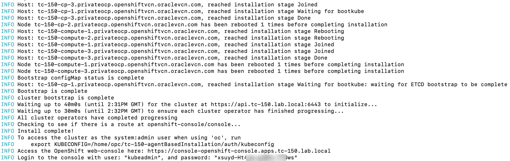
  <br/><em>🎉 <strong>Install complete!</strong> The console URL and kubeconfig path are printed at the end</em>
</p>

> 🔐 **Access the cluster:**
> ```bash
> export KUBECONFIG=/home/opc/tc-150-agentBasedInstallation/auth/kubeconfig
> oc get nodes
> oc get clusteroperators
> ```

**3.** **Check that all nodes and cluster operators are healthy.** ✅

<p align="center">
  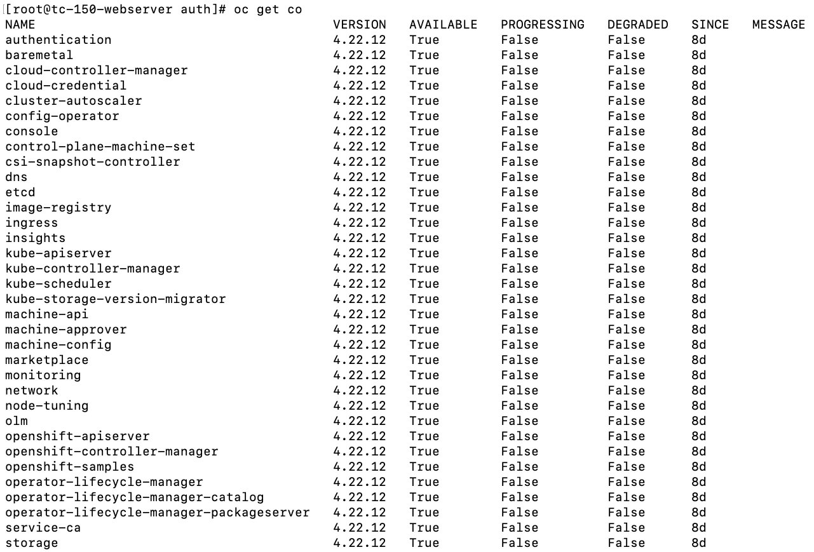
  <br/><em>All cluster operators are Available</em>
</p>

<p align="center">
  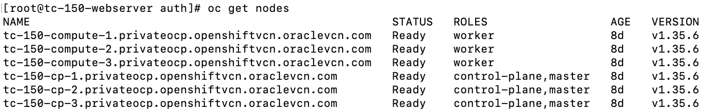
  <br/><em>All control plane and worker nodes are Ready</em>
</p>

**4.** The cluster also appears in the **Red Hat Hybrid Cloud Console**. 🟥

<p align="center">
  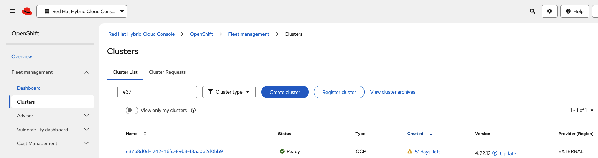
  <br/><em>Cluster registered in the Red Hat console</em>
</p>

---

## 🏁 Wrapping Up

🎊 **Congratulations!** You've deployed a **Red Hat OpenShift cluster on Oracle Cloud Infrastructure** with the **Agent-Based Installer**.

Here's what you did:

- ✅ Created the **resource attribution tag namespace**
- ✅ Provisioned the **web server, VCN, private DNS and load balancers** with Terraform
- ✅ Generated and published the **agent ISO and rootfs image**
- ✅ Brought up **3 control plane + 3 worker nodes** and confirmed the cluster is healthy

Your cluster is ready for **containerized apps**, **OpenShift Virtualization VMs** and everything in between. 🚀

---

## 🙌 Acknowledgments

| | Author | Role |
|:---:|---|---|
| ✍️ | **Gianluca Cecchi** | Oracle Virtualization BlackBelt |
| ✍️ | **Vaibhav Tiwari** | Oracle Virtualization BlackBelt |

<div align="center">

---

*Found this useful? Share it with your team!* ⭐

</div>
