<div align="center">

# Adding a Virtual Machine Worker Node to OpenShift on OCI<br/>(Agent-Based Installation, Day 2)

**Add a virtual machine (VM) worker node with its full FQDN to a running OpenShift cluster on Oracle Cloud Infrastructure.**

`Red Hat OpenShift` · `Oracle Cloud Infrastructure` · `Agent-Based Installer` · `Day-2 Operations` · `oc adm node-image`

</div>

---

## 📑 Table of Contents

- [Overview](#-overview)
- [Before We Begin](#-before-we-begin)
- [The Journey at a Glance](#%EF%B8%8F-the-journey-at-a-glance)
- [Step 1: Prepare the Web Server](#%EF%B8%8F-step-1--prepare-the-web-server)
- [Step 2: Export and Publish the Worker Ignition](#-step-2--export-and-publish-the-worker-ignition)
- [Step 3: Build and Upload the Node ISO](#-step-3--build-and-upload-the-node-iso)
- [Step 4: Import the ISO as a Custom Image](#%EF%B8%8F-step-4--import-the-iso-as-a-custom-image)
- [Step 5: Create the Worker Instance](#-step-5--create-the-worker-instance)
- [Step 6: Approve the Node and Validate](#-step-6--approve-the-node-and-validate)
- [Optional: Add the New Worker to the Apps Load Balancer](#%EF%B8%8F-optional-add-the-new-worker-to-the-apps-load-balancer)
- [Wrapping Up](#-wrapping-up)

---

## 🌟 Overview

In the [previous blog](https://github.com/oracle-devrel/technology-engineering/blob/main/oci-and-db/virtualization/openshift-on-oci/deploy-new-cluster-agent-based-method/index.md) we deployed Red Hat OpenShift on OCI with the **Agent-Based Installer**: 3 control plane nodes and 3 worker nodes. This post adds **one extra virtual machine (VM) worker node** to that running cluster. The node registers with its **full FQDN**, just like the original nodes.

> ⚠️ **Scope: virtual machines only.** This procedure is for **VM worker nodes** (for example `VM.Standard.E5.Flex`). It does **not** cover **bare metal (BM)** shapes. Bare metal workers boot and install differently (custom image capabilities, firmware and networking), so don't follow these steps for a BM node.

The flow is:

1. Export the worker **Ignition** config and serve it over HTTP.
2. Build a node ISO with **`oc adm node-image create`** and customize its kernel arguments.
3. Import the ISO into OCI as a **custom image**.
4. Launch an instance whose **name is the node's FQDN**.
5. **Approve** the node's certificates and validate.

Starting point: six nodes, all `Ready`, all with FQDN names.

```text
[root@tc-150-webserver day2]# oc get nodes
NAME                                                     STATUS   ROLES                  AGE   VERSION
tc-150-compute-1.privateocp.openshiftvcn.oraclevcn.com   Ready    worker                 16d   v1.35.6
tc-150-compute-2.privateocp.openshiftvcn.oraclevcn.com   Ready    worker                 16d   v1.35.6
tc-150-compute-3.privateocp.openshiftvcn.oraclevcn.com   Ready    worker                 16d   v1.35.6
tc-150-cp-1.privateocp.openshiftvcn.oraclevcn.com        Ready    control-plane,master   16d   v1.35.6
tc-150-cp-2.privateocp.openshiftvcn.oraclevcn.com        Ready    control-plane,master   16d   v1.35.6
tc-150-cp-3.privateocp.openshiftvcn.oraclevcn.com        Ready    control-plane,master   16d   v1.35.6
```

---

## ✅ Before We Begin

| Item | Value used in this walkthrough |
|---|---|
| **Cluster** | `tc-150` (3 control plane + 3 workers, v1.35.6) |
| **Web server / bastion** | `tc-150-webserver`, `10.150.0.200`, the same host used for the original install |
| **Working directory** | `/vaibhav/day2` |
| **Object Storage bucket** | `oci-bucket-tc-150` (compartment `vaibhav-demo`, UAE East / Dubai) |
| **New node** | `tc-150-compute-4.privateocp.openshiftvcn.oraclevcn.com` |
| **Node type** | **Virtual machine** (`VM.Standard.E5.Flex`). Not applicable to bare metal shapes |

You'll need:

- [ ] `oc` logged in to the cluster as **cluster-admin**
- [ ] The **OCI CLI**, or Console access, to upload objects, import custom images and create instances

> 🌐 **Network:** put the new node in the **same VCN and subnet as the existing workers** (`tc-150` / `private_ocp`). It must reach the web server on TCP 80 and `api-int` on TCP 22623 and 6443.

---

## 🗺️ The Journey at a Glance

| Step | What we do | Where |
|:---:|---|---|
| **1** | 🛠️ Check the web server and required tools | Web Server |
| **2** | 📄 Export the worker Ignition and publish it over HTTP | Web Server |
| **3** | 💿 Build and customize the node ISO, upload it | Web Server + Object Storage |
| **4** | 🖼️ Import the ISO as a custom image, set UEFI only | OCI Console |
| **5** | 🚀 Create the worker instance **with the FQDN as its name** | OCI Console |
| **6** | ✅ Approve CSRs and validate the node | Web Server |

---

## 🛠️ Step 1 – Prepare the Web Server

We reuse the **web server from the original agent-based install**. It already runs **Apache httpd** on port 80, so there's nothing to install or enable there.

```bash
systemctl status httpd
```

```text
● httpd.service - The Apache HTTP Server
     Loaded: loaded (/usr/lib/systemd/system/httpd.service; enabled; preset: disabled)
     Active: active (running) since Sun 2026-09-13 13:05:13 GMT; 2 weeks 4 days ago
   Main PID: 10209 (httpd)
     Status: "Total requests: 27; Idle/Busy workers 100/0;..."
...
Sep 27 00:15:18 tc-150-webserver httpd[10209]: Server configured, listening on: port 80
```

The workflow needs **rsync**, **coreos-installer** and **jq**. In this environment they were already present, but make sure they're installed:

```bash
dnf install -y rsync coreos-installer jq
```

```text
Package rsync-3.5.0-3.el10_2.x86_64 is already installed.
Package coreos-installer-0.26.0-1.0.1.el10_2.x86_64 is already installed.
Package jq-1.7.1-11.el10_2.2.x86_64 is already installed.
Dependencies resolved.
Nothing to do.
Complete!
```

> ⚠️ **Don't skip rsync.** Without it, `oc adm node-image create` builds the ISO in the cluster but fails to copy it back (`rsync command not found`, `tar: *.iso: Cannot stat`).

Create the working directory and move into it:

```bash
mkdir -p /vaibhav/day2 && cd /vaibhav/day2
```

---

## 📄 Step 2 – Export and Publish the Worker Ignition

**1.** Export the worker Ignition from the **`openshift-machine-api`** namespace:

```bash
oc -n openshift-machine-api get secret worker-user-data \
  -o jsonpath='{.data.userData}' | base64 -d > worker.ign
```

```text
[root@tc-150-webserver day2]# ls -lthr
-rw-r--r--. 1 root root 1.7K Oct  1 14:57 worker.ign

[root@tc-150-webserver day2]# cat worker.ign
{"ignition":{"config":{"merge":[{"source":"https://api-int.tc-150.lab.local:22623/config/worker"}]},
 "security":{"tls":{"certificateAuthorities":[{"source":"data:text/plain;charset=utf-8;base64,LS0tLS1CRUdJTi...(truncated)"}]}},
 "version":"3.2.0"}}
```

The result is a small (~1.7 KB) stub. It points the node at the Machine Config Server and carries the cluster root CA. That's expected.

> ℹ️ Some older procedures use the `openshift-machine-config-operator` namespace. That fails with `secrets "worker-user-data" not found`.

**2.** Publish it on the web server. A `day2` subfolder keeps these files apart from the original install files. The file is generic, so the same one works for every new worker:

```bash
mkdir -p /var/www/html/day2
cp worker.ign /var/www/html/day2/worker-compute-4.ign
chmod 0644 /var/www/html/day2/worker-compute-4.ign
```

**3.** Check it's served as valid JSON. Use the web server's **real IP**, not `localhost`, because the new node fetches this URL:

```bash
curl -sS http://10.150.0.200/day2/worker-compute-4.ign | jq -e . >/dev/null && echo OK
```

```text
OK
```

---

## 💿 Step 3 – Build and Upload the Node ISO

**1.** Create the node ISO:

```bash
oc adm node-image create \
  --mac-address=00:00:00:00:00:00 \
  --root-device-hint=deviceName:/dev/sda
```

```text
2026-10-01T14:58:39Z [node-image create] Launching command
2026-10-01T14:58:45Z [node-image create] Gathering additional information from the target cluster
2026-10-01T14:58:45Z [node-image create] Rendering ISO ignition
2026-10-01T14:58:45Z [node-image create] Retrieving the base ISO image
2026-10-01T14:59:10Z [node-image create] Creating agent artifacts for the final image
2026-10-01T14:59:25Z [node-image create] Assembling ISO image
2026-10-01T14:59:25Z [node-image create] Saving ISO image to /vaibhav/day2
2026-10-01T14:59:47Z [node-image create] Command successfully completed

[root@tc-150-webserver day2]# ls -lthr
-rw-r--r--. 1 root root 1.7K Oct  1 14:57 worker.ign
-rw-r--r--. 1 root root 1.4G Oct  1 14:59 node.x86_64.iso
```

> 💡 `00:00:00:00:00:00` is a placeholder MAC. It works with DHCP, so you don't need the instance's MAC in advance.

**2.** Add the kernel arguments OCI needs: serial console, run from RAM, install to `/dev/sda`, and the Ignition URL from Step 2.

```bash
coreos-installer iso customize -f \
 --live-karg-append console=tty0 \
 --live-karg-append console=ttyS0,115200n8 \
 --live-karg-append rd.debug \
 --live-karg-append rd.live.ram=1 \
 --live-karg-append rd.live.overlay=none \
 --live-karg-append rd.luks=0 \
 --live-karg-append rd.lvm=0 \
 --live-karg-append rd.md=0 \
 --live-karg-append rd.dm=0 \
 --live-karg-append coreos.liveiso.fromram \
 --live-karg-append coreos.inst.install_dev=/dev/sda \
 --live-karg-append coreos.inst.ignition_url=http://10.150.0.200/day2/worker-compute-4.ign \
 -o rhcos-auto-worker-oci-ram-debug-DAY2-1.iso \
 node.x86_64.iso
```

```text
[root@tc-150-webserver day2]# ls -lthr
-rw-r--r--. 1 root root 1.7K Oct  1 14:57 worker.ign
-rw-r--r--. 1 root root 1.4G Oct  1 14:59 node.x86_64.iso
-rw-------. 1 root root 1.4G Oct  1 15:01 rhcos-auto-worker-oci-ram-debug-DAY2-1.iso
```

Optionally, check the embedded arguments. The output should end with the `ignition_url`:

```bash
coreos-installer iso kargs show rhcos-auto-worker-oci-ram-debug-DAY2-1.iso
```

**3.** Upload the ISO to Object Storage:

```bash
oci os object put --bucket-name oci-bucket-tc-150 \
  --file rhcos-auto-worker-oci-ram-debug-DAY2-1.iso \
  --name rhcos-auto-worker-oci-ram-debug-DAY2-1.iso
```

```text
Upload ID: e151cb76-****-****-****-20f76174abed
Split file into 11 parts for upload.
Uploading object  [####################################]  100%
{
  "etag": "64dbcb42-****-****-****-def709fd3aab",
  "last-modified": "Thu, 01 Oct 2026 15:02:46 GMT",
  "opc-multipart-md5": "Ke8W************wA==-11"
}
```

---

## 🖼️ Step 4 – Import the ISO as a Custom Image

**1.** Go to **Compute** → **Custom images** → **Import image** and fill in:

| Field | Value |
|---|---|
| **Name** | `tc-150-compute-4` |
| **Operating system** | **Red Hat Enterprise Linux** |
| **Source** | Import from an Object Storage bucket |
| **Bucket / Object** | `oci-bucket-tc-150` / `rhcos-auto-worker-oci-ram-debug-DAY2-1.iso` |
| **Image type** | **QCOW2** (there's no ISO option) |
| **Launch mode** | **Paravirtualized mode** |

<p align="center">
  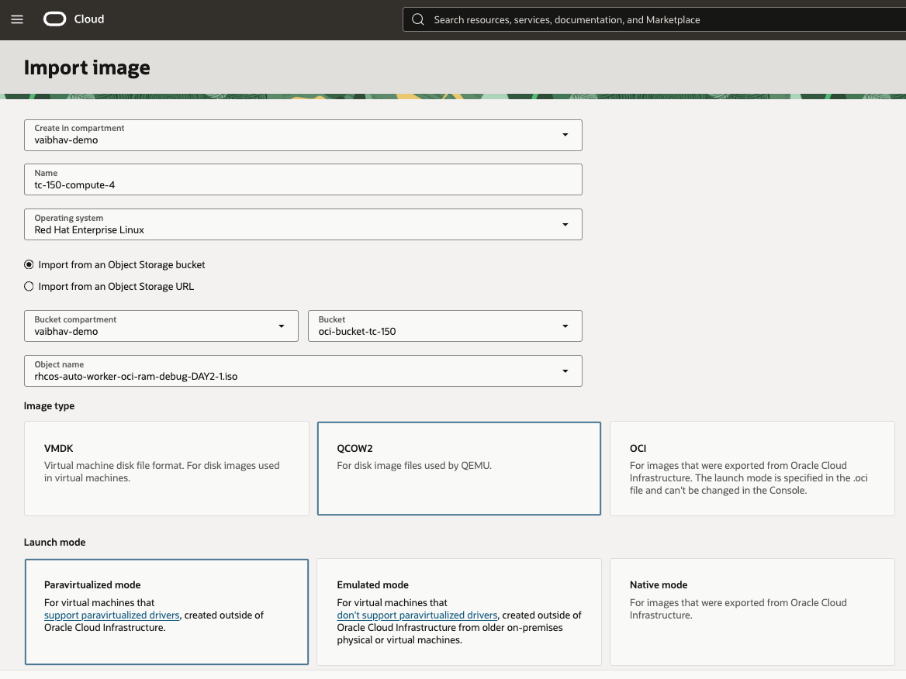
  <br/><em>Import image: RHEL, QCOW2, Paravirtualized</em>
</p>

**2.** Wait until the image is **Available** (a few minutes).

<p align="center">
  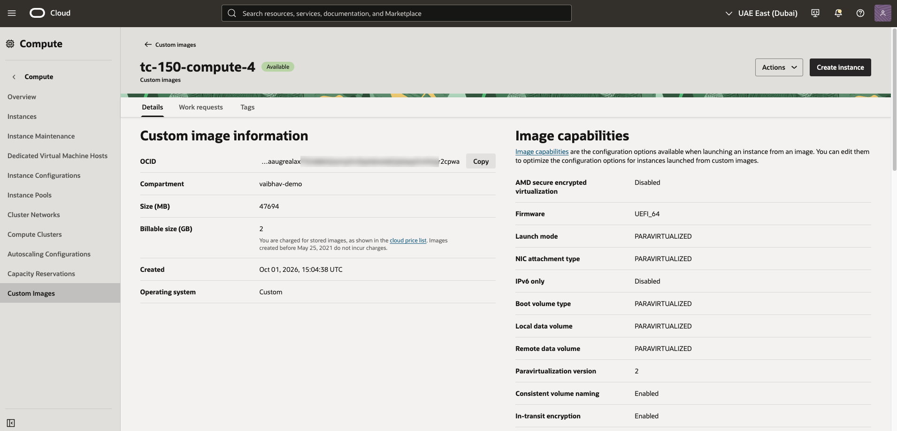
  <br/><em>Custom image Available</em>
</p>

**3.** Open **Actions** → **Edit image capabilities** and **uncheck BIOS** under Firmware, so only **UEFI_64** remains. Save.

> ⚠️ **Don't skip this.** The details page shows `Firmware: UEFI_64`, but that's only the *preferred* value. If BIOS is still allowed, the instance can boot in BIOS mode and stop at SeaBIOS with *"No bootable device"*. Firmware can't be changed on an existing instance, so you'd have to terminate it and start over.

Keep the other capabilities as shown: **PARAVIRTUALIZED** launch mode, NIC and volume types, SEV / Secure Boot / IPv6-only **disabled**, consistent volume naming **enabled**, paravirtualization version **2**.

---

## 🚀 Step 5 – Create the Worker Instance

From the custom image, click **Create instance**.

**1. Name: use the node's full FQDN.** This name becomes the node's hostname.

```text
tc-150-compute-4.privateocp.openshiftvcn.oraclevcn.com
```

<p align="center">
  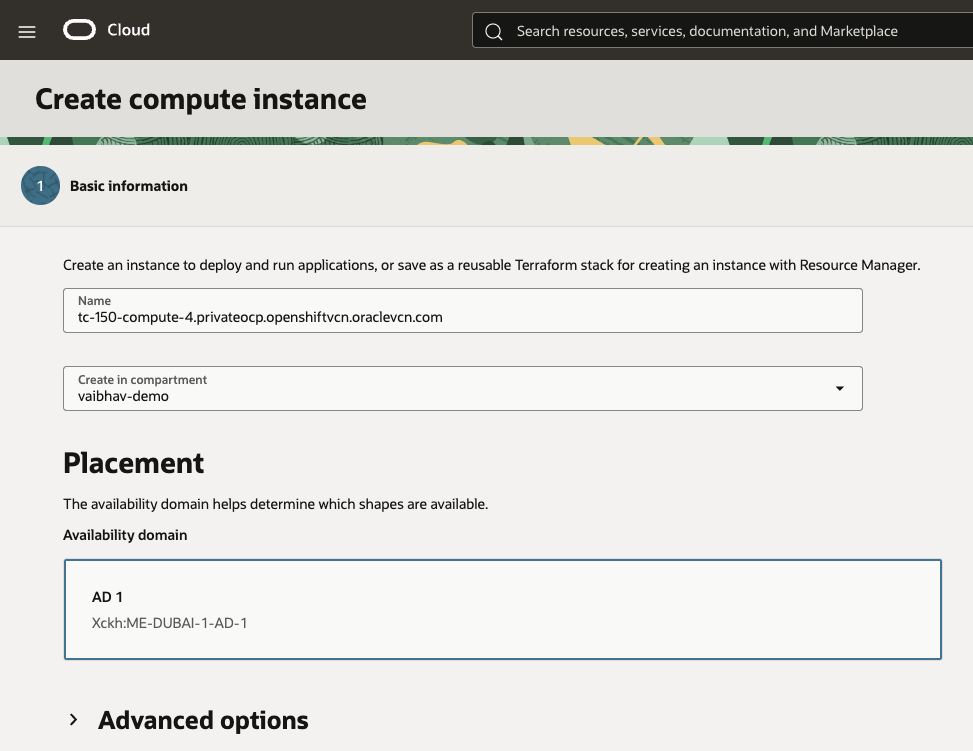
  <br/><em>Instance name = the full FQDN</em>
</p>

**2. Image and shape.** The image `tc-150-compute-4` is already selected. Choose a **VM shape** (this procedure doesn't apply to bare metal shapes), then **set the OCPUs and memory** you need for the worker. Here we used `VM.Standard.E5.Flex` with **8 OCPUs and 70 GB memory**.

<p align="center">
  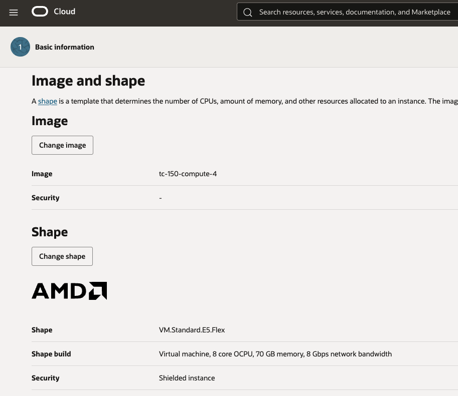
  <br/><em>Custom image and shape: set OCPUs and memory for your workload</em>
</p>

**3. Tagging.** Still in the **Basic information** section, below the shape, expand **Advanced options** and go to **Tagging**. These tags are **not added automatically**, so add both yourself (use **Add tag** for the second one):

| Namespace | Key | Value |
|---|---|---|
| Your cluster's tag namespace, `openshift-tc-150` here | `instance-role` | `compute`, because this instance is a **worker** node, not a control plane node |
| `openshift-tags` | `openshift-resource` | `openshift-resource-infra` |

<p align="center">
  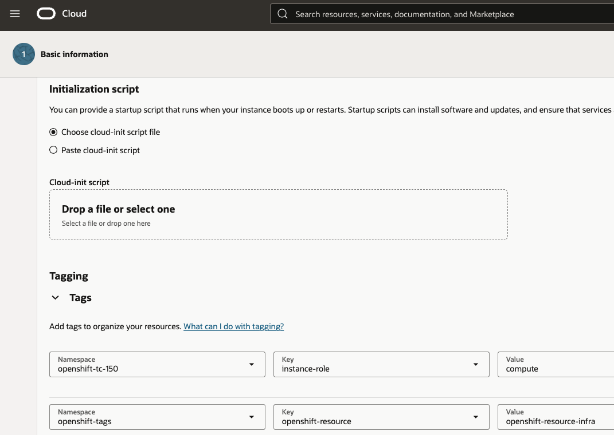
  <br/><em>Advanced options → Tagging: both tags set</em>
</p>

**4. Networking.** Use the **same VCN and subnet as the existing workers**: `tc-150` / `private_ocp`.

<p align="center">
  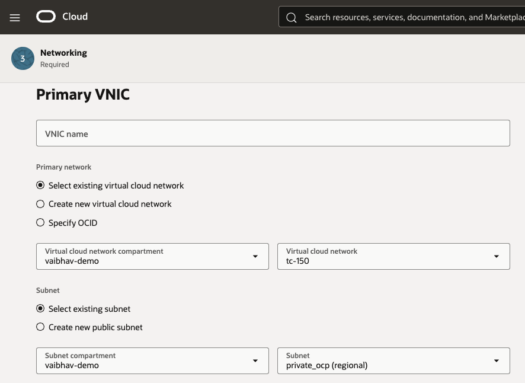
  <br/><em>Same VCN and subnet as the other workers</em>
</p>

**5. Hostname label.** In the networking section, expand **Advanced options**, keep **Assign a private DNS record** selected, and set the **Hostname** to the **short** name (no dots):

```text
tc-150-compute-4
```

The **Fully qualified domain name** line must read `tc-150-compute-4.privateocp.openshiftvcn.oraclevcn.com`. That's the same value as the instance name.

<p align="center">
  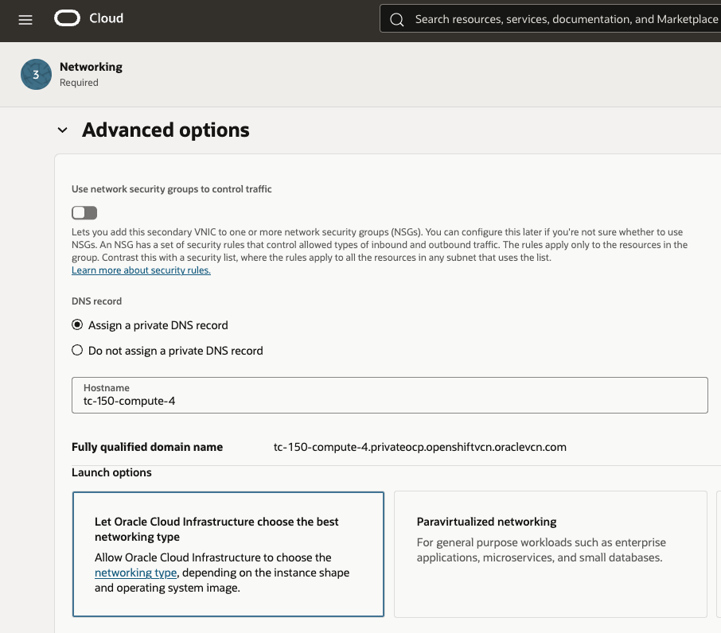
  <br/><em>Hostname label is the short name; the FQDN matches the instance name</em>
</p>

> ⚠️ If the FQDN line shows a different subdomain (for example `.public.`), the wrong subnet is selected. Go back and pick `private_ocp`.

**6. SSH keys** are optional. RHCOS doesn't read OCI metadata, so the key is ignored either way. The node gets the cluster's SSH key through Ignition, and you log in as `core@<node-IP>`.

<p align="center">
  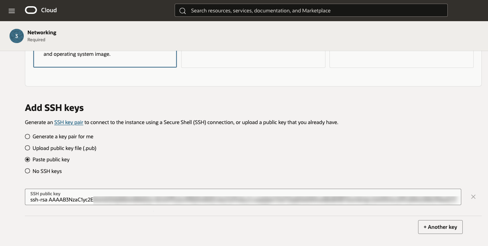
  <br/><em>SSH keys: optional</em>
</p>

**7. Boot volume.** In the **Storage** section, turn on **Specify a custom boot volume size and performance setting** and set the values below. These are the OCI recommended best-practice values for a worker node:

| Field | Value |
|---|---|
| **Boot volume size (GB)** | `100` |
| **Boot volume performance (VPU)** | `30` |

<p align="center">
  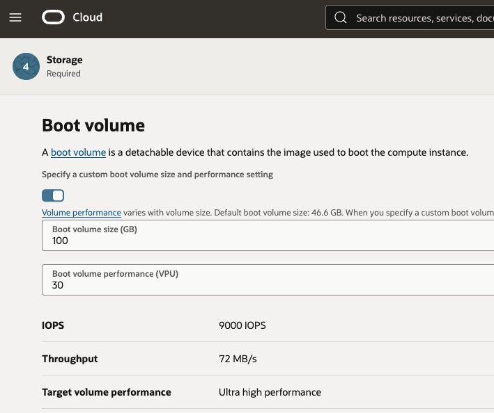
  <br/><em>Boot volume: 100 GB, 30 VPU</em>
</p>

**8.** Click **Create**. On the instance **Details** page, confirm **Firmware: UEFI_64** and note the **private IP** (`10.150.20.25` here). You can open **Console connection** to watch the node install RHCOS and reboot.

<p align="center">
  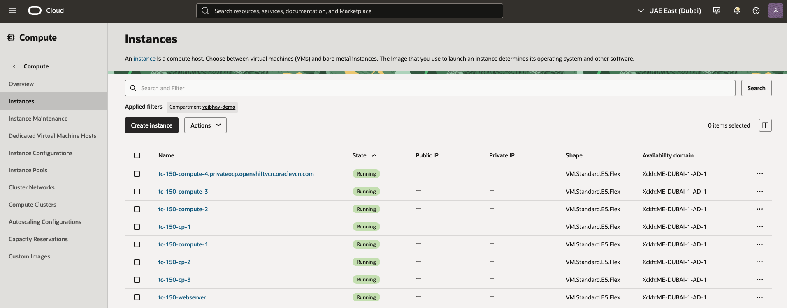
  <br/><em>The new instance is Running, named with its FQDN</em>
</p>

---

## ✅ Step 6 – Approve the Node and Validate

**1.** Watch the node join with its private IP:

```bash
oc adm node-image monitor --ip-addresses 10.150.20.25
```

```text
2026-10-01T15:21:54Z [node-image monitor] Monitoring IPs: [10.150.20.25]
2026-10-01T15:26:00Z [node-image monitor] Node 10.150.20.25: Kubelet is running
2026-10-01T15:26:00Z [node-image monitor] Node 10.150.20.25: First CSR Pending approval
2026-10-01T15:26:00Z [node-image monitor] Node 10.150.20.25: CSR csr-qfvj6 with signerName kubernetes.io/kube-apiserver-client-kubelet and username system:serviceaccount:openshift-machine-config-operator:node-bootstrapper is Pending and awaiting approval
```

**2.** Approve the first, **client** CSR:

```bash
oc get csr | grep Pending
oc adm certificate approve csr-qfvj6      # use your CSR name
```

```text
csr-qfvj6   55s   kubernetes.io/kube-apiserver-client-kubelet   system:serviceaccount:openshift-machine-config-operator:node-bootstrapper   <none>   Pending
certificatesigningrequest.certificates.k8s.io/csr-qfvj6 approved
```

**3.** About a minute later the node joins and asks for a **serving** CSR. Note the username: it carries the **full FQDN**.

```bash
oc adm node-image monitor --ip-addresses 10.150.20.25
```

```text
2026-10-01T15:27:32Z [node-image monitor] Node 10.150.20.25: Node joined cluster
2026-10-01T15:27:57Z [node-image monitor] Node 10.150.20.25: Second CSR Pending approval
2026-10-01T15:27:57Z [node-image monitor] Node 10.150.20.25: CSR csr-ncsrd with signerName kubernetes.io/kubelet-serving and username system:node:tc-150-compute-4.privateocp.openshiftvcn.oraclevcn.com is Pending and awaiting approval
2026-10-01T15:28:28Z [node-image monitor] Node 10.150.20.25: Node is Ready but has CSRs pending approval. Until all CSRs are approved, the node may not be fully functional.
```

Approve it:

```bash
oc adm certificate approve csr-ncsrd      # use your CSR name

# or approve everything pending in one go:
oc get csr -o go-template='{{range .items}}{{if not .status}}{{.metadata.name}}{{"\n"}}{{end}}{{end}}' \
  | xargs -r oc adm certificate approve
```

```text
certificatesigningrequest.certificates.k8s.io/csr-ncsrd approved
```

**4.** Run the monitor once more. It finishes when the node is Ready:

```bash
oc adm node-image monitor --ip-addresses 10.150.20.25
```

```text
2026-10-01T15:29:01Z [node-image monitor] Node 10.150.20.25: Kubelet is running
2026-10-01T15:29:01Z [node-image monitor] Node 10.150.20.25: Node joined cluster
2026-10-01T15:29:01Z [node-image monitor] Node 10.150.20.25: Node is Ready
2026-10-01T15:29:11Z [node-image monitor] Command successfully completed
```

**5.** Check the nodes. 🎉 The new worker is `Ready` **with its full FQDN**, consistent with the original nodes:

```bash
oc get nodes
```

```text
NAME                                                     STATUS   ROLES                  AGE     VERSION
tc-150-compute-1.privateocp.openshiftvcn.oraclevcn.com   Ready    worker                 16d     v1.35.6
tc-150-compute-2.privateocp.openshiftvcn.oraclevcn.com   Ready    worker                 16d     v1.35.6
tc-150-compute-3.privateocp.openshiftvcn.oraclevcn.com   Ready    worker                 16d     v1.35.6
tc-150-compute-4.privateocp.openshiftvcn.oraclevcn.com   Ready    worker                 2m14s   v1.35.6
tc-150-cp-1.privateocp.openshiftvcn.oraclevcn.com        Ready    control-plane,master   16d     v1.35.6
tc-150-cp-2.privateocp.openshiftvcn.oraclevcn.com        Ready    control-plane,master   16d     v1.35.6
tc-150-cp-3.privateocp.openshiftvcn.oraclevcn.com        Ready    control-plane,master   16d     v1.35.6
```

To finish, check that the worker pool and cluster operators are healthy:

```bash
oc get csr | grep Pending        # nothing
oc get mcp worker                # MACHINECOUNT = READY = UPDATED
oc get co | grep -v "True        False         False"   # header only
```

---

## ⚖️ Optional: Add the New Worker to the Apps Load Balancer

The OCI stack creates a load balancer for application traffic (`*.apps`), named **`tc-150-openshift_apps_lb`** here. It has two backend sets:

| Backend set | Port |
|---|:---:|
| `openshift_cluster_ingress_http` | 80 |
| `openshift_cluster_ingress_https` | 443 |

Both sets contain the nodes from the original install (3 control plane + 3 workers). A new Day-2 worker is **not added automatically**.

<p align="center">
  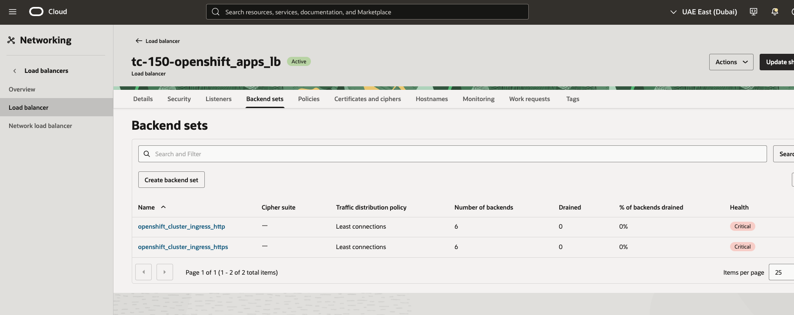
  <br/><em>The two backend sets of the apps load balancer</em>
</p>

A backend shows **OK** only when an ingress router pod runs on that node. The default ingress controller runs **2 router pods**, so only two backends are OK and the rest show *Critical – Connection failed*. That's expected.

```bash
oc get pods -n openshift-ingress -o wide
```

```text
NAME                              READY   STATUS    RESTARTS      AGE   IP              NODE
router-default-7d74f9f96f-bzrdv   1/1     Running   2 (17d ago)   17d   10.150.19.86    tc-150-compute-3.privateocp.openshiftvcn.oraclevcn.com
router-default-7d74f9f96f-wmgzh   1/1     Running   1 (17d ago)   17d   10.150.24.108   tc-150-compute-1.privateocp.openshiftvcn.oraclevcn.com
```

<p align="center">
  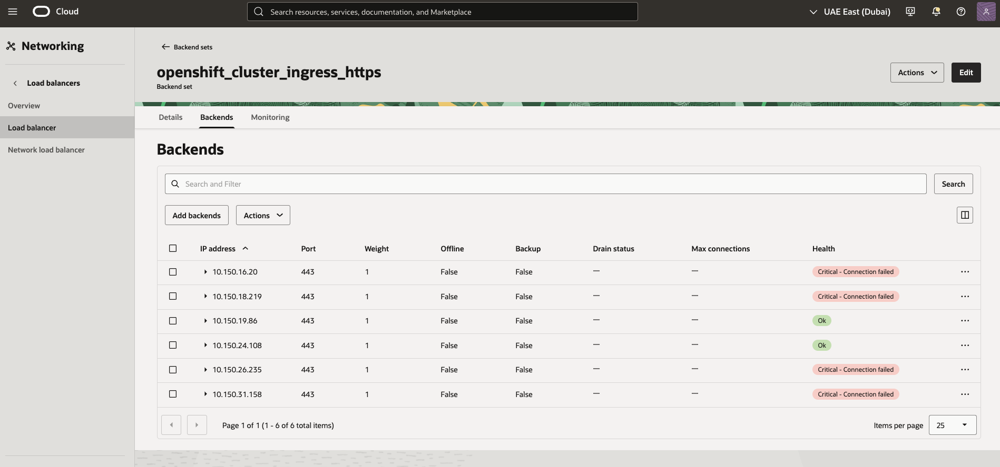
  <br/><em>HTTPS (443) backend set: only the two nodes running router pods are OK</em>
</p>

**Should you add the new worker?** It depends on how you'll use the node:

- **General-purpose worker:** add it. Router pods can be rescheduled to any worker node, including the new one. If a router pod lands on a node that isn't in the backend sets, it receives no traffic.
- **Dedicated worker** (a specific workload or namespace) that should never run ingress: you can leave it out. In that case, pin the ingress routers to the nodes that *are* in the load balancer, using the ingress controller's `nodePlacement`.

**To add the node:**

**1.** Get the new node's IP address:

```bash
oc get nodes -o wide | grep -i tc-150-compute-4.privateocp.openshiftvcn.oraclevcn.com
```

```text
tc-150-compute-4.privateocp.openshiftvcn.oraclevcn.com   Ready    worker   44h   v1.35.6   10.150.20.25    <none>   Red Hat Enterprise Linux CoreOS 9.8.20260825-0 (Plow)   5.14.0-687.42.1.el9_8.x86_64   cri-o://1.35.6
```

**2.** In the OCI Console, open **Networking** → **Load balancers** → `tc-150-openshift_apps_lb` → **Backend sets**.

**3.** Open **`openshift_cluster_ingress_https`** → **Backends** → **Add backends**, and add the node's IP (`10.150.20.25`) on port **443**.

**4.** Repeat for **`openshift_cluster_ingress_http`** with port **80**.

> ℹ️ The new backend will show *Critical – Connection failed* until a router pod runs on that node. That's normal.

---

## 🏁 Wrapping Up

🎊 You've added a **Day-2 virtual machine worker node with its full FQDN** to an agent-based OpenShift cluster on OCI.

Here's what you did:

- ✅ Reused the existing **web server** to serve the worker Ignition
- ✅ Built a **node ISO** with `oc adm node-image create` and customized its kernel arguments
- ✅ Imported it as an OCI **custom image** with **UEFI-only** firmware
- ✅ Launched the worker with **instance name = FQDN** and **hostname label = short name**
- ✅ **Approved both CSRs** and confirmed the node is **Ready**

The same ISO and custom image can be reused for more **VM** workers. Bare metal workers need a different procedure. Just repeat Steps 5 and 6 with a new name.

### Quick checklist for the next node

- [ ] rsync, coreos-installer and jq installed on the web server
- [ ] `worker.ign` exported from `openshift-machine-api`, served and checked with `curl` + `jq`
- [ ] `oc adm node-image create`, then `coreos-installer iso customize`
- [ ] ISO uploaded; imported as **RHEL / QCOW2 / Paravirtualized**
- [ ] Image capabilities: **BIOS unchecked**, UEFI_64 only
- [ ] Instance tags: cluster namespace / `instance-role` = `compute`, and `openshift-tags` / `openshift-resource` = `openshift-resource-infra`
- [ ] Boot volume: **100 GB**, **30 VPU**
- [ ] Instance **name = FQDN**, **hostname label = short name**, subnet `private_ocp`, OCPUs and memory set
- [ ] Client CSR approved, then serving CSR approved (check it shows the FQDN)
- [ ] Nodes, `mcp worker` and cluster operators checked
- [ ] Optional: node IP added to the apps load balancer backend sets (ports 80 and 443)

---

## 🙌 Acknowledgments

| | Author | Role |
|:---:|---|---|
| ✍️ | **Gianluca Cecchi** | Oracle Virtualization BlackBelt |
| ✍️ | **Vaibhav Tiwari** | Oracle Virtualization BlackBelt |

<div align="center">

---

*Found this useful? Share it with your team!* ⭐

</div>
