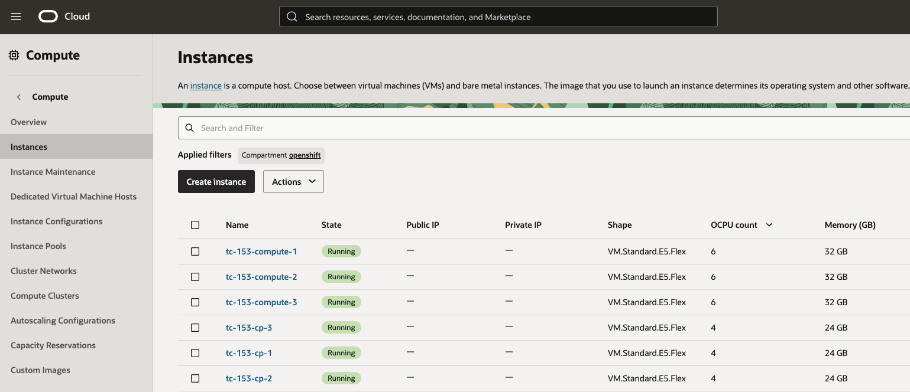
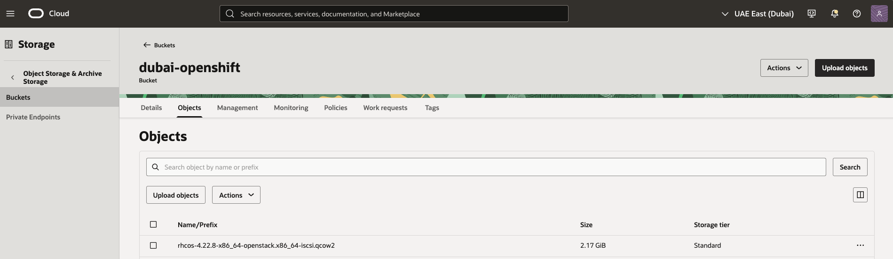
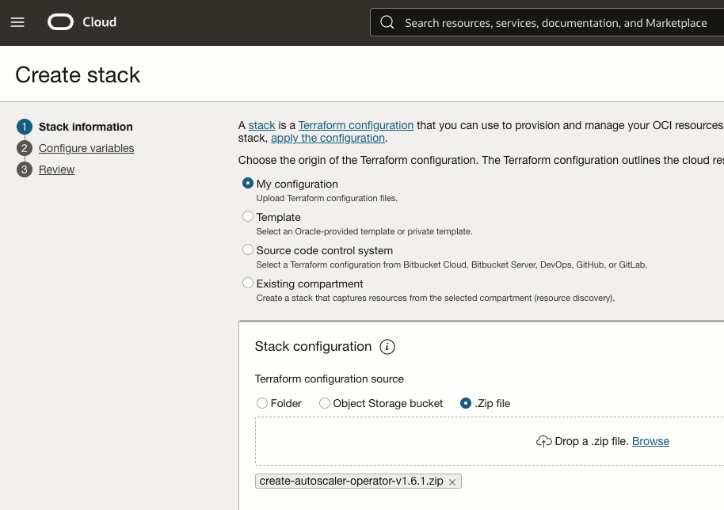
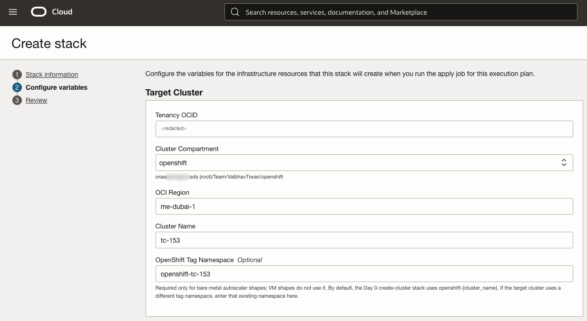
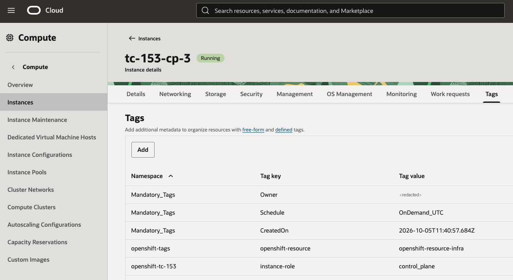
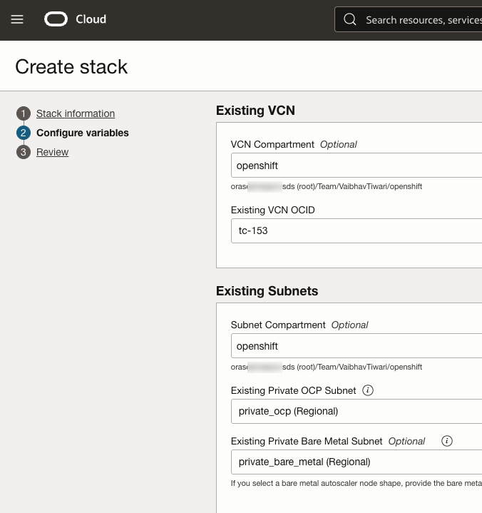
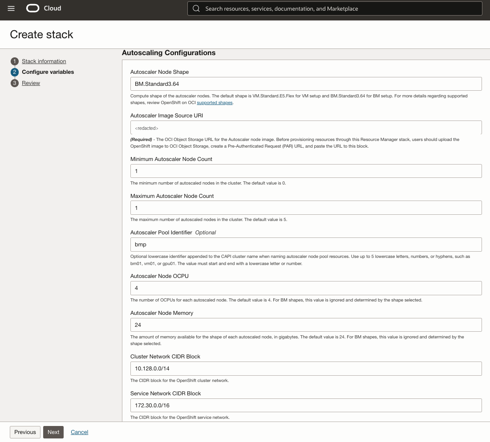
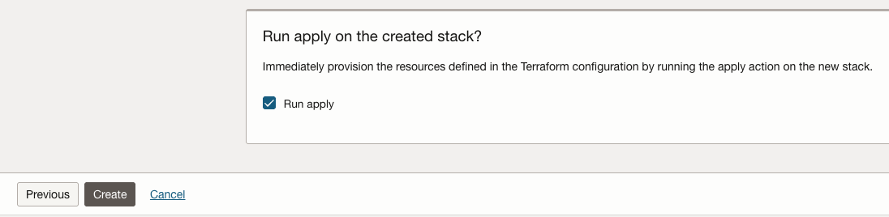
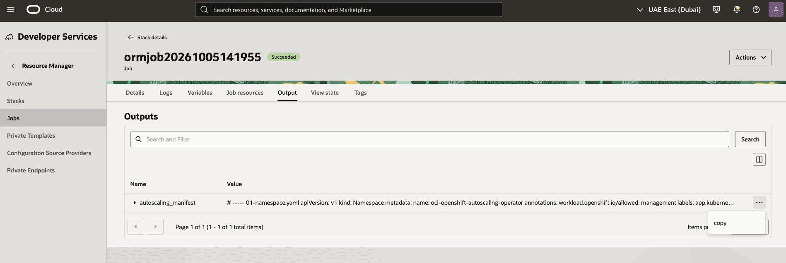

<div align="center">

# Autoscaling a Bare Metal Worker Node on OpenShift on OCI<br/>(Assisted Installer Cluster)

**Enable the OCI autoscaler on a running OpenShift cluster and let it add a bare metal worker node for you.**

`Red Hat OpenShift` · `Oracle Cloud Infrastructure` · `Assisted Installer` · `Cluster Autoscaler` · `Cluster API` · `Bare Metal`

</div>

---

## 📑 Table of Contents

- [Overview](#-overview)
- [Before We Begin](#-before-we-begin)
- [The Journey at a Glance](#-the-journey-at-a-glance)
- [Step 1: Prepare the RHCOS Image](#-step-1--prepare-the-rhcos-image)
- [Step 2: Upload the Image and Create a PAR](#-step-2--upload-the-image-and-create-a-par)
- [Step 3: Create the Autoscaler Stack](#-step-3--create-the-autoscaler-stack)
- [Step 4: Apply the Autoscaling Manifest](#-step-4--apply-the-autoscaling-manifest)
- [Step 5: Verify the Operator and the Autoscaler](#-step-5--verify-the-operator-and-the-autoscaler)
- [Step 6: Watch the Bare Metal Node Join](#-step-6--watch-the-bare-metal-node-join)
- [Wrapping Up](#-wrapping-up)
- [Acknowledgments](#-acknowledgments)

---

## 🌟 Overview

Autoscaling is the mechanism that **adds and removes worker nodes for you**. Instead of building a node by hand, you tell the cluster the shape, the image and the minimum and maximum number of nodes, and it creates (or deletes) OCI instances to stay inside those limits.

On OCI this is delivered as a Resource Manager stack, **`create-autoscaler-operator`**, which you run against a cluster that is already installed. The stack produces a manifest. Applying that manifest installs an operator that brings in **Cluster API**, the **OCI Cluster API provider** and the **cluster autoscaler**.

This post enables autoscaling on a cluster installed with the **Assisted Installer** and uses it to add **one bare metal worker node** (`BM.Standard3.64`).

The flow is:

1. Download the **RHCOS image** and patch it for bare metal (iSCSI boot).
2. Upload it to **Object Storage** and create a **PAR URL**.
3. Create and apply the **autoscaler stack**.
4. Apply the generated **manifest** to the cluster.
5. Verify the operator, then watch the **bare metal node join**.

Starting point: six nodes, all `Ready`.

```text
[root@oracle-linux vaibhav]# oc get nodes
NAME                                                     STATUS   ROLES                  AGE   VERSION
tc-153-compute-1.privateocp.openshiftvcn.oraclevcn.com   Ready    worker                 34m   v1.35.6
tc-153-compute-2.privateocp.openshiftvcn.oraclevcn.com   Ready    worker                 44m   v1.35.6
tc-153-compute-3.privateocp.openshiftvcn.oraclevcn.com   Ready    worker                 44m   v1.35.6
tc-153-cp-1.privateocp.openshiftvcn.oraclevcn.com        Ready    control-plane,master   33m   v1.35.6
tc-153-cp-2.privateocp.openshiftvcn.oraclevcn.com        Ready    control-plane,master   49m   v1.35.6
tc-153-cp-3.privateocp.openshiftvcn.oraclevcn.com        Ready    control-plane,master   49m   v1.35.6
```

The same six nodes in the OCI Console, all virtual machines:



> 📚 **Official documentation**
> - [Enabling autoscaling for an existing cluster](https://docs.oracle.com/en-us/iaas/Content/openshift-on-oci/enabling-autoscaling-post-install.htm)
> - [Autoscaling prerequisites](https://docs.oracle.com/en-us/iaas/Content/openshift-on-oci/install-prereq.htm#autoscale-prereqs)
> - [oci-openshift releases (stack downloads)](https://github.com/oracle-quickstart/oci-openshift/releases)

---

## ✅ Before We Begin

| Item | Value used in this walkthrough |
|---|---|
| **Cluster** | `tc-153` (3 control plane + 3 workers, v1.35.6, installed with the Assisted Installer) |
| **Bastion** | `oracle-linux`, logged in to the cluster with `oc` |
| **Working directory** | `/vaibhav/auto` |
| **Region / compartment** | UAE East (Dubai), `me-dubai-1` / `openshift` |
| **Object Storage bucket** | `dubai-openshift` |
| **Autoscaler stack** | `create-autoscaler-operator-v1.6.1.zip` |
| **Autoscaled node shape** | `BM.Standard3.64` (bare metal) |
| **Pool identifier** | `bmp` |
| **Minimum / maximum nodes** | `1` / `1` |

You'll need:

- [ ] OpenShift **4.22 or later**. Autoscaling is not supported on earlier versions.
- [ ] `oc` logged in to the cluster as **cluster-admin**
- [ ] The existing **VCN** and the **private OpenShift subnet** of the cluster. For bare metal, also the **private bare metal subnet**.
- [ ] An **Object Storage bucket** and permission to create a pre-authenticated request (PAR)
- [ ] The **`create-autoscaler-operator`** stack zip from the [releases page](https://github.com/oracle-quickstart/oci-openshift/releases)

> ⚠️ **The image must match the cluster.** The RHCOS image used for autoscaled workers must be the same OpenShift **minor version** as the cluster. A different z-stream of the same minor version is fine.

---

## 🧭 The Journey at a Glance

| Step | What we do | Where |
|:---:|---|---|
| **1** | 💿 Download the RHCOS image and patch it for bare metal | Bastion |
| **2** | 📦 Upload the image and create a PAR URL | Object Storage |
| **3** | 🧱 Create and apply the autoscaler stack | Resource Manager |
| **4** | 📄 Copy the manifest and apply it | Resource Manager + Bastion |
| **5** | 🔍 Verify the operator and the autoscaler | Bastion |
| **6** | 🚀 Watch the bare metal node join the cluster | Bastion |

---

## 💿 Step 1 – Prepare the RHCOS Image

The autoscaler boots new workers from a **RHCOS OpenStack `qcow2` image**. Download the one that matches your cluster version from the [OpenShift mirror](https://mirror.openshift.com/pub/openshift-v4/x86_64/dependencies/rhcos/). This cluster is 4.22, so we take `4.22.8`.

```bash
curl -O https://mirror.openshift.com/pub/openshift-v4/x86_64/dependencies/rhcos/4.22/4.22.8/rhcos-4.22.8-x86_64-openstack.x86_64.qcow2.gz
```

```text
  % Total    % Received % Xferd  Average Speed   Time    Time     Time  Current
                                 Dload  Upload   Total   Spent    Left  Speed
100 1371M  100 1371M    0     0  28.7M      0  0:00:47  0:00:47 --:--:-- 31.6M
```

Unpack it. The `-k` flag keeps the original archive.

```bash
gunzip -k rhcos-4.22.8-x86_64-openstack.x86_64.qcow2.gz
```

> 💡 **Virtual machine or bare metal?**
> - **VM shapes:** the `qcow2` is ready as it is. Skip to [Step 2](#-step-2--upload-the-image-and-create-a-par).
> - **Bare metal shapes:** the image must first be patched with iSCSI kernel arguments. That is what the rest of this step does.

### Patch the image for bare metal

Bare metal instances on OCI boot over iSCSI, so the image needs the matching kernel arguments. Oracle provides a script for this, **[`iscsi.sh`](https://github.com/oracle-quickstart/oci-openshift/blob/main/assets/autoscaler/iscsi.sh)**.

Install the packages the script needs:

```bash
dnf install -y qemu-img ostree util-linux
```

```text
Installed:
  composefs-1.0.8-1.el10.x86_64        composefs-libs-1.0.8-1.el10.x86_64        liburing-2.12-1.el10.x86_64
  ostree-2025.7-1.el10.x86_64          ostree-libs-2025.7-1.el10.x86_64          qemu-img-18:10.1.0-16.el10_2.5.x86_64

Complete!
```

> ⚠️ **Install the packages first.** Without `qemu-img` the script stops with `Missing required command: qemu-nbd`.

Copy the contents of `iscsi.sh` into a file on the bastion, make it executable and run it against the `qcow2`:

```bash
vi iscsi.sh
chmod +x iscsi.sh
./iscsi.sh ./rhcos-4.22.8-x86_64-openstack.x86_64.qcow2
```

```text
Copying image -> ./rhcos-4.22.8-x86_64-openstack.x86_64-iscsi.qcow2
Setting kargs in OSTree deployment...
Bootloader updated; bootconfig swap: yes; bootversion: boot.0.1, deployment count change: 0
Verifying...
3:options rw $ignition_firstboot  ostree=/ostree/boot.0/rhcos/2da2870a349594c20617261eaed083ada8cbeb2cf711d8d9b26e6e0344e4b669/0 ignition.platform.id=openstack console=ttyS0,115200n8 console=tty0 rd.neednet=1 ip=ibft rd.iscsi=1 rd.iscsi.firmware=1 rd.iscsi.ibft=1 rd.net.timeout.dhcp=30 rd.net.timeout.carrier=30 rd.iscsi.param=node.conn[0].timeo.noop_out_interval=30 rd.iscsi.param=node.conn[0].timeo.noop_out_timeout=180 rd.iscsi.param=node.session.timeo.replacement_timeout=600 rd.retry=10 rootwait rd.debug
Done: ./rhcos-4.22.8-x86_64-openstack.x86_64-iscsi.qcow2 now has iBFT/iSCSI boot kargs and iSCSI timeout kargs.
```

The script leaves the original image untouched and writes a new one ending in **`-iscsi.qcow2`**. That is the file to upload.

```text
[root@oracle-linux auto]# ls -lthr
-rw-r--r--. 1 root root 1.4G Oct  6 07:46 rhcos-4.22.8-x86_64-openstack.x86_64.qcow2.gz
-rw-r--r--. 1 root root 2.2G Oct  6 07:46 rhcos-4.22.8-x86_64-openstack.x86_64.qcow2
-rwxr-xr-x. 1 root root 4.4K Oct  6 07:46 iscsi.sh
-rw-r--r--. 1 root root 2.2G Oct  6 07:51 rhcos-4.22.8-x86_64-openstack.x86_64-iscsi.qcow2
```

---

## 📦 Step 2 – Upload the Image and Create a PAR

Upload `rhcos-4.22.8-x86_64-openstack.x86_64-iscsi.qcow2` to your Object Storage bucket. Here the bucket is `dubai-openshift`.



Then create a **pre-authenticated request** on that object: open the object's menu (**⋯**) and select **Create Pre-Authenticated Request**, with:

- **Pre-authenticated request target:** Object
- **Access type:** Permit object reads

> 📋 **Copy the PAR URL now.** OCI shows it only once. You'll paste it into the stack in the next step.

---

## 🧱 Step 3 – Create the Autoscaler Stack

Download the latest **`create-autoscaler-operator`** zip from the [releases page](https://github.com/oracle-quickstart/oci-openshift/releases). At the time of writing that is `create-autoscaler-operator-v1.6.1.zip`.

In the OCI Console go to **Developer Services → Resource Manager → Stacks → Create stack**.

### Stack information

Select **My configuration**, choose **.Zip file** and upload the zip.



### Target Cluster

Fill in the compartment, region and **cluster name** of the cluster that is already running.



> 🏷️ **OpenShift Tag Namespace: bare metal only.** This field is required for **bare metal** autoscaler shapes. **VM shapes do not use it**, so leave it empty for a VM pool.

To find the tag namespace, open any **control plane** instance of the cluster, select the **Tags** tab and look at the last entry. Here it is `openshift-tc-153`, which is the default pattern `openshift-{cluster_name}`.



### Existing VCN and Subnets

Select the VCN of the cluster and its **private OCP subnet**. For a bare metal shape, also select the **private bare metal subnet**.



### Autoscaling Configurations



| Field | Value used | Notes |
|---|---|---|
| **Autoscaler Node Shape** | `BM.Standard3.64` | Default is `VM.Standard.E5.Flex` for VMs |
| **Autoscaler Image Source URI** | The PAR URL from Step 2 | Required |
| **Minimum Autoscaler Node Count** | `1` | Default is `0` |
| **Maximum Autoscaler Node Count** | `1` | Default is `5` |
| **Autoscaler Pool Identifier** | `bmp` | Optional. Up to 5 lowercase letters, numbers or hyphens. It becomes part of the node pool name |
| **Autoscaler Node OCPU / Memory** | `4` / `24` (defaults) | **Ignored for bare metal.** The shape decides |
| **Cluster Network CIDR Block** | `10.128.0.0/14` | Default |
| **Service Network CIDR Block** | `172.30.0.0/16` | Default |

> 💡 **Why minimum 1?** With a minimum of `1` the autoscaler creates one node straight away and always keeps it. That makes it easy to see the whole flow working. Raise the maximum when you want the pool to grow under load.

### Review and apply

On the **Review** page, tick **Run apply** and select **Create**. The stack is created and the apply job starts immediately.



---

## 📄 Step 4 – Apply the Autoscaling Manifest

Wait for the apply job to show **Succeeded**. Open the job, select the **Output** tab and copy the value of **`autoscaling_manifest`** using the **⋯** menu.



On the bastion, paste it into a file named `autoscaling.yml`:

```text
[root@oracle-linux auto]# ls -lthr
total 36K
-rw-r--r--. 1 root root 33K Oct  5 16:28 autoscaling.yml
```

Apply it to the cluster:

```bash
oc apply -f autoscaling.yml
```

```text
namespace/oci-openshift-autoscaling-operator created
serviceaccount/oci-capi-operator-controller-manager created
clusterrole.rbac.authorization.k8s.io/oci-capi-operator-manager-role created
role.rbac.authorization.k8s.io/oci-capi-operator-leader-election-role created
clusterrole.rbac.authorization.k8s.io/oci-capi-operator-metrics-auth-role created
clusterrole.rbac.authorization.k8s.io/oci-capi-operator-metrics-reader created
clusterrole.rbac.authorization.k8s.io/oci-capi-operator-ociclusterautoscaler-editor-role created
clusterrole.rbac.authorization.k8s.io/oci-capi-operator-ociclusterautoscaler-viewer-role created
rolebinding.rbac.authorization.k8s.io/oci-capi-operator-leader-election-rolebinding created
clusterrolebinding.rbac.authorization.k8s.io/oci-capi-operator-manager-rolebinding created
clusterrolebinding.rbac.authorization.k8s.io/oci-capi-operator-metrics-auth-rolebinding created
clusterrolebinding.rbac.authorization.k8s.io/oci-capi-operator-oci-capi-operator-admin created
clusterrolebinding.rbac.authorization.k8s.io/oci-capi-operator-capoci-privileged-scc created
customresourcedefinition.apiextensions.k8s.io/ociclusterautoscalers.capi.openshift.io created
secret/oci-capi-operator-capoci-auth-credentials created
deployment.apps/oci-capi-operator-controller-manager created
configmap/oci-capi-operator-config created
job.batch/oci-capi-operator-provider-installer created
```

Everything lands in one namespace, **`oci-openshift-autoscaling-operator`**.

---

## 🔍 Step 5 – Verify the Operator and the Autoscaler

Set the namespace once. The rest of the commands use it.

```bash
NS=oci-openshift-autoscaling-operator
```

### The pods

```bash
oc get pods -n $NS
```

```text
NAME                                                    READY   STATUS      RESTARTS   AGE
capi-manager-6979b7c47c-mjjz2                           1/1     Running     0          9m53s
capoci-controller-manager-8694cfcfc8-tn2kc              1/1     Running     0          9m44s
oci-capi-operator-controller-manager-68cdd49d7c-ggzst   1/1     Running     0          10m
oci-capi-operator-provider-installer-9trpd              0/1     Completed   0          10m
oci-cluster-autoscaler-9db5bdfd5-v9wlt                  1/1     Running     0          9m3s
```

| Pod | What it does |
|---|---|
| `oci-capi-operator-controller-manager` | The operator installed by the manifest |
| `oci-capi-operator-provider-installer` | One-off job that installs the providers. `Completed` is the expected state |
| `capi-manager` | Cluster API core controller |
| `capoci-controller-manager` | Cluster API provider for OCI. It creates the instances |
| `oci-cluster-autoscaler` | The cluster autoscaler |

### The autoscaler resource

The settings from the stack are stored in an `OCIClusterAutoscaler` resource. Its status tells you whether every part is healthy.

```bash
oc get ociclusterautoscaler ociclusterautoscaler -n $NS -o yaml
```

```yaml
spec:
  autoscaling:
    imageId: ocid1.image.oc1.me-dubai-1.<unique-id>
    maxNodes: 1
    minNodes: 1
    poolIdentifier: bmp
    shape: BM.Standard3.64
    shapeConfig:
      cpus: 4
      memory: 24
  clusterAutoscaler:
    cloudProvider: clusterapi
    createRBAC: true
    createServiceAccount: true
    name: oci-cluster-autoscaler
    repositoryURL: https://kubernetes.github.io/autoscaler
    serviceAccountName: oci-cluster-autoscaler
status:
  capiInstalled: true
  clusterAutoscalerDeployed: true
  conditions:
  - message: OCI CAPI autoscaler is ready
    reason: ReconcileSuccess
    status: "True"
    type: Ready
  - message: Autoscaler policy accepted
    reason: PolicyAccepted
    status: "True"
    type: PolicyAccepted
  - message: CAPI and CAPOCI provider controller managers are available
    reason: ProvidersReady
    status: "True"
    type: ProvidersReady
  - message: cluster-autoscaler deployment oci-openshift-autoscaling-operator/oci-cluster-autoscaler
      is available
    reason: AutoscalerReady
    status: "True"
    type: AutoscalerReady
  - message: Managed scaling resources for cluster "tc-153-zn45b" are reconciled
    reason: ScalingResourcesReady
    status: "True"
    type: ScalingResourcesReady
  phase: Ready
```

`phase: Ready` with all five conditions `True` means the autoscaler is working. Note `imageId`: the stack imported the image from your PAR URL as an OCI **custom image**.

### The node pool

The pool is a Cluster API **MachineDeployment**. Its name is the cluster's infrastructure name plus your pool identifier: `tc-153-zn45b` + `bmp`.

```bash
oc get infrastructure cluster -o jsonpath='{.status.infrastructureName}'
```

```text
tc-153-zn45b
```

The minimum and maximum you set in the stack are stored as annotations on the MachineDeployment:

```bash
oc get machinedeployment -A -o yaml | grep -i 'autoscaler.*size'
```

```text
      cluster.x-k8s.io/cluster-api-autoscaler-node-group-max-size: "1"
      cluster.x-k8s.io/cluster-api-autoscaler-node-group-min-size: "1"
```

And the autoscaler confirms it has discovered that pool:

```bash
oc logs deployment/oci-cluster-autoscaler -n $NS | grep 'discovered node group'
```

```text
I1005 16:33:12.199977       1 clusterapi_controller.go:694] discovered node group: MachineDeployment/oci-openshift-autoscaling-operator/tc-153-zn45b-bmp (min: 1, max: 1, replicas: 1)
```

> ℹ️ **Only the new pool is managed.** The autoscaler logs the six original nodes as `should not be processed by cluster autoscaler (no node group config)`. The installer-created nodes are left as they are.

---

## 🚀 Step 6 – Watch the Bare Metal Node Join

Because the minimum is `1`, a machine is created right away. A handy way to follow it:

```bash
watch -n20 "oc get machines -n oci-openshift-autoscaling-operator; echo; oc get nodes | grep zn45b; echo; oc get csr | grep -i pending"
```

### Provisioning

For the first few minutes the machine waits for its OCI instance:

```bash
oc get machinedeployment tc-153-zn45b-bmp -n $NS -o jsonpath='{range .status.conditions[*]}{.type}{"="}{.status}{"  "}{.reason}{"  "}{.message}{"\n"}{end}'
```

```text
Available=True  Available
RollingOut=False  NotRollingOut
Remediating=False  NotRemediating
ScalingDown=False  NotScalingDown
ScalingUp=False  NotScalingUp
MachinesReady=False  NotReady  * Machine tc-153-zn45b-bmp-pmzjr-wdwsb:
  * InfrastructureReady: InstanceNotReady
  * NodeHealthy: Waiting for OCIMachine to report spec.providerID
MachinesUpToDate=True  UpToDate
Paused=False  NotPaused
Deleting=False  NotDeleting
```

Once the instance exists, the machine moves to **`Provisioned`**. The instance is running, but it has not joined the cluster yet.

```bash
oc get machines -n $NS
```

```text
NAME                           CLUSTER        NODE NAME   FAILURE DOMAIN   READY     AVAILABLE   UP-TO-DATE   PHASE         AGE    VERSION
tc-153-zn45b-bmp-pmzjr-wdwsb   tc-153-zn45b                                Unknown   False       True         Provisioned   6m9s
```

> ⏱️ **Bare metal takes time, and there is a deadline.** The stack also creates a **MachineHealthCheck** with a 20-minute startup timeout. A machine whose node has not registered within that time is marked unhealthy and replaced.
>
> ```bash
> oc get machinehealthcheck -A -o yaml | grep -iE 'name:|nodeStartupTimeout|maxUnhealthy'
> ```
>
> ```text
>       app.kubernetes.io/name: oci-capi-autoscaling-operator
>       cluster.x-k8s.io/cluster-name: tc-153-zn45b
>     name: tc-153-zn45b-bmp-autoscaling
>       name: tc-153-zn45b
>       nodeStartupTimeoutSeconds: 1200
>     clusterName: tc-153-zn45b
>         cluster.x-k8s.io/cluster-name: tc-153-zn45b
>         cluster.x-k8s.io/deployment-name: tc-153-zn45b-bmp
> ```
>
> If your machine is replaced over and over, the node is not booting or not reaching the cluster. Check the image first: it must be the **`-iscsi.qcow2`** for bare metal and match the cluster's minor version.

### Running

About 15 minutes after creation, the machine reports **`Running`** and now has a **node name**:

```bash
oc get clusters,machinedeployments,machinesets,machines,machinepools -A
```

```text
...
NAMESPACE                            NAME                                                    CLUSTER        NODE NAME                      FAILURE DOMAIN   READY   AVAILABLE   UP-TO-DATE   PHASE     AGE   VERSION
oci-openshift-autoscaling-operator   machine.cluster.x-k8s.io/tc-153-zn45b-bmp-pmzjr-wdwsb   tc-153-zn45b   tc-153-zn45b-bmp-pmzjr-wdwsb                    False   False       False        Running   15m
```

The node appears in the cluster. For the first couple of minutes it shows `NotReady`:

```text
[root@oracle-linux auto]# oc get nodes
NAME                                                     STATUS     ROLES                  AGE    VERSION
tc-153-compute-1.privateocp.openshiftvcn.oraclevcn.com   Ready      worker                 20h    v1.35.6
tc-153-compute-2.privateocp.openshiftvcn.oraclevcn.com   Ready      worker                 20h    v1.35.6
tc-153-compute-3.privateocp.openshiftvcn.oraclevcn.com   Ready      worker                 20h    v1.35.6
tc-153-cp-1.privateocp.openshiftvcn.oraclevcn.com        Ready      control-plane,master   20h    v1.35.6
tc-153-cp-2.privateocp.openshiftvcn.oraclevcn.com        Ready      control-plane,master   20h    v1.35.6
tc-153-cp-3.privateocp.openshiftvcn.oraclevcn.com        Ready      control-plane,master   20h    v1.35.6
tc-153-zn45b-bmp-pmzjr-wdwsb                             NotReady   worker                 101s   v1.35.6
```

You can see the cluster's own pods being scheduled on it:

```bash
oc get pods -A -o wide --field-selector spec.nodeName=tc-153-zn45b-bmp-pmzjr-wdwsb
```

```text
NAMESPACE                                NAME                                                READY   STATUS    RESTARTS      AGE     IP              NODE                           NOMINATED NODE   READINESS GATES
oci-csi                                  csi-oci-node-zt8vp                                  3/3     Running   0             2m27s   10.153.20.129   tc-153-zn45b-bmp-pmzjr-wdwsb   <none>           <none>
openshift-cluster-node-tuning-operator   tuned-jm42w                                         1/1     Running   0             2m27s   10.153.20.129   tc-153-zn45b-bmp-pmzjr-wdwsb   <none>           <none>
openshift-dns                            dns-default-8sbqp                                   2/2     Running   0             31s     10.130.2.7      tc-153-zn45b-bmp-pmzjr-wdwsb   <none>           <none>
openshift-dns                            node-resolver-whzhn                                 1/1     Running   0             2m27s   10.153.20.129   tc-153-zn45b-bmp-pmzjr-wdwsb   <none>           <none>
openshift-image-registry                 node-ca-gf6dr                                       1/1     Running   0             2m27s   10.153.20.129   tc-153-zn45b-bmp-pmzjr-wdwsb   <none>           <none>
openshift-ingress-canary                 ingress-canary-wv7l4                                1/1     Running   0             31s     10.130.2.6      tc-153-zn45b-bmp-pmzjr-wdwsb   <none>           <none>
openshift-insights                       insights-runtime-extractor-7cxz7                    3/3     Running   0             31s     10.130.2.5      tc-153-zn45b-bmp-pmzjr-wdwsb   <none>           <none>
openshift-machine-config-operator        kube-rbac-proxy-crio-tc-153-zn45b-bmp-pmzjr-wdwsb   1/1     Running   0             2m27s   10.153.20.129   tc-153-zn45b-bmp-pmzjr-wdwsb   <none>           <none>
openshift-machine-config-operator        machine-config-daemon-lj4v9                         2/2     Running   0             2m27s   10.153.20.129   tc-153-zn45b-bmp-pmzjr-wdwsb   <none>           <none>
openshift-monitoring                     node-exporter-dfpth                                 2/2     Running   0             2m27s   10.153.20.129   tc-153-zn45b-bmp-pmzjr-wdwsb   <none>           <none>
openshift-multus                         multus-additional-cni-plugins-zjlbr                 1/1     Running   0             2m27s   10.153.20.129   tc-153-zn45b-bmp-pmzjr-wdwsb   <none>           <none>
openshift-multus                         multus-p4x5r                                        1/1     Running   1 (62s ago)   2m27s   10.153.20.129   tc-153-zn45b-bmp-pmzjr-wdwsb   <none>           <none>
openshift-multus                         network-metrics-daemon-99tgq                        2/2     Running   0             2m27s   10.130.2.3      tc-153-zn45b-bmp-pmzjr-wdwsb   <none>           <none>
openshift-network-diagnostics            network-check-target-ksp9f                          0/1     Running   0             2m27s   10.130.2.4      tc-153-zn45b-bmp-pmzjr-wdwsb   <none>           <none>
openshift-network-operator               iptables-alerter-c9c7l                              1/1     Running   0             2m27s   10.153.20.129   tc-153-zn45b-bmp-pmzjr-wdwsb   <none>           <none>
openshift-ovn-kubernetes                 ovnkube-node-gz2hc                                  8/8     Running   0             2m27s   10.153.20.129   tc-153-zn45b-bmp-pmzjr-wdwsb   <none>           <none>
```

### Ready

A few minutes later the node is **`Ready`**. The cluster has gone from six nodes to seven, and nobody built the seventh by hand.

```text
[root@oracle-linux auto]# oc get nodes
NAME                                                     STATUS   ROLES                  AGE    VERSION
tc-153-compute-1.privateocp.openshiftvcn.oraclevcn.com   Ready    worker                 20h    v1.35.6
tc-153-compute-2.privateocp.openshiftvcn.oraclevcn.com   Ready    worker                 20h    v1.35.6
tc-153-compute-3.privateocp.openshiftvcn.oraclevcn.com   Ready    worker                 20h    v1.35.6
tc-153-cp-1.privateocp.openshiftvcn.oraclevcn.com        Ready    control-plane,master   20h    v1.35.6
tc-153-cp-2.privateocp.openshiftvcn.oraclevcn.com        Ready    control-plane,master   20h    v1.35.6
tc-153-cp-3.privateocp.openshiftvcn.oraclevcn.com        Ready    control-plane,master   20h    v1.35.6
tc-153-zn45b-bmp-pmzjr-wdwsb                             Ready    worker                 6m9s   v1.35.6
```

> 🏷️ **A note on the node name.** The autoscaled node is named after its machine, `tc-153-zn45b-bmp-pmzjr-wdwsb`. That is `<infrastructure name>-<pool identifier>-<generated suffix>`. It does not use the FQDN style of the original nodes.

> ⚖️ **A note on the load balancer.** A node provisioned through the autoscaler is **not** added to the cluster's load balancers. If the new node needs to be a load balancer backend, add it manually.

---

## 🎉 Wrapping Up

We took a running Assisted Installer cluster and gave it a pool of bare metal workers that the cluster manages itself:

- ✅ Downloaded the RHCOS `qcow2` and patched it for bare metal with `iscsi.sh`
- ✅ Uploaded it to Object Storage and created a PAR URL
- ✅ Created and applied the `create-autoscaler-operator` stack
- ✅ Applied the generated manifest to install the operator, Cluster API and the cluster autoscaler
- ✅ Watched `tc-153-zn45b-bmp-pmzjr-wdwsb`, a `BM.Standard3.64` worker, join the cluster and become `Ready`

**Things worth remembering**

| Point | Why it matters |
|---|---|
| Use the **RHCOS OpenStack `qcow2`** from the OpenShift mirror | This is the image the autoscaler boots workers from |
| Bare metal needs the **`-iscsi.qcow2`** | Bare metal on OCI boots over iSCSI |
| Image minor version must match the cluster | The documentation requires it for autoscaled workers |
| **Tag namespace** is for bare metal only | VM shapes do not use it |
| OCPU and memory are **ignored for bare metal** | The shape decides |
| Allow **about 15 minutes** for a bare metal node | And keep the 20-minute health check in mind |
| Autoscaled nodes are **not added to the load balancers** | Add them manually if required |

**Useful links**

- [Enabling autoscaling for an existing cluster](https://docs.oracle.com/en-us/iaas/Content/openshift-on-oci/enabling-autoscaling-post-install.htm)
- [Autoscaling prerequisites](https://docs.oracle.com/en-us/iaas/Content/openshift-on-oci/install-prereq.htm#autoscale-prereqs)
- [Managing autoscaling](https://docs.oracle.com/en-us/iaas/Content/openshift-on-oci/managing-autoscaling.htm)
- [oci-openshift releases](https://github.com/oracle-quickstart/oci-openshift/releases)
- [`iscsi.sh` script](https://github.com/oracle-quickstart/oci-openshift/blob/main/assets/autoscaler/iscsi.sh)
- [RHCOS images on the OpenShift mirror](https://mirror.openshift.com/pub/openshift-v4/x86_64/dependencies/rhcos/)

---

## 🙌 Acknowledgments

| | Author | Role |
|:---:|---|---|
| ✍️ | **Gianluca Cecchi** | Oracle Virtualization BlackBelt |
| ✍️ | **Vaibhav Tiwari** | Oracle Virtualization BlackBelt |

<div align="center">

---

*Found this useful? Share it with your team!* ⭐

</div>
